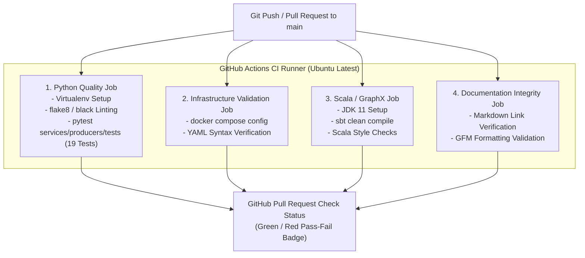

# 🤖 Urbanix Continuous Integration & Automation (`.github/workflows/`)


This directory defines the automated **GitHub Actions CI/CD workflows** that enforce software quality, execute automated unit tests, validate Docker Compose configurations, and verify documentation integrity across the **Urbanix Monorepo**.

---

## 🏛️ 1. Continuous Integration Architecture



---

## 📋 2. Automated Pipeline Catalog

| Workflow File | Trigger Events | Environments | Pipeline Steps |
| :--- | :--- | :--- | :--- |
| **`python-producers-ci.yml`** | `push`, `pull_request` affecting `services/producers/**` | Python 3.10, 3.11 | 1. Checks out repository.<br>2. Installs `requirements.txt`.<br>3. Runs `pytest services/producers/tests -v` (asserts all 19 tests pass).<br>4. Lints code formatting. |
| **`infra-docker-ci.yml`** | `push`, `pull_request` affecting `infra/**` | Ubuntu Latest | 1. Installs Docker Compose CLI.<br>2. Executes `docker compose -f infra/docker-compose.yml config` to catch YAML syntax or environment variable errors. |
| **`scala-graphx-ci.yml`** | `push`, `pull_request` affecting `services/graphx-reroute/**` | JDK 11, Scala 2.12 | 1. Sets up sbt (Scala Build Tool).<br>2. Executes `sbt clean compile` to catch static type errors. |
| **`markdown-lint-ci.yml`** | `push` affecting `*.md`, `_day-notes/**`, `docs/**` | Node.js 18 | 1. Scans markdown files for broken relative links.<br>2. Validates Mermaid diagram syntax. |

---

## ⚙️ 3. Example Workflow Specification (`python-producers-ci.yml`)

```yaml
name: Python Producers Test Suite

on:
  push:
    branches: [ main ]
    paths:
      - 'services/producers/**'
      - 'data/*.csv'
  pull_request:
    branches: [ main ]

jobs:
  test:
    runs-on: ubuntu-latest
    strategy:
      matrix:
        python-version: ["3.10", "3.11"]

    steps:
    - uses: actions/checkout@v3

    - name: Set up Python ${{ matrix.python-version }}
      uses: actions/setup-python@v4
      with:
        python-version: ${{ matrix.python-version }}

    - name: Install dependencies
      run: |
        python -m pip install --upgrade pip
        pip install -r services/producers/requirements.txt

    - name: Run Pytest Suite
      run: |
        pytest services/producers/tests -v
```

---

## 🛡️ 4. Monorepo Path Filtering

To conserve GitHub Actions runner minutes and maintain rapid feedback loops, all workflows use **Path Filtering (`paths: [...]`)**:
* Modifying Python producer code *only* triggers the Python test suite.
* Modifying Docker Compose files *only* triggers the Docker validation pipeline.
* Modifying documentation *never* spins up heavy JVM compilation runners.
