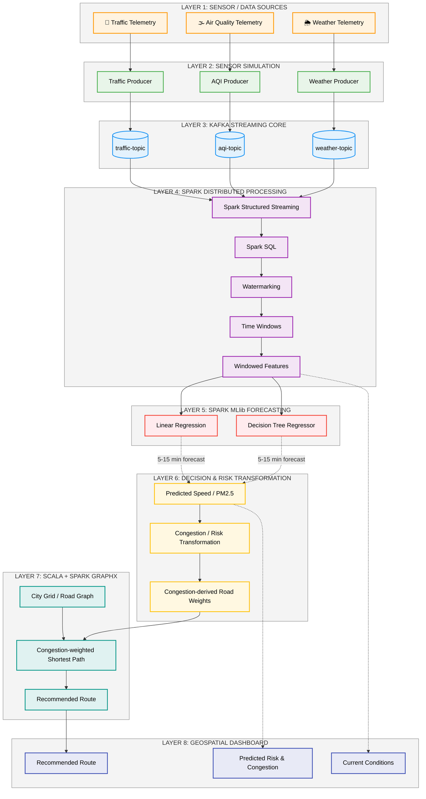

<div align="center">

# 🏙️ Urbanix
**Smart City IoT Traffic & Environmental Risk Forecasting Platform**


-orange?style=for-the-badge&logo=apachespark)


-brightgreen?style=for-the-badge)
-brightgreen?style=for-the-badge)


*A distributed Kafka + Spark platform for streaming urban telemetry, forecasting localized traffic and environmental risk, and supporting congestion-aware route planning.*

</div>

## 📖 Overview
Urbanix is a smart city project that collects live data from traffic, air quality, and weather sensors. It helps city systems understand what is happening in real time and predict problems such as traffic congestion, pollution risks, and unsafe travel conditions. By using modern data processing tools, the project can handle large amounts of information quickly and turn it into useful decisions for safer and smarter city movement.

### ❓ Problem Statement
In many cities, traffic and air quality can change very quickly. Roads may become crowded, pollution levels may rise, and citizens may not know which route is safer or faster. Most traditional systems struggle to process this information fast enough or combine different types of data in one place. Urbanix was created to show how real-time city data can be collected, analyzed, and used to forecast future problems and guide better travel decisions for people and city planners.

## 🏗️ High-Level Architecture
Urbanix processes data through a structured pipeline:
1. **Ingestion:** Python producers simulate/replay JSON sensor events to Kafka.
2. **Stream Processing:** PySpark Structured Streaming ingests events, applying watermarking and windowed aggregations.
3. **Forecasting:** Spark MLlib predicts near-future traffic speed and pollution (PM2.5) levels.
4. **Graph Routing:** Predictions are converted to congestion-derived road weights, mapped onto a city grid, and processed by Scala Spark GraphX to find optimal routes.
5. **Visualization:** A geospatial dashboard visualizes current and predicted states.

### 🏗️ End-to-End System Architecture
Urbanix follows an event-driven pipeline in which simulated/replayed traffic, air-quality, and weather telemetry are ingested into Kafka, processed using Spark Structured Streaming and SQL, transformed into ML-ready features, forecasted, and finally turned into route recommendations for a city road network.

**Target end-to-end architecture:**



**Core Prediction to Routing Flow:**
```text
Predicted Speed / PM2.5
          ↓
Congestion-derived Road Weights
          ↓
Congestion-weighted Shortest Path
          ↓
Recommended Route
   ### 📦 The Six Core Modules
| Module | Purpose | Technology | Status | Deep-Dive Guide |
|---|---|---|:---:|---|
| **M1 — Sensor Simulation Layer** | Ingests & replays verified public telemetry (Traffic, AQI, Weather) with delivery callbacks | Python 3.10, `kafka-python-ng` | **COMPLETE ✅** (Day 2) | [`services/producers/README.md`](services/producers/README.md) |
| **M2 — Kafka Streaming Core** | Distributed event messaging backbone & topic provisioning | Apache Kafka, Zookeeper | **COMPLETE ✅** (Day 1) | [`infra/README.md`](infra/README.md) |
| **M3 — Structured Streaming + SQL** | Real-time multi-stream window joins, watermarking & risk calculation | PySpark 3.5.1, Spark SQL | **ACTIVE / NEXT ⏳** (Day 3) | [`services/streaming/README.md`](services/streaming/README.md) |
| **M4 — Spark MLlib Forecasting** | Regressor models predicting near-future speed and particulate matter | Spark MLlib | 📅 Planned (Days 4–6) | [`services/streaming/README.md`](services/streaming/README.md) |
| **M5 — Scala Spark GraphX Rerouting** | Dynamic road network graph modeling & congestion-aware pathfinding | Scala 2.12, GraphX | 📅 Planned (Days 7–9) | [`services/graphx-reroute/README.md`](services/graphx-reroute/README.md) |
| **M6 — Geospatial Dashboard** | Real-time 3D operator dashboard & REST/WebSocket API | React 18, FastAPI, deck.gl | 📅 Planned (Days 10–11) | [`dashboard/README.md`](dashboard/README.md) |

## 🛠️ Technology Stack
<details>
<summary><b>View Complete Tech Stack</b></summary>

- **Host Languages:** Python 3.10.11, Scala 2.12, Java JDK 25.0.2 (session isolated)
- **Streaming & Messaging:** Apache Kafka 7.5.0, Zookeeper 7.5.0 (`kafka-python-ng`)
- **Distributed Stream Processing:** Apache Spark 3.5.1 (PySpark Structured Streaming, Spark SQL)
- **Machine Learning:** Apache Spark MLlib (Linear Regression, Decision Tree Regressor)
- **Graph Processing:** Scala 2.12, Apache Spark GraphX
- **Infrastructure Orchestration:** Docker Engine, Docker Compose v3.8 (isolated bridge network)
- **Testing & Verification:** pytest 9.1.1 (19 automated unit & integration tests)
- **API & Visualization:** FastAPI, WebSockets, React 18, Vite, MapLibre GL, deck.gl
- **Analytical Storage:** Partitioned Parquet, Data Lake Checkpoints
</details>

## 🚀 Quick Start & Day 1–2 Reproduction Guide

### 1. Boot Distributed Infrastructure (Kafka & Spark)
```powershell
cd infra
docker compose up -d
docker ps  # Verifies 4 containers: zookeeper, kafka, spark-master, spark-worker
```
* **Kafka External Broker:** `localhost:9092`
* **Spark Master Web UI:** `http://localhost:8081` *(mapped from container port 8080)*

### 2. Set Up Python Producer Virtual Environment
```powershell
cd services\producers
python -m venv venv
.\venv\Scripts\Activate.ps1
pip install -r requirements.txt
```

### 3. Run Automated Unit & Integration Tests (19/19 Tests)
```powershell
# From services/producers or project root:
pytest services/producers/tests -v
```

### 4. Execute Telemetry Simulation Stream (Concurrent Replay)
```powershell
# Replay 5 events per stream concurrently (Traffic, AQI, Weather = 15 total events)
python services\producers\run_all.py 5
```

### 5. Verify Ingested Events Directly From Kafka
```powershell
# Inspect traffic-topic
docker exec kafka kafka-console-consumer --bootstrap-server localhost:9092 --topic traffic-topic --from-beginning --max-messages 2

# Inspect aqi-topic
docker exec kafka kafka-console-consumer --bootstrap-server localhost:9092 --topic aqi-topic --from-beginning --max-messages 2

# Inspect weather-topic
docker exec kafka kafka-console-consumer --bootstrap-server localhost:9092 --topic weather-topic --from-beginning --max-messages 2
```

## 🗺️ 12-Day Engineering Roadmap
* **Phase 1: Core Foundation & Ingestion (COMPLETE ✅)**
  * [x] **Day 1:** Local Environment + Docker Cluster (Zookeeper, Kafka, Spark Master/Worker) + Topics
  * [x] **Day 2:** Sensor Simulation Producers (Traffic, AQI, Weather) + Delivery Guarantees + 19 Tests
* **Phase 2: Distributed Analytics & Graph Engine (ACTIVE ⏳)**
  * [ ] **Day 3:** Spark Structured Streaming + Watermarking + Multi-Stream Window Joins *(Next)*
  * [ ] **Day 4:** Feature Engineering + Chronological Split + Municipal Risk Index
  * [ ] **Day 5:** Scala/sbt + Road Network Property Graph Modeling
  * [ ] **Day 6:** GraphX Congestion-Weighted Dynamic Shortest Path (Dijkstra / Pregel)
* **Phase 3: Storage, Gateway & Dashboard (PLANNED 📅)**
  * [ ] **Day 7:** Parquet Analytical Sinks + State Store Checkpoints
  * [ ] **Day 8:** FastAPI Gateway + Asynchronous WebSocket Telemetry Server
  * [ ] **Day 9:** React 18 + deck.gl 3D Geospatial Heatmap Canvas
  * [ ] **Day 10:** Interactive Operator Command Console & Dynamic Route Comparator
* **Phase 4: Benchmarks & Defense (PLANNED 📅)**
  * [ ] **Day 11:** End-to-End Stress Testing + Fault Tolerance Benchmarks
  * [ ] **Day 12:** Capstone Documentation Finalization + Academic Viva Defense

## 📊 Current Implementation Status
**Current Phase: Transitioning from Day 3 to Day 4 (Real-Time ML Risk Forecasting)**
- [x] **Repository & Monorepo Scaffold:** Verified & clean working tree
- [x] **Environment Isolation:** JDK 25 session-isolated; Python 3.10 virtualenv configured
- [x] **Docker Infrastructure:** Zookeeper, Kafka, Spark Master, Spark Worker running
- [x] **Kafka Topics Provisioned:** `traffic-topic`, `aqi-topic`, `weather-topic` (1 partition, 1 replica)
- [x] **Public Dataset Provenance:** METR-LA (Caltrans PeMS), EPA AirData (PM2.5), OpenWeather
- [x] **Data Preparation Script:** `data/prepare_data.py` verified; EPA constrained to March–June 2012 (712 rows)
- [x] **Telemetry Producers:** Traffic, AQI, and Weather producers with Kafka delivery callbacks & retries
- [x] **Concurrent Runner:** `run_all.py` supervisor with clean signal handling and exit codes
- [x] **Automated Test Suite (Producers):** 19/19 tests passing in pytest (unit tests + sample integrity checks)
- [x] **End-to-End Simulation Replay:** Live bounded replays and console consumer validations passed
- [x] **Spark Structured Streaming (Day 3):** 3 independent streaming queries, 2-min watermarks, 5-min tumbling windows, static zone joins, independent Parquet feature tables
- [x] **Automated Test Suite (Streaming):** 14/14 tests passing in pytest (schemas, parsing, windowing, nulls)
- [x] **End-to-End Feature Verification:** Parquet feature tables verified via `verify_features.py` (Traffic, AQI, Weather all PASS)
- [ ] **MLlib Risk Forecasting (Day 4):** Up next
- [ ] **GraphX Dynamic Routing (Days 5–6):** Planned
- [ ] **Geospatial Operator Dashboard (Days 8–10):** Planned

## 📁 Repository Structure
- [`services/`](services/README.md) - Microservices computational tier
  - [`producers/`](services/producers/README.md) - Sensor data simulation & Kafka streaming (Day 2 Complete)
    - [`tests/`](services/producers/tests/README.md) - Automated unit test suite (19 tests)
  - [`streaming/`](services/streaming/README.md) - PySpark Structured Streaming engine & feature tables (Day 3 Complete)
    - [`tests/`](services/streaming/tests/) - Automated streaming test suite (14 tests)
  - [`graphx-reroute/`](services/graphx-reroute/README.md) - Scala GraphX dynamic routing engine
- [`infra/`](infra/README.md) - Docker Compose distributed cluster (Day 1 Complete)
- [`data/`](data/README.md) - Verified public sample datasets, static grid zones & preprocessing scripts
- [`dashboard/`](dashboard/README.md) - FastAPI gateway & React/deck.gl operator command center
- [`docs/`](docs/README.md) - Official project documentation, SRS v1.0, and academic deliverables
- [`_day-notes/`](_day-notes/README.md) - Daily engineering journals, deep-dive reports & viva defense playbooks
  - [`day-01/`](_day-notes/day-01/DAY_01_INFRASTRUCTURE_REPORT.md) - Day 1 Infrastructure Deep-Dive Report
  - [`day-02/`](_day-notes/day-02/DAY_02_SENSOR_SIMULATION_REPORT.md) - Day 2 Sensor Simulation Deep-Dive Report
  - [`day-03/`](_day-notes/day-03/DAY_03_STREAMING_REPORT.md) - Day 3 Structured Streaming Deep-Dive Report
- [`.github/workflows/`](.github/workflows/README.md) - Automated CI/CD pipelines & matrix test runners

## 🎓 Learning & Engineering Philosophy
Urbanix is intentionally built incrementally. Each stage focuses on reproducibility, observable milestones, and meaningful Git commits. We emphasize understanding distributed-system fundamentals, fault tolerance, and ML-driven decision support in a realistic urban data setting.

### ⚠️ Scope and Limitations
- Uses simulated/replayed public or historical data.
- Maps to a defined city-grid/road network.
- Operates on a local standalone cluster (no cloud/Kubernetes).
- Designed purely as a distributed streaming demonstration, forecasting, and routing capstone.

## ⚖️ License
This project is licensed under the MIT License.

<div align="center">
<hr>
<b>Urbanix</b><br>
<i>Smart City IoT Traffic & Environmental Risk Forecasting Platform</i><br>
Built as an academic Cluster Computing capstone.<br>
<br>
</div>
