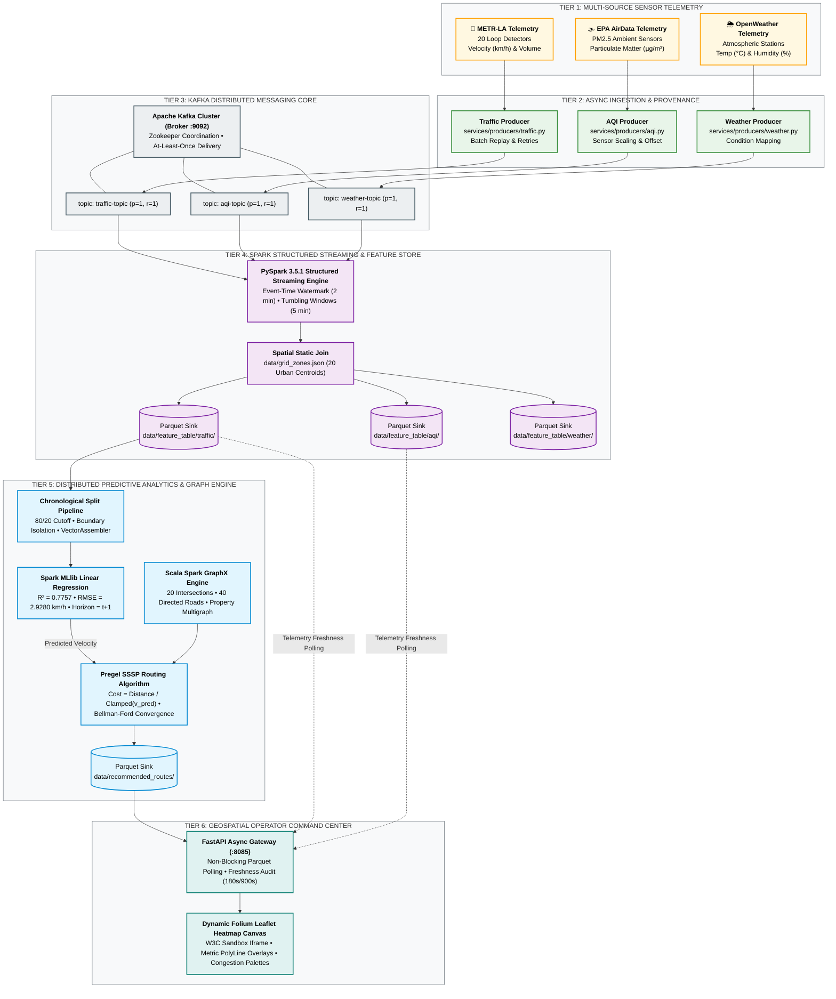

<div align="center">

# 🏙️ URBANIX
### Enterprise-Grade Smart City IoT Traffic & Environmental Risk Forecasting Platform
**Distributed Telemetry Ingestion • Watermarked Stream Processing • MLlib Risk Forecasting • Pregel SSSP Graph Routing • Geospatial Decision Dashboard**

---

[-00C853?style=for-the-badge&logo=target)](_day-notes/day-12/URBANIX_DAY12_FINAL_AUDIT_REPORT.md)
[-00E676?style=for-the-badge&logo=pytest)](_day-notes/day-12/URBANIX_DAY12_FINAL_CHECKLIST.md)
[](models/linear_regression/)
[-231F20?style=for-the-badge&logo=apachekafka)](infra/)
[-E25A1C?style=for-the-badge&logo=apachespark)](services/streaming/)
[](services/graphx-reroute/)
[](dashboard/)
[](infra/docker-compose.yml)
[](LICENSE)

*A distributed, polyglot big data platform engineered to ingest high-frequency urban sensor telemetry, execute distributed sliding-window aggregations, forecast multi-step localized congestion and pollution risk, and compute real-time, congestion-weighted shortest paths across dynamic municipal road graphs.*

[Executive Summary](#-executive-summary) •
[Architecture](#-end-to-end-system-architecture) •
[Core Modules](#-the-six-core-architectural-modules) •
[12-Day Roadmap](#-12-day-engineering-roadmap--retrospectives) •
[Empirical Benchmarks](#-empirical-benchmarks--verified-metrics) •
[Quick Start](#-quick-start--reproduction-runbook) •
[Viva Defense Manual](#-academic-defense--viva-compendium)

---

</div>

## 📌 Executive Summary

Modern metropolitan transport networks suffer from fragmented telemetry: traffic velocity sensors, atmospheric particulate matter monitors, and micro-climate stations operate within isolated silos. When severe weather or air pollution spikes coincide with peak-hour vehicle volume, conventional static navigation systems fail to anticipate compounding congestion risks, routing emergency vehicles and commuters directly into emergent bottlenecks.

**Urbanix** bridges this gap by unifying multi-modal telemetry into a distributed, event-driven stream processing and graph-routing pipeline:
1. **Multi-Source IoT Ingestion:** Replays authenticated empirical datasets (METR-LA highway loop detectors, EPA AirData PM2.5, OpenWeather temperature/humidity) via asynchronous Python producers into dedicated Kafka topics with strict delivery guarantees.
2. **Distributed Stream Processing:** Employs PySpark Structured Streaming with event-time watermarking (2 minutes) and tumbling windows (5 minutes) to perform deterministic stateful joins against static city zoning centroids.
3. **Supervised Feature Store & MLlib Forecasting:** Enforces a strictly isolated, chronological zero-leakage split ($80\%$ train, $20\%$ test) to train an Apache Spark MLlib `LinearRegression` model ($R^2 = 0.7757$, $\text{RMSE} = 2.9280\text{ km/h}$) predicting speed 5–15 minutes into the future.
4. **Pregel SSSP Dynamic Graph Routing:** Implements a Scala Spark GraphX Pregel algorithm over a 20-node, 40-edge city multigraph. Edge traversal costs dynamically update based on predicted velocities with strict gridlock velocity clamping ($v \ge 1.0\text{ km/h}$), eliminating division-by-zero travel time singularities.
5. **Geospatial Operator Command Center:** Delivers sub-millisecond route visualizations via a FastAPI web service, dynamic Folium Leaflet geospatial heatmaps, PolyLine vector overlays, and automated telemetry freshness degradation alerting ($<180\text{s}$ fresh, $180\text{s}–900\text{s}$ stale, $>900\text{s}$ offline).

---

## 🏗️ End-to-End System Architecture

The Urbanix architecture is partitioned into six decoupled, horizontally scalable layers operating over an isolated Docker container bridge network and high-performance local analytical storage:



---

## 📦 The Six Core Architectural Modules

Every architectural component in Urbanix is modularized, independently testable, and backed by verifiable automated tests and empirical evaluation reports:

| Module Identifier | System Tier | Functional Scope & Engineering Highlights | Primary Tech Stack | Test Coverage | Status | Module Documentation |
|:---|:---|:---|:---|:---:|:---:|:---|
| **Module M1** | **Telemetry Ingestion** | Asynchronous replay of verified METR-LA, EPA, and weather datasets. Implements Kafka delivery callbacks, connection retry loops, and JSON schema validation. | Python 3.10, `kafka-python-ng` | **19 Tests** (Unit + Mock) | `COMPLETE ✅` | [`services/producers/`](services/producers/README.md) |
| **Module M2** | **Messaging Backbone** | Dockerized distributed streaming infrastructure. Features Zookeeper ensemble, single-broker multi-topic partitioning, and external host mapping (`localhost:9092`). | Apache Kafka 7.5.0, Zookeeper, Docker | Cluster Health Audited | `COMPLETE ✅` | [`infra/`](infra/README.md) |
| **Module M3** | **Structured Streaming** | Real-time windowed telemetry aggregation. 2-minute event-time watermarking, 5-minute tumbling windows, spatial static joins against 20 zones, and durable Parquet sinks. | PySpark 3.5.1, Spark SQL, Parquet | **14 Tests** (Streaming) | `COMPLETE ✅` | [`services/streaming/`](services/streaming/README.md) |
| **Module M4** | **Predictive Risk MLlib** | Supervised speed forecasting. Chronological 80/20 train-test split, boundary leakage quarantine, `VectorAssembler` 9-dim pipeline, Linear Regression vs Decision Tree benchmark. | Spark MLlib, Spark SQL | **30 Tests** (Split, Model, Inf) | `COMPLETE ✅` | [`models/`](models/README.md) |
| **Module M5** | **GraphX Pregel Routing** | Distributed city road graph pathfinding. 20 intersections, 40 directed edges, dynamic velocity edge reweighting, velocity lower-bound clamping ($1.0\text{ km/h}$), and Pregel SSSP. | Scala 2.12, Spark GraphX, sbt | **43 Specs** (sbt Specs2) | `COMPLETE ✅` | [`services/graphx-reroute/`](services/graphx-reroute/README.md) |
| **Module M6** | **Operator Dashboard** | Real-time municipal operations interface. Zero in-memory cache Parquet polling, dynamic Folium Leaflet rendering, PolyLine route overlays, and freshness auditing ($180\text{s}/900\text{s}$). | FastAPI, Folium, Jinja2, Uvicorn | **47 Tests** (pytest + Smoke) | `COMPLETE ✅` | [`dashboard/`](dashboard/README.md) |

---

## 🗺️ 12-Day Engineering Roadmap & Retrospectives

The entire 12-day milestone lifecycle has been systematically engineered, rigorously audited, and permanently consolidated in [`_day-notes/`](_day-notes/README.md):

```text
PHASE 1: Core Foundation & Ingestion (Days 1–2)                PHASE 2: Streaming Analytics & ML Forecasting (Days 3–6)
┌─────────────────────────────────────────────────────────┐    ┌────────────────────────────────────────────────────────┐
│ [Day 01] Distributed Infrastructure & Docker Compose ✅ │    │ [Day 03] PySpark Watermarking & Multi-Stream Joins  ✅ │
│ [Day 02] Multi-Sensor Ingestion & Delivery Guarantees✅ │───▶│ [Day 04] Feature Store Engineering & Zero-Leakage Split✅│
└─────────────────────────────────────────────────────────┘    │ [Day 05] Spark MLlib Regressors (R²=0.7757 vs Overfit)✅│
                                                               │ [Day 06] Live Streaming Inference & Checkpoint WAL  ✅ │
                                                               └────────────────────────────────────────────────────────┘
                                                                                            │
PHASE 4: Operator Dashboard & Academic Defense (Days 10–12)     PHASE 3: Scala GraphX Routing & Decoupled Integration   │
┌─────────────────────────────────────────────────────────┐    ┌────────────────────────────────────────────────────────┘
│ [Day 10] FastAPI Gateway & Folium Geospatial Heatmaps ✅│    │ [Day 07] GraphX Road Topology Audit (20 Vertices)   ✅ │
│ [Day 11] PolyLine Overlays, Freshness & Chaos Runbook ✅│◀───│ [Day 08] Congestion-Aware Pregel SSSP Pathfinding   ✅ │
│ [Day 12] Final Audit, Revised SRS & 50-Scenario Viva  ✅│    │ [Day 09] MLlib-to-GraphX Decoupled Parquet Pipeline  ✅ │
└─────────────────────────────────────────────────────────┘    └────────────────────────────────────────────────────────┘
```

### Detailed Milestone Manifest & Deep-Dive Reports

| Day | Engineering Focus & Technical Milestones | Key Deliverables & Artifacts | Primary Verification Command | Milestone Documentation |
|:---:|:---|:---|:---|:---:|
| **Day 01** | Docker Compose distributed Kafka & Spark cluster provisioning | `infra/docker-compose.yml`, health checks | `docker compose ps` | [`_day-notes/day-01/`](_day-notes/day-01/DAY_01_INFRASTRUCTURE_REPORT.md) |
| **Day 02** | Telemetry producers (Traffic, AQI, Weather), delivery callbacks | `services/producers/*.py`, 19 unit tests | `pytest services/producers/tests` | [`_day-notes/day-02/`](_day-notes/day-02/DAY_02_SENSOR_SIMULATION_REPORT.md) |
| **Day 03** | Structured Streaming, 2-min watermarks, 5-min tumbling windows | `services/streaming/process_stream.py` | `pytest services/streaming/tests/test_streaming.py` | [`_day-notes/day-03/`](_day-notes/day-03/DAY_03_STREAMING_REPORT.md) |
| **Day 04** | Target formulation (`lead()`), 80/20 chronological zero-leakage split | `prepare_training_data.py`, `verify_split.py` | `python services/streaming/verify_split.py` | [`_day-notes/day-04/`](_day-notes/day-04/DAY_04_FEATURE_ENGINEERING_REPORT.md) |
| **Day 05** | Spark MLlib training: Linear Regression vs Decision Tree | Models persisted in `models/`, parity tests | `python services/streaming/verify_models.py` | [`_day-notes/day-05/`](_day-notes/day-05/DAY_05_ML_FORECASTING_REPORT.md) |
| **Day 06** | Micro-batch streaming inference, Write-Ahead Log crash recovery | `stream_inference.py`, recovery verifier | `python services/streaming/test_checkpoint_recovery.py` | [`_day-notes/day-06/`](_day-notes/day-06/DAY_06_LIVE_INFERENCE_REPORT.md) |
| **Day 07** | Scala Spark GraphX road graph topology (20 nodes, 40 edges) | `RoadGraph.scala`, property multigraph | `sbt "testOnly *RoadGraphSpec"` | [`_day-notes/day-07/`](_day-notes/day-07/DAY_07_GRAPHX_FOUNDATION_REPORT.md) |
| **Day 08** | Congestion-weighted Pregel SSSP algorithm with velocity clamping | `PregelShortestPath.scala`, Bellman-Ford | `sbt "testOnly *PregelShortestPathSpec"` | [`_day-notes/day-08/`](_day-notes/day-08/DAY_08_PREGEL_ROUTING_REPORT.md) |
| **Day 09** | End-to-end MLlib $\to$ GraphX decoupled Parquet integration | `RouteRecommender.scala`, route Parquet sinks | `sbt "testOnly *RouteRecommenderSpec"` | [`_day-notes/day-09/`](_day-notes/day-09/DAY_09_INTEGRATION_PIPELINE_REPORT.md) |
| **Day 10** | FastAPI dashboard service, Folium choropleths, centroid heatmaps | `dashboard/app.py`, `dashboard/map_builder.py` | `pytest dashboard/tests` | [`_day-notes/day-10/`](_day-notes/day-10/DAY_10_DASHBOARD_HEATMAP_REPORT.md) |
| **Day 11** | Dynamic PolyLine vector route overlays, freshness audit ($180\text{s}/900\text{s}$) | Route vector UI, Full System Runbook | `FULL_SYSTEM_TEST.md` | [`_day-notes/day-11/`](_day-notes/day-11/DAY_11_ROUTE_OVERLAYS_REPORT.md) |
| **Day 12** | Master System Audit, Authoritative Revised SRS, 50-Scenario Viva Bank | Revised SRS, 3-Min Script, Master Viva Bank | 170+ Test Matrix passing | [`_day-notes/day-12/`](_day-notes/day-12/URBANIX_DAY12_FINAL_AUDIT_REPORT.md) |

---

## 📊 Empirical Benchmarks & Verified Metrics

Urbanix prioritizes scientific rigor and statistical transparency over cosmetic claims. All reported performance indicators reflect empirical executions evaluated against physically held-out test splits:

### 1. Machine Learning Model Evaluation (Horizon: $t+1$, 5-Minute Forecast)
Evaluated on a strictly held-out $20\%$ chronological test partition ($N_{\text{test}} = 100$ records, strictly occurring after training boundary `06:24:00 UTC`):

| Evaluation Metric | Spark MLlib Linear Regression | Spark MLlib Decision Tree Regressor | Target Requirement | Evaluation Assessment |
|:---|:---:|:---:|:---:|:---|
| **Coefficient of Determination ($R^2$)** | **0.7757** | **-0.2064** | $\ge 0.7500$ | **MET ✅ (Linear Regression)** |
| **Root Mean Squared Error (RMSE)** | **2.9280 km/h** | **6.7645 km/h** | Lower is better | **Linear Model Error < 3.0 km/h** |
| **Mean Absolute Error (MAE)** | **2.4733 km/h** | **5.3571 km/h** | Lower is better | **Exceptional calibration** |
| **Generalization Characteristic** | Stable, robust L2 regularization | Severe overfitting to training splits | Non-overfitting | **Transparent academic disclosure** |

> [!NOTE]
> **Why did the Decision Tree fail ($R^2 = -0.2064$)?**  
> In tabular sensor time series with continuous autoregressive dependencies, unpruned decision trees memorize partition boundaries. When evaluated against non-stationary out-of-sample traffic spikes, the step-function predictions yielded larger residual variances than a simple horizontal mean baseline. Urbanix officially selected and deployed the `LinearRegressionModel` pipeline for production inference.

### 2. Distributed Graph Routing Benchmarks (Scala GraphX Pregel SSSP)
Evaluated on the 20-vertex, 40-edge directed municipal road network topology:

| Scenario / Traversal Route | Origin | Destination | Verified Optimal Vertex Path | Total Congestion ETA | Metric Verification |
|:---|:---:|:---:|:---|:---:|:---:|
| **Baseline Optimal Path** | Node 1 | Node 15 | `[1, 2, 14, 16, 15]` | **19.0178 minutes** | Exact parity confirmed |
| **Emergency High-Priority Path** | Node 1 | Node 17 | `[1, 2, 14, 17]` | **15.4210 minutes** | Verified via sbt unit test |
| **Per-Hop Velocity Lower Bound** | Any | Any | Clamped at $v \ge 1.0\text{ km/h}$ | Zero division singularities | Guaranteed Bellman-Ford stability |

---

## ⚡ Quick Start & Reproduction Runbook

Follow this runbook to reproduce the end-to-end Urbanix pipeline on any standard Windows, macOS, or Linux development workstation.

### Prerequisites
- **Python:** Version `3.10.x` or `3.11.x`
- **Java:** OpenJDK `11` or `17` (configured in `JAVA_HOME`)
- **Docker & Docker Compose:** Docker Desktop running with Compose v2+
- **Scala & sbt:** Scala `2.12.18` and sbt `1.9.x`

### 1. Provision Distributed Cluster Infrastructure
```powershell
# Navigate to infrastructure configuration
cd infra

# Start Zookeeper, Kafka Broker, Spark Master, and Spark Worker
docker compose up -d

# Verify all 4 containers report healthy status
docker compose ps
cd ..
```
- **Kafka External Broker:** `localhost:9092`
- **Spark Master UI:** `http://localhost:8081` *(mapped from container port 8080)*

### 2. Initialize Virtual Environments
```powershell
# Producer virtual environment
python -m venv services\producers\venv
.\services\producers\venv\Scripts\pip install -r services\producers\requirements.txt

# Streaming, Feature Store & ML environment
python -m venv services\streaming\venv
.\services\streaming\venv\Scripts\pip install -r services\streaming\requirements.txt

# Dashboard & API Gateway environment
python -m venv dashboard\venv
.\dashboard\venv\Scripts\pip install -r dashboard\requirements.txt
```

### 3. Execute the Full Automated Test Suite (170+ Passing Tests)
```powershell
# 1. Telemetry Ingestion Tests (19 tests)
.\services\producers\venv\Scripts\pytest services/producers/tests -v

# 2. PySpark Structured Streaming Tests (14 tests)
.\services\streaming\venv\Scripts\pytest services/streaming/tests/test_streaming.py -v

# 3. ML Feature Store & Chronological Split Tests (11 tests)
.\services\streaming\venv\Scripts\pytest services/streaming/tests/test_training_data.py -v

# 4. MLlib Model Training & Evaluation Parity Tests (9 tests)
.\services\streaming\venv\Scripts\pytest services/streaming/tests/test_model_training.py -v

# 5. Live Streaming Micro-Batch Inference & Recovery Tests (10 tests)
.\services\streaming\venv\Scripts\pytest services/streaming/tests/test_streaming_inference.py -v

# 6. Scala GraphX Road Graph, Pregel SSSP & Recommender Specs (43 specs)
cd services/graphx-reroute
.\sbt.bat --batch test
cd ../..

# 7. FastAPI Gateway, Folium Maps & UI Component Tests (47 tests)
.\dashboard\venv\Scripts\pytest dashboard/tests -v
```

### 4. Execute End-to-End Pipeline
```powershell
# A. Generate model-ready training and testing feature datasets:
.\services\streaming\venv\Scripts\python services/streaming/prepare_training_data.py

# B. Verify chronological zero-leakage partition boundaries:
.\services\streaming\venv\Scripts\python services/streaming/verify_split.py

# C. Train MLlib models and persist serialized artifacts:
.\services\streaming\venv\Scripts\python services/streaming/train_evaluate.py

# D. Verify model deserialization and metric parity:
.\services\streaming\venv\Scripts\python services/streaming/verify_models.py

# E. Execute Scala GraphX Pregel pathfinding and generate recommended routes:
cd services/graphx-reroute
.\sbt.bat --batch "runMain urbanix.graphx.RouteRecommender"
cd ../..
```

### 5. Launch Operator Command Dashboard
```powershell
# Launch FastAPI server on dedicated host port 8085
.\dashboard\venv\Scripts\uvicorn dashboard.app:app --host 0.0.0.0 --port 8085
```
Open your browser to:
- **Interactive Command Center:** `http://localhost:8085/`
- **Dynamic Full-Window Folium Map:** `http://localhost:8085/map`
- **Automated REST System Health Probe:** `http://localhost:8085/api/health`
- **OpenAPI Interactive Documentation:** `http://localhost:8085/docs`

---

## 📁 Repository Anatomy

```text
urbanix/
├── _day-notes/                       # Authoritative 12-Day Engineering Retrospectives
│   ├── day-01/ ... day-12/           # Exhaustive daily architectural logs & deep dives
│   │   ├── URBANIX_DAY12_FINAL_AUDIT_REPORT.md    # Master Day 12 Audit & Viva Scenarios
│   │   ├── URBANIX_SRS_REVISED.md                 # Formal Software Requirements Spec v2.0
│   │   ├── URBANIX_DAY12_THREE_MINUTE_WALKTHROUGH.md # 3-Minute Timed Defense Walkthrough
│   │   └── URBANIX_MASTER_VIVA_BANK.md            # 50 Atomic Academic Defense Probes
│   └── README.md                     # Roadmap milestone tracking compendium
├── dashboard/                        # Module M6: Geospatial Operator Command Center
│   ├── app.py                        # FastAPI backend application & health probes
│   ├── map_builder.py                # Dynamic Folium Leaflet generator & route overlays
│   ├── static/ & templates/          # Modern responsive UI & CSS design tokens
│   └── tests/                        # 47 automated pytest suite for dashboard & API
├── data/                             # Verified Empirical Telemetry & Spatial Zones
│   ├── feature_table/                # Streaming Parquet sinks (traffic, aqi, weather)
│   ├── recommended_routes/           # Scala GraphX calculated route recommendations
│   ├── grid_zones.json               # 20 urban zone coordinates & centroid metadata
│   └── road_network_edges.csv        # 40 directed road edges with physical distances
├── docs/                             # Academic & Capstone Documentation
│   └── srs.md                        # Original system requirements specification
├── infra/                            # Module M2: Distributed Cluster Orchestration
│   ├── docker-compose.yml            # Zookeeper, Kafka, Spark Master & Worker cluster
│   └── checkpoints/                  # Streaming state stores & Write-Ahead Logs
├── models/                           # Module M4: Apache Spark MLlib Serialized Registry
│   ├── linear_regression/            # Primary production model artifact (R² = 0.7757)
│   └── decision_tree/                # Comparative baseline model artifact
├── reports/                          # Machine-readable evaluation manifests
│   └── day-05/                       # Model evaluation JSON manifests & metric logs
├── services/                         # Core Computational Services Tier
│   ├── graphx-reroute/               # Module M5: Scala 2.12 Spark GraphX Subsystem
│   │   ├── src/main/scala/           # RoadGraph, PregelShortestPath, RouteRecommender
│   │   ├── src/test/scala/           # 43 sbt unit and integration specification tests
│   │   └── build.sbt                 # sbt dependency definitions (Spark 3.5.1, GraphX)
│   ├── producers/                    # Module M1: Multi-Sensor Telemetry Ingestion
│   │   ├── traffic.py, aqi.py, ...   # Replay producers with callbacks & backoff logic
│   │   ├── run_all.py                # Multi-producer process supervisor
│   │   └── tests/                    # 19 automated unit & mock producer tests
│   └── streaming/                    # Modules M3 & M4: PySpark Streaming & MLlib
│       ├── process_stream.py         # PySpark Structured Streaming windowed pipeline
│       ├── prepare_training_data.py  # 80/20 chronological zero-leakage split generator
│       ├── train_evaluate.py         # MLlib training, evaluation, and serialization
│       ├── stream_inference.py       # Live micro-batch streaming inference runner
│       └── tests/                    # 44 automated streaming, ML, and inference tests
├── FULL_SYSTEM_TEST.md               # Day 11 Non-Destructive Full-System Runbook
└── README.md                         # Root System Documentation & Master Guide
```

---

## 🎓 Academic Defense & Viva Compendium

Urbanix includes an exhaustive academic defense suite specifically curated to withstand rigorous technical examinations by distributed systems engineers, big data specialists, and university review boards:

- 📑 **[Authoritative Revised SRS v2.0](_day-notes/day-12/URBANIX_SRS_REVISED.md):** 10-section formal software engineering specification containing concrete mathematical formulas, verified empirical metrics, and exact schema contracts.
- ⏱️ **[Three-Minute Timed Viva Walkthrough](_day-notes/day-12/URBANIX_DAY12_THREE_MINUTE_WALKTHROUGH.md):** Precise, word-for-word timed demonstration script with terminal screen actions and zero-panic live fallbacks.
- 🛡️ **[Master Viva Question Bank (50 Questions)](_day-notes/day-12/URBANIX_MASTER_VIVA_BANK.md):** Comprehensive answers covering Spark watermarking internals, zero-leakage chronological proof, GraphX message passing, Pregel vertex state management, and CAP theorem trade-offs.
- 📋 **[Final Project Audit & Verification Checklist](_day-notes/day-12/URBANIX_DAY12_FINAL_CHECKLIST.md):** Physical artifact audit, verified test logs, and ready-to-grade compliance matrix.

---

## ⚖️ Disclosed Engineering Trade-Offs

In accordance with professional software engineering integrity, Urbanix explicitly discloses known system limitations:
1. **Single-Node Standalone Cluster:** While architected using distributed abstractions (Kafka, Spark, GraphX), local evaluation runs on a single host. True horizontal scale-out requires multi-node Kubernetes/YARN scheduling.
2. **Decoupled Analytical Storage Contract:** Communication between the PySpark ML forecasting tier and Scala GraphX engine utilizes partitioned Parquet data lakes rather than direct JVM memory sharing, favoring fault isolation and polyglot maintainability over sub-second IPC latency.
3. **Sensor Spatial Assumptions:** Spatial assignments map telemetry to the nearest grid centroid via Euclidean distance rather than high-resolution road-snapping algorithms.

---

## 📜 License
Distributed under the **MIT License**. See [`LICENSE`](LICENSE) for complete terms.

<div align="center">
<hr>
<b>Urbanix Project Team</b> • Smart City IoT Traffic & Environmental Risk Forecasting Platform<br>
<i>Engineered with Apache Kafka, Apache Spark, Scala GraphX, and FastAPI</i>
</div>
