# 📅 Urbanix Daily Engineering Journal & Milestone Tracker (`_day-notes/`)

-brightgreen)


-brightgreen)
-brightgreen)


> [!WARNING]
> **DEVELOPMENT NOTEBOOK, PEDAGOGICAL COMPENDIUM & ACADEMIC VIVA DEFENSE MANUAL**  
> The documents inside `_day-notes/` are exhaustive daily engineering retrospectives, mathematical derivations, and atomic implementation logs. They serve as the **authoritative source of truth** for project recaps, technical interview preparation, and external capstone viva defense.

---

## 🗺️ 1. 12-Day Capstone Master Roadmap & Tracking Matrix

```mermaid
graph TD
    %% Phase 1: Core Foundation & Ingestion
    subgraph P1["<b>PHASE 1: Core Foundation & Ingestion (Days 1–2)</b> — [100% COMPLETE ✅]"]
        D1["<b>Day 1: Distributed Infrastructure Foundation</b><br>Zookeeper • Kafka Broker (9092) • Spark Master (8081/7077) & Worker<br><b>Status: COMPLETE ✅</b>"]
        D2["<b>Day 2: Sensor Simulation Layer & Provenance</b><br>METR-LA • EPA AirData • OpenWeather • 3 Kafka Producers • Unit Conversions<br><b>Status: COMPLETE ✅</b>"]
        D1 --> D2
    end

    %% Phase 2: Distributed Analytics & ML Forecasting
    subgraph P2["<b>PHASE 2: Streaming Analytics & ML Forecasting (Days 3–6)</b> — [100% COMPLETE ✅]"]
        D3["<b>Day 3: Spark Structured Streaming Core</b><br>5-Min Tumbling Windows • 2-Min Watermarking • Grid-Zone Joins • Parquet Sink<br><b>Status: COMPLETE ✅</b>"]
        D4["<b>Day 4: Feature Engineering & Chronological Split</b><br>VectorAssembler • Zero-Leakage 80/20 Time Split • Target Generation (t+1)<br><b>Status: COMPLETE ✅</b>"]
        D5["<b>Day 5: MLlib Regressor Training & Evaluation</b><br>Linear Regression (R²=0.7757) • Decision Tree (Overfitting R²=-0.2064)<br><b>Status: COMPLETE ✅</b>"]
        D6["<b>Day 6: Live Streaming Inference & Checkpoints</b><br>Model Deserialization • Real-Time Scoring • Write-Ahead Log Crash Recovery<br><b>Status: COMPLETE ✅</b>"]
        D3 --> D4 --> D5 --> D6
    end

    %% Phase 3: Scala GraphX Routing & Integration
    subgraph P3["<b>PHASE 3: Scala GraphX Routing & Decoupled Integration (Days 7–9)</b> — [100% COMPLETE ✅]"]
        D7["<b>Day 7: Scala GraphX Road-Graph Topology Audit</b><br>Property Multigraph • 20 Intersections • 40 Directed Roads • 100% Reciprocity<br><b>Status: COMPLETE ✅</b>"]
        D8["<b>Day 8: Congestion-Weighted Pregel SSSP Routing</b><br>Travel-Time Dynamic Costs • 1.0 km/h Gridlock Clamping • Bellman-Ford Convergence<br><b>Status: COMPLETE ✅</b>"]
        D9["<b>Day 9: End-to-End Forecast-to-Reroute Integration</b><br>Decoupled Parquet Contract • RouteRecommender • Dest 15 Baseline ETA 19.02m<br><b>Status: COMPLETE ✅</b>"]
        D7 --> D8 --> D9
    end

    %% Phase 4: Dashboard, Resilience & Academic Defense
    subgraph P4["<b>PHASE 4: Dashboard, Resilience & Capstone Defense (Days 10–12)</b> — [100% COMPLETE ✅]"]
        D10["<b>Day 10: Geospatial Dashboard Core & Heatmaps</b><br>FastAPI Backend • Zero-Cache Parquet Ingestion • Folium Centroid Maps • CORS<br><b>Status: COMPLETE ✅</b>"]
        D11["<b>Day 11: Route Vector Overlays & Chaos Resilience</b><br>GraphX PolyLine • Freshness Detection (180s/900s) • Structured Error Taxonomy<br><b>Status: COMPLETE ✅</b>"]
        D12["<b>Day 12: Final System Audit & Academic Viva Defense</b><br>Revised SRS • 3-Min Walkthrough Script • 50 Atomic Viva Scenarios • Readiness Verdict<br><b>Status: COMPLETE ✅</b>"]
        D10 --> D11 --> D12
    end

    %% Inter-Phase Transitions
    D2 ==>|Kafka Stream Topics| D3
    D6 ==>|Shared Parquet Feature Store| D7
    D9 ==>|Recommended Routes Parquet| D10

    %% High-Contrast Theme Styling
    style D1 fill:#d4edda,stroke:#28a745,stroke-width:2px,color:#155724
    style D2 fill:#d4edda,stroke:#28a745,stroke-width:2px,color:#155724
    style D3 fill:#d4edda,stroke:#28a745,stroke-width:2px,color:#155724
    style D4 fill:#d4edda,stroke:#28a745,stroke-width:2px,color:#155724
    style D5 fill:#d4edda,stroke:#28a745,stroke-width:2px,color:#155724
    style D6 fill:#d4edda,stroke:#28a745,stroke-width:2px,color:#155724
    style D7 fill:#d4edda,stroke:#28a745,stroke-width:2px,color:#155724
    style D8 fill:#d4edda,stroke:#28a745,stroke-width:2px,color:#155724
    style D9 fill:#d4edda,stroke:#28a745,stroke-width:2px,color:#155724
    style D10 fill:#d4edda,stroke:#28a745,stroke-width:2px,color:#155724
    style D11 fill:#d4edda,stroke:#28a745,stroke-width:2px,color:#155724
    style D12 fill:#d4edda,stroke:#28a745,stroke-width:2px,color:#155724
```



---

## 🛣️ 2. Visual Phase-by-Phase Timeline

```text
Phase 1: Foundation (COMPLETE)        Phase 2: Analytics & Models (COMPLETE)      Phase 3: GraphX Routing (COMPLETE)          Phase 4: Dashboard & Defense (COMPLETE)
┌──────────────────────────────────┐  ┌────────────────────────────────────────┐  ┌────────────────────────────────────────┐  ┌───────────────────────────────────────┐
│ [Day 01] Docker & Spark Cluster✅│  │ [Day 03] Spark Structured Streaming ✅ │  │ [Day 07] Scala GraphX Road Graph    ✅ │  │ [Day 10] FastAPI & Folium Heatmap  ✅ │
│ [Day 02] Sensors & Kafka Replay✅│──▶ [Day 04] Feature Eng & Split Pipeline ✅│──▶ [Day 08] Congestion Pregel SSSP     ✅ │─▶│ [Day 11] Route PolyLine & Chaos Hard✅ │
└──────────────────────────────────┘  │ [Day 05] MLlib Model Training & Eval ✅│  │ [Day 09] Forecast-Reroute ClosedLoop✅ │  │ [Day 12] Final Audit & Viva Defense ✅ │
                                      │ [Day 06] Live Streaming Inference    ✅ │  └────────────────────────────────────────┘  └───────────────────────────────────────┘
                                      └────────────────────────────────────────┘
```

---

## 📊 3. Master Milestone Registry & Deep-Dive Links

| Day | Milestone / Module | Primary Tech Stack | Status | Deep-Dive Report Link |
| :---: | :--- | :--- | :---: | :--- |
| **01** | **Distributed Infrastructure Foundation** | Docker Compose, Zookeeper, Kafka, Apache Spark Master & Worker | **COMPLETE ✅** | [`day-01/DAY_01_INFRASTRUCTURE_REPORT.md`](file:///c:/Users/Tokachichu%20SriCharan/OneDrive/Documents/GitHub/urbanix/_day-notes/day-01/DAY_01_INFRASTRUCTURE_REPORT.md) |
| **02** | **Sensor Simulation Layer & Data Provenance** | Python 3.10, `kafka-python-ng`, pytest, METR-LA, EPA AirData, OpenWeather | **COMPLETE ✅** | [`day-02/DAY_02_SENSOR_SIMULATION_REPORT.md`](file:///c:/Users/Tokachichu%20SriCharan/OneDrive/Documents/GitHub/urbanix/_day-notes/day-02/DAY_02_SENSOR_SIMULATION_REPORT.md) |
| **03** | **Spark Structured Streaming Engine** | PySpark 3.5.1, Kafka Connector, Watermarking, Independent Parquet Feature Tables | **COMPLETE ✅** | [`day-03/DAY_03_STREAMING_REPORT.md`](file:///c:/Users/Tokachichu%20SriCharan/OneDrive/Documents/GitHub/urbanix/_day-notes/day-03/DAY_03_STREAMING_REPORT.md) |
| **04** | **Feature Engineering & Chronological Split** | Spark MLlib, VectorAssembler, StringIndexer, Zero-Leakage Split | **COMPLETE ✅** | [`day-04/DAY_04_FEATURE_ENGINEERING_REPORT.md`](file:///c:/Users/Tokachichu%20SriCharan/OneDrive/Documents/GitHub/urbanix/_day-notes/day-04/DAY_04_FEATURE_ENGINEERING_REPORT.md) |
| **05** | **MLlib Regression & Forecasting Evaluation** | Spark MLlib, Linear Regression, Decision Tree Regressor, RegressionEvaluator | **COMPLETE ✅** | [`day-05/DAY_05_ML_FORECASTING_REPORT.md`](file:///c:/Users/Tokachichu%20SriCharan/OneDrive/Documents/GitHub/urbanix/_day-notes/day-05/DAY_05_ML_FORECASTING_REPORT.md) |
| **06** | **Live MLlib Streaming Inference & Checkpoints** | Spark Structured Streaming, MLlib Deserialization, Live Forecasting, Crash Recovery | **COMPLETE ✅** | [`day-06/DAY_06_LIVE_INFERENCE_REPORT.md`](file:///c:/Users/Tokachichu%20SriCharan/OneDrive/Documents/GitHub/urbanix/_day-notes/day-06/DAY_06_LIVE_INFERENCE_REPORT.md) |
| **07** | **Scala + sbt Setup, Spark GraphX Road Graph** | Scala 2.12.18, sbt 1.9.9, Spark GraphX 3.5.0, ScalaTest, Road Network Topology | **COMPLETE ✅** | [`day-07/DAY_07_GRAPHX_CONSTRUCTION_REPORT.md`](file:///c:/Users/Tokachichu%20SriCharan/OneDrive/Documents/GitHub/urbanix/_day-notes/day-07/DAY_07_GRAPHX_CONSTRUCTION_REPORT.md) |
| **08** | **Congestion-Weighted Shortest-Path Routing** | Spark GraphX, Custom Pregel SSSP, Dynamic Travel Times, Clamping Mechanics | **COMPLETE ✅** | [`day-08/DAY_08_FINAL_REPORT.md`](file:///c:/Users/Tokachichu%20SriCharan/OneDrive/Documents/GitHub/urbanix/_day-notes/day-08/DAY_08_FINAL_REPORT.md) |
| **09** | **End-to-End Forecast-to-Reroute Integration** | Shared Parquet Storage, `RouteRecommender`, Snapshot Overwrite, Closed Loop | **COMPLETE ✅** | [`day-09/DAY_09_FINAL_REPORT.md`](file:///c:/Users/Tokachichu%20SriCharan/OneDrive/Documents/GitHub/urbanix/_day-notes/day-09/DAY_09_FINAL_REPORT.md) |
| **10** | **Geospatial Dashboard Backend & Heatmaps** | FastAPI, Folium / Leaflet, Zero-Cache Ingestion, Dark Glassmorphism, CORS | **COMPLETE ✅** | [`day-10/DAY_10_FINAL_REPORT.md`](file:///c:/Users/Tokachichu%20SriCharan/OneDrive/Documents/GitHub/urbanix/_day-notes/day-10/DAY_10_FINAL_REPORT.md) |
| **11** | **Route PolyLine Overlays & Chaos Resilience** | Folium PolyLine Vector, Timestamp Freshness (180s/900s), Error Taxonomy | **COMPLETE ✅** | [`day-11/DAY_11_FINAL_REPORT.md`](file:///c:/Users/Tokachichu%20SriCharan/OneDrive/Documents/GitHub/urbanix/_day-notes/day-11/DAY_11_FINAL_REPORT.md) |
| **12** | **Final System Audit, SRS Finalization & Viva Voce** | Revised SRS, 3-Min Script, 50 Atomic Viva Scenarios, Readiness Verdict | **COMPLETE ✅** | [`day-12/URBANIX_DAY12_FINAL_AUDIT_REPORT.md`](file:///c:/Users/Tokachichu%20SriCharan/OneDrive/Documents/GitHub/urbanix/_day-notes/day-12/URBANIX_DAY12_FINAL_AUDIT_REPORT.md) |

---

## 📑 4. Completed Milestone Retrospectives (Days 1–12)

### Day 1: Distributed Infrastructure Foundation
* **Report:** [`day-01/DAY_01_INFRASTRUCTURE_REPORT.md`](file:///c:/Users/Tokachichu%20SriCharan/OneDrive/Documents/GitHub/urbanix/_day-notes/day-01/DAY_01_INFRASTRUCTURE_REPORT.md)
* **Key Achievements:**
  * Provisioned Docker Compose cluster: Zookeeper (2181), Kafka (9092), Spark Master (8081/7077), Spark Worker on isolated bridge network `urbanix-network`.
  * Resolved host port 8080 collision by cleanly mapping host `8081` $\to$ container `8080`.
  * Configured dual-listener Kafka networking: `PLAINTEXT://kafka:29092` (internal) and `PLAINTEXT_HOST://localhost:9092` (external).
  * Provisioned Kafka topics: `traffic-topic`, `aqi-topic`, `weather-topic` (1 partition, replication factor 1).

### Day 2: Sensor Simulation Layer & Provenance
* **Report:** [`day-02/DAY_02_SENSOR_SIMULATION_REPORT.md`](file:///c:/Users/Tokachichu%20SriCharan/OneDrive/Documents/GitHub/urbanix/_day-notes/day-02/DAY_02_SENSOR_SIMULATION_REPORT.md)
* **Key Achievements:**
  * Vetted public sensor benchmarks: Caltrans PeMS METR-LA loop detectors, EPA AirData PM2.5, OpenWeather historical observations.
  * Formulated SI unit conversions: $\text{speed\_kmph} = \text{mph} \times 1.60934$, temperature to Celsius.
  * Developed three Kafka simulation producers with asynchronous delivery callbacks and buffer flushes.
  * Authored 19 automated tests in `test_producers.py` passing in $< 0.5\text{s}$.

### Day 3: Spark Structured Streaming Engine
* **Report:** [`day-03/DAY_03_STREAMING_REPORT.md`](file:///c:/Users/Tokachichu%20SriCharan/OneDrive/Documents/GitHub/urbanix/_day-notes/day-03/DAY_03_STREAMING_REPORT.md)
* **Key Achievements:**
  * Structured PySpark streaming queries aggregating raw telemetry into 5-minute tumbling windows.
  * Enforced 2-minute event-time watermark (`.withWatermark("timestamp", "2 minutes")`), bounding executor state store memory.
  * Broadcast join with `data/grid_zones.csv` to enrich telemetry without expensive shuffles.
  * Committed micro-batches to Snappy Parquet sinks (`data/feature_table/traffic/`, 480 valid window rows).

### Day 4: Feature Engineering & Chronological Train/Test Split
* **Report:** [`day-04/DAY_04_FEATURE_ENGINEERING_REPORT.md`](file:///c:/Users/Tokachichu%20SriCharan/OneDrive/Documents/GitHub/urbanix/_day-notes/day-04/DAY_04_FEATURE_ENGINEERING_REPORT.md)
* **Key Achievements:**
  * Supervised label generation via `lead("avg_speed_kmph", 1)` partitioned by `zone_id`.
  * Enforced strict 80/20 chronological time split: 365 train rows ($\le$ 06:20 UTC) and 100 test rows ($\ge$ 06:25 UTC).
  * Excluded boundary-crossing rows, mathematically proving zero temporal lookahead leakage.
  * Bundled features into `DenseVector` format via `VectorAssembler`.

### Day 5: MLlib Model Training & Evaluation
* **Report:** [`day-05/DAY_05_ML_FORECASTING_REPORT.md`](file:///c:/Users/Tokachichu%20SriCharan/OneDrive/Documents/GitHub/urbanix/_day-notes/day-05/DAY_05_ML_FORECASTING_REPORT.md)
* **Key Achievements:**
  * Trained Model A (`LinearRegressionModel`) on 365 rows; evaluated on 100 held-out morning rush-hour rows.
  * Achieved **$R^2 = 0.7757$**, **$\text{RMSE} = 2.9280\text{ km/h}$**, **$\text{MAE} = 2.4733\text{ km/h}$**, surpassing roadmap gate ($R^2 > 0.75$).
  * Trained Model B (`DecisionTreeRegressor`, $d=8$); documented that unconstrained tree depth (307 leaves) memorized training noise, yielding out-of-sample $R^2 = -0.2064$.
  * Persisted native MLlib models to `models/linear_regression/` and `models/decision_tree/`.

### Day 6: Live MLlib Streaming Inference & Checkpoints
* **Report:** [`day-06/DAY_06_LIVE_INFERENCE_REPORT.md`](file:///c:/Users/Tokachichu%20SriCharan/OneDrive/Documents/GitHub/urbanix/_day-notes/day-06/DAY_06_LIVE_INFERENCE_REPORT.md)
* **Key Achievements:**
  * Loaded MLlib model once on Spark Driver, avoiding task closure serialization errors.
  * Integrated scoring via `foreachBatch` callback to overcome streaming DataFrame limitations.
  * Evaluated checkpoint recovery harness (`infra/checkpoints/traffic/`); verified state recovery and at-least-once semantics.

### Day 7: Scala + sbt Setup, Spark GraphX Road Graph
* **Report:** [`day-07/DAY_07_GRAPHX_CONSTRUCTION_REPORT.md`](file:///c:/Users/Tokachichu%20SriCharan/OneDrive/Documents/GitHub/urbanix/_day-notes/day-07/DAY_07_GRAPHX_CONSTRUCTION_REPORT.md)
* **Key Achievements:**
  * Scaffolded hermetic Scala/sbt module (`services/graphx-reroute/`) with Scala 2.12.18, sbt 1.9.9, and Spark 3.5.0.
  * Ingested `data/intersections.csv` (20 vertices) and `data/roads.csv` (40 directed edges).
  * Built `RoadGraphBuilder.scala` with two-phase auditing: phantom vertex detection and dangling edge validation.
  * Proved 100% reciprocity across bidirectional corridors ($k=1$ connected component).

### Day 8: Congestion-Weighted Shortest Paths via Pregel SSSP
* **Report:** [`day-08/DAY_08_FINAL_REPORT.md`](file:///c:/Users/Tokachichu%20SriCharan/OneDrive/Documents/GitHub/urbanix/_day-notes/day-08/DAY_08_FINAL_REPORT.md)
* **Key Achievements:**
  * Formulated travel-time cost equation: $\text{cost} = \text{distance} / v_{\text{eff}}$, with $1.0\text{ km/h}$ gridlock clamping.
  * Implemented custom Pregel SSSP (`ShortestPathPregel.scala`) with `vprog`, `sendMsg`, and `mergeMsg`.
  * Verified against hand-computed 4-node benchmark: $A \to C \to D = 0.2311\text{ h}$ (13.87 min); proved dynamic route flipping to $A \to B \to D$ ($24.0\text{ min}$) under injected congestion.

### Day 9: End-to-End Forecast-to-Reroute Integration
* **Report:** [`day-09/DAY_09_FINAL_REPORT.md`](file:///c:/Users/Tokachichu%20SriCharan/OneDrive/Documents/GitHub/urbanix/_day-notes/day-09/DAY_09_FINAL_REPORT.md)
* **Key Achievements:**
  * Engineered `RouteRecommender.scala`: closed the loop via decoupled Parquet contract (`data/feature_table/traffic`).
  * Ingested latest zone velocity forecasts and reweighted 40 road edges based on destination intersection zones.
  * Persisted operational route snapshot to `data/recommended_routes/` in `OVERWRITE` mode (20 destination rows).
  * Verified Destination 15 baseline ETA: **19.0178 minutes** via `1 -> 2 -> 14 -> 16 -> 15`.

### Day 10: Geospatial Dashboard Core & Heatmaps
* **Report:** [`day-10/DAY_10_FINAL_REPORT.md`](file:///c:/Users/Tokachichu%20SriCharan/OneDrive/Documents/GitHub/urbanix/_day-notes/day-10/DAY_10_FINAL_REPORT.md)
* **Key Achievements:**
  * Developed asynchronous FastAPI backend (`dashboard/main.py`) with zero in-memory caching (scans Parquet fresh per request).
  * Rendered interactive Folium Leaflet maps displaying 5 zone centroids and 20 intersection nodes.
  * Resolved the blank-map bug via W3C HTML5 `<iframe>` isolation in `dashboard/static/index.html`.
  * Configured restrictive local CORS preventing unauthorized cross-origin requests.

### Day 11: Route PolyLine Overlays & Chaos Resilience
* **Report:** [`day-11/DAY_11_FINAL_REPORT.md`](file:///c:/Users/Tokachichu%20SriCharan/OneDrive/Documents/GitHub/urbanix/_day-notes/day-11/DAY_11_FINAL_REPORT.md)
* **Runbook:** [`FULL_SYSTEM_TEST.md`](file:///c:/Users/Tokachichu%20SriCharan/OneDrive/Documents/GitHub/urbanix/FULL_SYSTEM_TEST.md)
* **Key Achievements:**
  * Chained intersection coordinates to render the genuine GraphX recommended route PolyLine vector on the live map.
  * Engineered timestamp-driven freshness detection: evaluated source data timestamps against 180s (routes) and 900s (predictions) thresholds, displaying honest amber `STALE` badges for historical replay data.
  * Formulated structured error taxonomy (`ErrorCode` enum); sanitized error envelopes for HTTP 503, 500, 422, 404 without leaking file paths.
  * Authored 47-test automated pytest regression suite and 9-test live HTTP smoke suite (100% pass rate).

### Day 12: Final System Audit, SRS Finalization & Academic Defense
* **Audit Report:** [`day-12/URBANIX_DAY12_FINAL_AUDIT_REPORT.md`](file:///c:/Users/Tokachichu%20SriCharan/OneDrive/Documents/GitHub/urbanix/_day-notes/day-12/URBANIX_DAY12_FINAL_AUDIT_REPORT.md)
* **Revised SRS:** [`day-12/URBANIX_SRS_REVISED.md`](file:///c:/Users/Tokachichu%20SriCharan/OneDrive/Documents/GitHub/urbanix/_day-notes/day-12/URBANIX_SRS_REVISED.md)
* **3-Minute Walkthrough:** [`day-12/URBANIX_DAY12_THREE_MINUTE_WALKTHROUGH.md`](file:///c:/Users/Tokachichu%20SriCharan/OneDrive/Documents/GitHub/urbanix/_day-notes/day-12/URBANIX_DAY12_THREE_MINUTE_WALKTHROUGH.md)
* **Master Viva Bank:** [`day-12/URBANIX_MASTER_VIVA_BANK.md`](file:///c:/Users/Tokachichu%20SriCharan/OneDrive/Documents/GitHub/urbanix/_day-notes/day-12/URBANIX_MASTER_VIVA_BANK.md)
* **Readiness Checklist:** [`day-12/URBANIX_DAY12_FINAL_CHECKLIST.md`](file:///c:/Users/Tokachichu%20SriCharan/OneDrive/Documents/GitHub/urbanix/_day-notes/day-12/URBANIX_DAY12_FINAL_CHECKLIST.md)
* **Key Achievements:**
  * Reconciled all draft placeholders across project documentation: replaced $R^2 = 0.81$ with verified $R^2 = 0.7757$, disclosed Decision Tree overfitting ($R^2 = -0.2064$), and noted deferred AQI forecasting (`null`).
  * Diagnosed host port 8000 collision by external container `sentinel-api-gateway`; verified safe dashboard operation on alternate ports 8085/8001.
  * Authored word-for-word timed 3-minute academic defense script with vocal delivery and pronunciation guides.
  * Consolidated master viva voce playbook with 50 atomic technical defense scenarios covering INT315 Units I–VI.
  * Certified project under verdict: **READY WITH DISCLOSED LIMITATIONS**.

---

## 🏛️ 5. Purpose & Conventions of Daily Notes

Every daily report inside `_day-notes/` adheres to a strict pedagogical and engineering format:
1. **Executive Objective & Scope Boundary:** Clarifies what was physically built vs. what was deferred.
2. **First Principles & Theoretical Definitions:** Formal mathematical and architectural definitions of all concepts.
3. **Architectural Blueprints:** High-contrast Mermaid diagrams and ASCII data flows.
4. **Step-by-Step Code Walkthroughs:** Line-by-line annotations of scripts, formulas, and configurations.
5. **Real-World Troubleshooting:** Documentation of real bugs, port conflicts, serialization crashes, and fixes.
6. **Academic Viva Voce Playbook:** 20+ to 50+ examiner questions with beginner-to-examiner model answers.
7. **Empirical Verification Logs:** Verbatim test execution outputs and proof logs.
