# 📅 Urbanix Daily Engineering Journal & Milestone Tracker (`_day-notes/`)

-brightgreen)


> [!WARNING]
> **DEVELOPMENT & VIVA ARTIFACT NOTICE**
> The documents inside `_day-notes/` are detailed daily engineering retrospectives and atomic implementation logs. They serve as the **authoritative source of truth** for project recaps, technical interview preparation, and external capstone viva defense.

---

## 🗺️ 1. 12-Day Capstone Master Roadmap & Tracking Matrix

```mermaid
graph TD
    %% Phase 1: Core Foundation & Ingestion
    subgraph P1["<b>PHASE 1: Core Foundation & Ingestion (Days 1–2)</b> — [100% COMPLETE]"]
        D1["<b>Day 1: Distributed Infrastructure Foundation</b><br>Zookeeper • Kafka Broker • Spark Master & Worker<br><b>Status: COMPLETE</b>"]
        D2["<b>Day 2: Sensor Simulation Layer & Provenance</b><br>METR-LA • EPA AirData • OpenWeather • 3 Kafka Producers<br><b>Status: COMPLETE</b>"]
        D1 --> D2
    end

    %% Phase 2: Distributed Analytics & Graph Engine
    subgraph P2["<b>PHASE 2: Distributed Analytics & Graph Engine (Days 3–6)</b> — [100% COMPLETE]"]
        D3["<b>Day 3: Spark Structured Streaming Engine</b><br>Kafka Ingestion • Watermarking • Multi-Stream Window Joins<br><b>Status: COMPLETE</b>"]
        D4["<b>Day 4: Feature Engineering & Chronological Split</b><br>Spark MLlib • VectorAssembler • Zero-Leakage Split<br><b>Status: COMPLETE</b>"]
        D5["<b>Day 5: MLlib Regressor Training & Evaluation</b><br>Linear Regression • Decision Tree • RMSE / R2 Evaluation<br><b>Status: COMPLETE</b>"]
        D6["<b>Day 6: Live MLlib Streaming Inference & Checkpoints</b><br>Model Deserialization • Real-Time Predictions • Crash Recovery<br><b>Status: COMPLETE</b>"]
        D3 --> D4 --> D5 --> D6
    end

    %% Phase 3: Analytical Sinks & Operator Dashboard
    subgraph P3["<b>PHASE 3: Analytical Sinks & Operator Dashboard (Days 7–10)</b> — [IN PROGRESS]"]
        D7["<b>Day 7: Scala GraphX Rerouting & Analytical Sinks</b><br>Dijkstra • Dynamic Edge Weights • Parquet Data Lake<br><b>Status: ACTIVE NEXT</b>"]
        D8["<b>Day 8: API Gateway & WebSocket Server</b><br>FastAPI Async Server • Real-Time Telemetry WebSockets<br><b>Status: PLANNED</b>"]
        D9["<b>Day 9: Geospatial Dashboard Core</b><br>React 18 • Vite • MapLibre GL • deck.gl 3D Hex Heatmaps<br><b>Status: PLANNED</b>"]
        D10["<b>Day 10: Interactive Operator Dashboard</b><br>Route Comparator • Live Gauges • Recharts Time-Series<br><b>Status: PLANNED</b>"]
        D7 --> D8 --> D9 --> D10
    end

    %% Phase 4: Benchmarks & Defense
    subgraph P4["<b>PHASE 4: Benchmarks & Capstone Defense (Days 11–12)</b> — [PLANNED]"]
        D11["<b>Day 11: End-to-End Testing & Chaos Benchmarks</b><br>Ingestion Latency • Fault Recovery • Stress Benchmarks<br><b>Status: PLANNED</b>"]
        D12["<b>Day 12: Capstone Packaging & Viva Defense</b><br>Academic Defense • Final Report • Slide Deck Archival<br><b>Status: PLANNED</b>"]
        D11 --> D12
    end

    %% Inter-Phase Transitions
    D2 ==>|Kafka Stream Topics| D3
    D6 ==>|Dynamic Edge Weights| D7
    D10 ==>|Full Platform Integration| D11

    %% Explicit High-Contrast Styling (Guaranteed Readability in Light & Dark Themes)
    style D1 fill:#d4edda,stroke:#28a745,stroke-width:2px,color:#155724
    style D2 fill:#d4edda,stroke:#28a745,stroke-width:2px,color:#155724
    style D3 fill:#d4edda,stroke:#28a745,stroke-width:2px,color:#155724
    style D4 fill:#d4edda,stroke:#28a745,stroke-width:2px,color:#155724
    style D5 fill:#d4edda,stroke:#28a745,stroke-width:2px,color:#155724
    style D6 fill:#d4edda,stroke:#28a745,stroke-width:2px,color:#155724
    style D7 fill:#cce5ff,stroke:#007bff,stroke-width:2px,color:#004085
    style D8 fill:#f8f9fa,stroke:#6c757d,stroke-width:1px,color:#212529
    style D9 fill:#f8f9fa,stroke:#6c757d,stroke-width:1px,color:#212529
    style D10 fill:#f8f9fa,stroke:#6c757d,stroke-width:1px,color:#212529
    style D11 fill:#f8f9fa,stroke:#6c757d,stroke-width:1px,color:#212529
    style D12 fill:#f8f9fa,stroke:#6c757d,stroke-width:1px,color:#212529
```



### 🛣️ Visual Phase-by-Phase Timeline
```text
Phase 1: Foundation (COMPLETE)        Phase 2: Analytics & Models (COMPLETE)      Phase 3: Sinks & Dashboard (IN PROGRESS)    Phase 4: Finalization
┌──────────────────────────────────┐  ┌────────────────────────────────────────┐  ┌────────────────────────────────────────┐  ┌───────────────────────────────┐
│ [Day 01] Docker & Spark Cluster✅│  │ [Day 03] Spark Structured Streaming ✅ │  │ [Day 07] GraphX & Dynamic Weights    ⏳ │  │ [Day 11] E2E Stress Testing 📅 │
│ [Day 02] Sensors & Kafka Replay✅│──▶ [Day 04] Feature Eng & Split Pipeline ✅│──▶ [Day 08] FastAPI & WebSockets       📅 │─▶│ [Day 12] Capstone Defense   📅 │
└──────────────────────────────────┘  │ [Day 05] MLlib Model Training & Eval ✅│  │ [Day 09] React & deck.gl 3D Maps    📅 │  └───────────────────────────────┘
                                      │ [Day 06] Live Streaming Inference    ✅ │  │ [Day 10] Operator Command Console   📅 │
                                      └────────────────────────────────────────┘  └────────────────────────────────────────┘
```

| Day | Milestone / Module | Primary Tech Stack | Status | Deep-Dive Report Link |
| :---: | :--- | :--- | :---: | :--- |
| **01** | **Distributed Infrastructure Foundation** | Docker Compose, Zookeeper, Kafka, Apache Spark Master & Worker | **COMPLETE ✅** | [`day-01/DAY_01_INFRASTRUCTURE_REPORT.md`](file:///c:/Users/Tokachichu%20SriCharan/OneDrive/Documents/GitHub/urbanix/_day-notes/day-01/DAY_01_INFRASTRUCTURE_REPORT.md) |
| **02** | **Sensor Simulation Layer & Data Provenance** | Python 3.10, `kafka-python-ng`, pytest, METR-LA, EPA AirData, OpenWeather | **COMPLETE ✅** | [`day-02/DAY_02_SENSOR_SIMULATION_REPORT.md`](file:///c:/Users/Tokachichu%20SriCharan/OneDrive/Documents/GitHub/urbanix/_day-notes/day-02/DAY_02_SENSOR_SIMULATION_REPORT.md) |
| **03** | **Spark Structured Streaming Engine** | PySpark 3.5.1, Kafka Connector, Watermarking, Independent Parquet Feature Tables | **COMPLETE ✅** | [`day-03/DAY_03_STREAMING_REPORT.md`](file:///c:/Users/Tokachichu%20SriCharan/OneDrive/Documents/GitHub/urbanix/_day-notes/day-03/DAY_03_STREAMING_REPORT.md) |
| **04** | **Feature Engineering & Chronological Split** | Spark MLlib, VectorAssembler, StringIndexer, Zero-Leakage Split | **COMPLETE ✅** | [`day-04/DAY_04_FEATURE_ENGINEERING_REPORT.md`](file:///c:/Users/Tokachichu%20SriCharan/OneDrive/Documents/GitHub/urbanix/_day-notes/day-04/DAY_04_FEATURE_ENGINEERING_REPORT.md) |
| **05** | **MLlib Regression & Forecasting Evaluation** | Spark MLlib, Linear Regression, Decision Tree Regressor, Evaluator | **COMPLETE ✅** | [`day-05/DAY_05_ML_FORECASTING_REPORT.md`](file:///c:/Users/Tokachichu%20SriCharan/OneDrive/Documents/GitHub/urbanix/_day-notes/day-05/DAY_05_ML_FORECASTING_REPORT.md) |
| **06** | **Live MLlib Streaming Inference & Checkpoints** | Spark Structured Streaming, MLlib Deserialization, Live Forecasting, Crash Recovery | **COMPLETE ✅** | [`day-06/DAY_06_LIVE_INFERENCE_REPORT.md`](file:///c:/Users/Tokachichu%20SriCharan/OneDrive/Documents/GitHub/urbanix/_day-notes/day-06/DAY_06_LIVE_INFERENCE_REPORT.md) |
| **07** | **Data Storage Layer & Analytical Sinks** | Scala 2.12, Spark GraphX, Dijkstra Rerouting, Partitioned Parquet Sinks | **ACTIVE NEXT ⏳** | *Planned: `day-07/DAY_07_STORAGE_SINKS_REPORT.md`* |
| **08** | **API Gateway & Telemetry Streaming** | FastAPI, Uvicorn, Asynchronous WebSockets, Pydantic | **PLANNED 📅** | *Planned: `day-08/DAY_08_FASTAPI_GATEWAY_REPORT.md`* |
| **09** | **Geospatial Dashboard Core** | React 18, Vite, MapLibre GL, deck.gl 3D Hexagonal Heatmaps | **PLANNED 📅** | *Planned: `day-09/DAY_09_DASHBOARD_CORE_REPORT.md`* |
| **10** | **Interactive Rerouting & Trend UI** | React Components, Recharts, Origin-Destination Path Comparator | **PLANNED 📅** | *Planned: `day-10/DAY_10_DASHBOARD_INTEGRATION_REPORT.md`* |
| **11** | **End-to-End Stress Testing & Chaos Verification** | Load Testing, Ingestion Latency Benchmarks, Broker Crash Recovery | **PLANNED 📅** | *Planned: `day-11/DAY_11_TESTING_VERIFICATION_REPORT.md`* |
| **12** | **Capstone Packaging, Documentation & Viva Defense** | Final Academic Report, Slide Deck, Code Archival, Defense Rehearsal | **PLANNED 📅** | *Planned: `day-12/DAY_12_FINALIZATION_VIVA_REPORT.md`* |

---

## 📑 2. Completed Milestone Retrospectives

### Day 1: Distributed Infrastructure Foundation
* **Report:** [`day-01/DAY_01_INFRASTRUCTURE_REPORT.md`](file:///c:/Users/Tokachichu%20SriCharan/OneDrive/Documents/GitHub/urbanix/_day-notes/day-01/DAY_01_INFRASTRUCTURE_REPORT.md)
* **Key Achievements:**
  * Created clean monorepo architecture and `.gitignore` safety boundaries.
  * Verified local Windows environment and JDK 25 session isolation while preserving Java 8 for legacy projects.
  * Authored `infra/docker-compose.yml` deploying Zookeeper, Kafka, Spark Master, and Spark Worker on an isolated bridge network (`urbanix-network`).
  * Resolved the Windows host port 8080 conflict by cleanly mapping host `8081` $\to$ container `8080`.
  * Configured dual-listener Kafka networking (`kafka:29092` internal, `localhost:9092` external).
  * Provisioned and verified topics: `traffic-topic`, `aqi-topic`, `weather-topic` (1 partition, replication factor 1).
  * Validated Spark Worker registration with Spark Master (`http://localhost:8081`).

### Day 2: Sensor Simulation Layer & Provenance
* **Report:** [`day-02/DAY_02_SENSOR_SIMULATION_REPORT.md`](file:///c:/Users/Tokachichu%20SriCharan/OneDrive/Documents/GitHub/urbanix/_day-notes/day-02/DAY_02_SENSOR_SIMULATION_REPORT.md)
* **Key Achievements:**
  * Established isolated Python 3.10 virtualenv using modern `kafka-python-ng` and `pytest`.
  * Vetted public real-world datasets: METR-LA (Caltrans PeMS), U.S. EPA AirData (AQS PM2.5), and OpenWeather historical records.
  * Created reproducible preprocessing pipeline in `data/prepare_data.py`.
  * Enforced strict calendar filtering on EPA AQI (March 1 – June 30, 2012, 712 observations across 10 stations), synchronizing with METR-LA.
  * Preserved authentic historical timestamps; documented the OpenWeather October 2012 gap as an event-time contract for Day 3.
  * Formulated SI unit conversions ($mph \to km/h$, $Kelvin \to ^\circ C$) and deterministic 5-zone mappings.
  * Developed three Kafka simulation producers with asynchronous delivery callbacks, 3 retries, and buffer flushes.
  * Built `run_all.py` concurrent runner tracking child PIDs and handling clean `SIGINT` termination.
  * Authored 19 automated tests (unit tests with mock Kafka + real sample assertions) running in $< 0.4s$.
  * Verified end-to-end replay and console consumer JSON outputs on all 3 topics.

### Day 3: Spark Structured Streaming Engine
* **Report:** [`day-03/DAY_03_STREAMING_REPORT.md`](file:///c:/Users/Tokachichu%20SriCharan/OneDrive/Documents/GitHub/urbanix/_day-notes/day-03/DAY_03_STREAMING_REPORT.md)
* **Key Achievements:**
  * Designed distributed PySpark Structured Streaming pipeline executing 3 independent streaming queries (`traffic_query`, `aqi_query`, `weather_query`).
  * Enforced event-time watermarking (2 minutes) and 5-minute tumbling windows on incoming Kafka streams.
  * Integrated static municipal enrichment via broadcast join on `data/grid_zones.csv` (5 zones).
  * Preserved honest domain semantics: physical velocity validation, particulate concentrations, and meteorological bounds without fabricating vehicle counts or CO₂.
  * Persisted streaming micro-batches into independent Parquet sinks (`data/feature_table/{traffic,aqi,weather}`) with checkpointed fault tolerance.
  * Authored 14 automated unit and integration tests in `test_streaming.py` validating parsing, schema enforcement, boundary filtering, and window calculations.
  * Validated feature table outputs using independent verifier `verify_features.py`.

### Day 4: Feature Engineering & Chronological Train/Test Split
* **Report:** [`day-04/DAY_04_FEATURE_ENGINEERING_REPORT.md`](file:///c:/Users/Tokachichu%20SriCharan/OneDrive/Documents/GitHub/urbanix/_day-notes/day-04/DAY_04_FEATURE_ENGINEERING_REPORT.md)
* **Key Achievements:**
  * Developed supervised target formulation pipeline in `prepare_training_data.py` using `lead('avg_speed_kmph', 1)` partitioned by `zone_id`.
  * Built a 300-second Continuity Guard guaranteeing no false labels are assigned across telemetry gaps or outages.
  * Formulated 9-dimensional feature vectors using `VectorAssembler` (velocity statistics, observation density, cyclic time-of-day encodings, and string-indexed zone IDs).
  * Enforced strict estimator hygiene: fitted `StringIndexer` on the training partition only (`handleInvalid='keep'`).
  * Implemented an 80% elapsed-time chronological cutoff ($t_{\text{cutoff}} = \text{2012-03-01 06:24:00 UTC}$, epoch $1330583040.0$).
  * Enforced a conservative boundary policy excluding 5 boundary-crossing rows, mathematically proving zero temporal leakage: $\max(\text{train.target}) < \min(\text{test.feature})$.
  * Resolved Py4J local host timezone string deserialization artifacts by standardizing metadata formatting to explicit UTC using Spark SQL `date_format`.
  * Persisted model-ready Parquet partitions to `data/train/` (365 rows) and `data/test/` (100 rows) with `split_metadata.json`.
  * Built independent split verification engine `verify_split.py` and 11 automated unit tests in `test_training_data.py` (total 44/44 tests passing across project).

### Day 5: MLlib Model Training & Evaluation
* **Report:** [`day-05/DAY_05_ML_FORECASTING_REPORT.md`](file:///c:/Users/Tokachichu%20SriCharan/OneDrive/Documents/GitHub/urbanix/_day-notes/day-05/DAY_05_ML_FORECASTING_REPORT.md)
* **Key Achievements:**
  * Implemented production model training and evaluation pipeline in `services/streaming/train_evaluate.py`.
  * Trained Model A (`LinearRegression`) on 365 training rows; evaluated on 100 held-out test rows across 5 zones.
  * Achieved **$R^2 = 0.7757$**, **$\text{RMSE} = 2.9280\text{ km/h}$**, and **$\text{MAE} = 2.4733\text{ km/h}$**, successfully surpassing the project milestone of **$R^2 > 0.75$**.
  * Trained Model B (`DecisionTreeRegressor`, `maxDepth=8`); documented and explained why piecewise-constant trees experience negative $R^2$ ($-0.2064$) due to extrapolation failure across chronological morning rush-hour regime shifts.
  * Computed per-zone metrics across all 5 zones (each $n=20$), proving consistent linear model generalization ($R^2 \ge 0.61$ in arterials, $R^2 \ge 0.83$ in outer rings).
  * Persisted fitted models natively via Spark MLlib (`models/linear_regression/`, `models/decision_tree/`).
  * Exported structured evaluation artifacts (`reports/day-05/metrics.json`, `per_zone_metrics.json`, `results.md`, `verification.md`).
  * Authored independent model audit verifier `verify_models.py` verifying numerical prediction parity ($\Delta \le 3.6 \times 10^{-5}$) and 9 automated unit/integration tests in `test_model_training.py` (53/53 tests passing across project).
### Day 6: Live MLlib Streaming Inference & Checkpoints
* **Report:** [`day-06/DAY_06_LIVE_INFERENCE_REPORT.md`](file:///c:/Users/Tokachichu%20SriCharan/OneDrive/Documents/GitHub/urbanix/_day-notes/day-06/DAY_06_LIVE_INFERENCE_REPORT.md)
* **Crash Test Runbook:** [`day-06/CRASH_TEST.md`](file:///c:/Users/Tokachichu%20SriCharan/OneDrive/Documents/GitHub/urbanix/_day-notes/day-06/CRASH_TEST.md)
* **Key Achievements:**
  * Engineered `services/streaming/streaming_inference.py` encapsulating model loading, exact 9-feature transformation, and micro-batch inference.
  * Solved driver/worker serialization constraints by loading `LinearRegressionModel` once on the Spark driver at pipeline startup, avoiding repeated disk reads and task closure serialization errors.
  * Integrated live inference into active Spark Structured Streaming pipeline (`streaming_job.py`) using `foreachBatch` callback to overcome Spark MLlib's static DataFrame constraint.
  * Enforced strict 9-dimensional feature parity (`avg_speed_kmph`, `min_speed_kmph`, `max_speed_kmph`, `speed_spread_kmph`, `traffic_record_count`, `hour_of_day`, `sin_hour`, `cos_hour`, `zone_index`).
  * Emitted downstream GraphX-compatible schema: `zone_id`, `window`, `avg_speed_kmph`, `predicted_speed_kmph`, `predicted_speed`, `prediction_model`.
  * Preserved scope integrity: explicitly documented deferred status of PM2.5 forecasting (zero synthetic models or fabricated predictions).
  * Implemented and executed crash-and-restart recovery harness (`test_checkpoint_recovery.py`) with durable checkpointing (`infra/checkpoints/traffic/`); proved state recovery and zero record loss.
  * Formally audited and documented at-least-once delivery guarantees for append-mode Parquet sinks.
  * Authored 10 automated tests in `test_streaming_inference.py` and independent verifier `verify_inference.py` (63/63 total tests passing across project).

---

## 🏛️ 3. Purpose & Conventions of Daily Notes

Every daily report inside `_day-notes/` follows a standardized structure:
1. **Executive Objective & Scope Boundary:** What was built vs. what was deliberately postponed.
2. **Deep Theory & Atomic Definitions:** Theoretical fundamentals of every library, protocol, and algorithm used.
3. **Architectural Blueprints:** High-contrast Mermaid diagrams and ASCII dataflows.
4. **Step-by-Step Implementation Logs:** Line-by-line breakdowns of scripts, configs, and formulas.
5. **Real-World Troubleshooting:** Documentation of real bugs encountered, root causes, and fixes.
6. **Comprehensive Viva Playbook:** 20+ examiner questions and senior-level model answers.
7. **Exhaustive Command Reference:** Step-by-step reproduction command cheat sheets.
