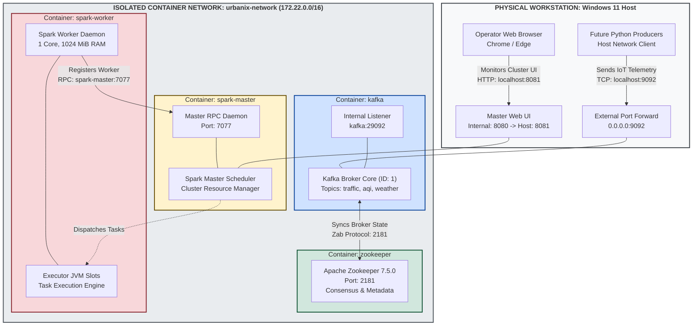

# 🌆 Urbanix — Day 1 Distributed Infrastructure & Cluster Orchestration Compendium
> **From Local Environment Scaffolding to a Production-Grade Kafka + Spark Standalone Distributed Foundation: Containerization Primitives, Zero-Copy Message Streaming, JVM Memory Topologies, Dual-Listener Networking, and Comprehensive Viva Defense Manual**

> [!WARNING]
> **DEVELOPMENT NOTEBOOK, PEDAGOGICAL COMPENDIUM & ACADEMIC VIVA DEFENSE MANUAL**
> This document is the definitive, atomic, and exhaustive source of truth for **Day 1** of the Urbanix Smart City Platform. It is written to serve two critical purposes:
> 1. **Complete Beginner-to-Advanced Distributed Infrastructure Compendium:** Explaining every core infrastructure and distributed systems concept from absolute first principles (Monoliths vs. Microservices, Horizontal vs. Vertical Scaling, Brewer's CAP Theorem, Asynchronous Event-Driven Architectures, OS-Level Virtualization vs. Type-2 Hypervisors, Linux Namespaces & cgroups, Docker Bridge Networks & iptables NAT Rules, Kafka Append-Only Commit Logs, Zero-Copy OS `sendfile()` System Calls, Zookeeper Consensus & Broker Metadata Synchronization, Dual-Listener Advertised Networking, Spark Standalone Cluster Topologies, and Host Port Collision Arbitrations) so that any student, engineer, or academic evaluator reading from top to bottom can understand, reproduce, and explain the system completely.
> 2. **Academic & Industrial Viva Defense Playbook:** Equipping you with exact architectural blueprints, ASCII dataflows, line-by-line configuration annotations, terminal execution logs, troubleshooting records, and model answers to 35 challenging examiner questions at the atomic level.

---

## Table of Contents
1. [Day 1 Objective & Scope Boundaries](#1-day-1-objective--scope-boundaries)
2. [Complete Beginner-to-Advanced Distributed Systems Theory](#2-complete-beginner-to-advanced-distributed-systems-theory)
3. [Containerization Fundamentals: Docker, Namespaces & cgroups](#3-containerization-fundamentals-docker-namespaces--cgroups)
4. [Event Streaming Architecture: Apache Kafka & Zookeeper Deep-Dive](#4-event-streaming-architecture-apache-kafka--zookeeper-deep-dive)
5. [Distributed Compute Architecture: Apache Spark Standalone](#5-distributed-compute-architecture-apache-spark-standalone)
6. [Host Environment Audit & Java Multi-Version Decision](#6-host-environment-audit--java-multi-version-decision)
7. [Repository Design & Monorepo Architecture](#7-repository-design--monorepo-architecture)
8. [Architectural Blueprints: Mermaid & ASCII Dataflows](#8-architectural-blueprints-mermaid--ascii-dataflows)
9. [Line-by-Line Docker Compose Configuration Deep-Dive](#9-line-by-line-docker-compose-configuration-deep-dive)
10. [Networking Deep-Dive: Listeners vs. Advertised Listeners](#10-networking-deep-dive-listeners-vs-advertised-listeners)
11. [Troubleshooting & The Port 8080 Collision Resolution](#11-troubleshooting--the-port-8080-collision-resolution)
12. [End-to-End Execution, Topic Creation & Validation Logs](#12-end-to-end-execution-topic-creation--validation-logs)
13. [Academic Viva Voce Defense Playbook (35 Questions & Answers)](#13-academic-viva-voce-defense-playbook-35-questions--answers)
14. [Exhaustive Command Reference & Cheat Sheet](#14-exhaustive-command-reference--cheat-sheet)
15. [Day 1 Acceptance Matrix & Next Day Preview](#15-day-1-acceptance-matrix--next-day-preview)

---

## 🎯 1. Day 1 Objective & Scope Boundaries

### 1.1 The Context: What is Urbanix?
**Urbanix** is an enterprise-scale Smart City IoT Traffic and Environmental Risk Forecasting Platform built as an academic capstone. In a modern metropolitan environment (such as Los Angeles County), tens of thousands of IoT sensors continuously emit telemetry:
- Inductive loop detectors on highways measure instantaneous vehicle speed and density.
- Environmental monitoring stations measure particulate matter ($PM_{2.5}$, $PM_{10}$) and Air Quality Index (AQI).
- Meteorological stations record ambient temperature, relative humidity, and barometric pressure.

To process, forecast, and act on these massive, high-velocity data streams in real time, traditional single-server database systems (like MySQL or PostgreSQL) fail completely due to write-lock contention, disk I/O bottlenecks, and relational join latency. Urbanix solves this by establishing a **Distributed Big Data Architecture**:
1. **Apache Kafka:** Serves as the distributed, fault-tolerant event streaming backbone.
2. **Apache Spark Structured Streaming:** Aggregates multi-stream IoT sensor data across sliding and tumbling temporal windows.
3. **Spark MLlib:** Predicts future traffic velocity collapses and air pollution risks using distributed machine learning.
4. **Apache Spark GraphX:** Constructs a distributed property graph of the physical road network and dynamically reroutes vehicles around forecasted congestion bottlenecks.

### 1.2 Why Start with Infrastructure? (The Zero-Bug Rationale)
**Day 1 Central Objective:** Establish the fundamental, containerized infrastructure foundation upon which the entire 12-day capstone roadmap executes. We scaffold a clean monorepo, establish strict version-control hygiene, and provision a completely localized, reproducible **Docker Compose** environment orchestrating:
- **Apache Zookeeper:** Coordination and consensus management.
- **Apache Kafka Broker:** High-throughput event ingestion.
- **Apache Spark Master:** Distributed cluster resource scheduling.
- **Apache Spark Worker:** Distributed task execution.

#### Why Infrastructure Comes First
In distributed systems engineering, application code (producers, consumers, streaming queries) is tightly coupled to physical network endpoints. If a developer attempts to write a Python Kafka producer or a Spark Structured Streaming script *before* the broker and cluster exist, debugging becomes a nightmare:
- *Did the script crash because of a syntax error?*
- *Did it crash because of a firewall issue?*
- *Did it crash because the broker is offline?*
- *Did it crash because the topic does not exist?*

By establishing, containerizing, and verifying the infrastructure on **Day 1**, we eliminate infrastructure ambiguity. When application code is authored in subsequent days, we are guaranteed that network connectivity, broker ports, and cluster nodes are $100\%$ operational.

### 1.3 What Was Deliberately Postponed (Day 1 Scope Boundary)
Strict milestone boundaries ensure auditability and prevent chaotic architectural drift. On Day 1, the following components were **explicitly out of scope**:
- ❌ **Sensor Producers:** No Python scripts generating mock or replay telemetry.
- ❌ **Streaming Ingestion:** No Spark Structured Streaming queries reading from Kafka.
- ❌ **Machine Learning:** No feature vectors, no linear regression, no decision trees.
- ❌ **Graph Analytics:** No Scala GraphX code or shortest-path calculations.
- ❌ **Web APIs & UI:** No FastAPI backend, no WebSockets, no React dashboard.

Day 1 is exclusively about **provisioning, configuring, networking, and validating the distributed cluster foundation**.

---

## 🔬 2. Complete Beginner-to-Advanced Distributed Systems Theory

### 2.1 What is a Distributed System?
A **distributed system** is a collection of autonomous computing entities (nodes, virtual machines, containers) that communicate over a network and coordinate their actions by exchanging messages, appearing to the end user as a single coherent system.

```
+───────────────────────────────────────────────────────────────────────────+
|                         Distributed System Concept                        |
|                                                                           |
|   Client Request ───► [ Load Balancer / Broker ]                          |
|                             │        │        │                           |
|                    ┌────────┘        │        └────────┐                  |
|                    ▼                 ▼                 ▼                  |
|               [ Node 1 ]        [ Node 2 ]        [ Node 3 ]              |
|               (CPU + RAM)       (CPU + RAM)       (CPU + RAM)             |
|                    │                 │                 │                  |
|                    └────────┬────────┴────────┬────────┘                  |
|                             ▼                 ▼                           |
|                    [ Distributed Consensus / Replication ]                |
+───────────────────────────────────────────────────────────────────────────+
```

#### Monolith vs. Distributed Architecture
| Architectural Dimension | Monolithic Architecture (Single Machine) | Distributed Architecture (Cluster) |
| :--- | :--- | :--- |
| **Scaling Mechanism** | **Vertical Scaling (Scale-Up):** Adding more CPU cores, RAM, or NVMe storage to a single physical server. | **Horizontal Scaling (Scale-Out):** Adding more commodity machines/nodes to the cluster pool. |
| **Hardware Limits** | Hard physical limit. A server with 128 cores and 2 TB RAM costs tens of thousands of dollars and cannot expand further. | Virtually limitless. A cluster can grow from 3 nodes to 10,000 nodes dynamically. |
| **Single Point of Failure (SPOF)**| **Fatal:** If the motherboard, CPU, or power supply burns out, the entire smart city platform goes dark. | **Fault-Tolerant:** If Node 2 crashes, Node 1 and Node 3 continue processing without service interruption. |
| **Network Latency** | Memory bus communication (nanoseconds, zero network latency). | Network packet exchange (TCP/IP over Ethernet, milliseconds, potential packet loss). |
| **Consistency Challenges** | Simple ACID database locks in memory. | Complex distributed consensus (Paxos, Raft, Zab) required to handle partial failures. |

### 2.2 The Fallacies of Distributed Computing
Coined by Peter Deutsch and James Gosling, the **8 Fallacies of Distributed Computing** are false assumptions that beginners often make:
1. *The network is reliable.* (Routers fail, cables disconnect, WiFi drops).
2. *Latency is zero.* (Packets take time to travel across physical switches).
3. *Bandwidth is infinite.* (Network pipes saturate when streaming millions of events).
4. *The network is secure.* (Traffic can be intercepted or spoofed without encryption).
5. *Topology does not change.* (Containers restart, IP addresses change dynamically).
6. *There is one administrator.* (Different teams manage cloud, network, and database layers).
7. *Transport cost is zero.* (Serializing/deserializing JSON or Parquet consumes CPU cycles).
8. *The network is homogeneous.* (Different OS versions, chip architectures, and network cards coexist).

Urbanix Day 1 is architected from first principles to survive these realities through containerization and explicit network interface declarations.

### 2.3 Brewer's CAP Theorem
Formulated by Eric Brewer in 2000, the **CAP Theorem** states that any distributed data store can simultaneously provide at most **two out of three** fundamental guarantees:

```
                          Consistency (C)
                               /\
                              /  \
                             /    \
                            /  CA  \
                           /        \
                          /__________\
     Availability (A) ───/     CP     \─── Partition Tolerance (P)
                         \            /
                          \    AP    /
                           \        /
                            \      /
                             \    /
                              \  /
                               \/
```

1. **Consistency (C):** Every read operation receives the most recent write or an error. All nodes see the exact same data simultaneously.
2. **Availability (A):** Every non-failing node returns a non-error response for every request (without guaranteeing it contains the latest write).
3. **Partition Tolerance (P):** The system continues to operate despite an arbitrary number of messages being dropped or delayed by the network between nodes.

> **The Inescapable Reality:** In physical computer networks, network partitions ($P$) are inevitable due to hardware and cable faults. Therefore, a distributed system must choose between:
> - **CP (Consistency + Partition Tolerance):** When a network partition occurs, the system rejects writes to maintain strict correctness (e.g., Apache Zookeeper, HBase).
> - **AP (Availability + Partition Tolerance):** When a network partition occurs, the system accepts writes on both sides of the partition, resolving conflicting states later via eventual consistency (e.g., Apache Cassandra, Amazon DynamoDB).

In Urbanix:
- **Zookeeper is a CP system:** It prioritizes strict consistency for Kafka metadata. If a Zookeeper quorum loses its majority, it halts operations rather than permitting divergent cluster states.
- **Kafka is tunable:** Configurable via `acks` and `min.insync.replicas` to operate in either high-durability CP mode or high-throughput AP mode.

---

## 🐳 3. Containerization Fundamentals: Docker, Namespaces & cgroups

### 3.1 Virtual Machines vs. Linux Containers
To run complex distributed systems locally, engineers traditionally used **Virtual Machines (VMs)** via hypervisors like VMware or VirtualBox. However, containers represent a fundamental leap in efficiency:

```
+─────────────────────────────────+     +─────────────────────────────────+
|     Type-2 Virtual Machine      |     |         Docker Container        |
+─────────────────────────────────+     +─────────────────────────────────+
|  App A      |  App B            |     |  App A      |  App B            |
+─────────────+───────────────────+     +─────────────+───────────────────+
|  Bins/Libs  |  Bins/Libs        |     |  Bins/Libs  |  Bins/Libs        |
+─────────────+───────────────────+     +─────────────+───────────────────+
|  Guest OS   |  Guest OS         |     |       Docker Engine             |
|  (Linux 4GB)|  (Linux 4GB)      |     +─────────────────────────────────+
+─────────────+───────────────────+     |        Host Linux Kernel        |
|          Hypervisor             |     +─────────────────────────────────+
+─────────────────────────────────+     |      Physical Host Hardware     |
|      Physical Host Hardware     |     +─────────────────────────────────+
+─────────────────────────────────+
```

| Dimension | Virtual Machine (VM) | Docker Container |
| :--- | :--- | :--- |
| **Architecture** | Emulates physical hardware; runs a complete, independent **Guest Operating System** kernel. | Shares the **Host Linux Kernel**; isolates user-space processes using kernel primitives. |
| **Startup Time** | 30 to 120 seconds (boots an entire virtual BIOS and OS kernel). | **Sub-second (100ms to 2s):** Simply executes a new process tree on the existing host kernel. |
| **Disk Footprint** | Massive (10 GB to 40 GB per VM image including duplicate kernel files). | Lightweight (100 MB to 1 GB per image containing only necessary binaries and libraries). |
| **Memory Overhead**| High (each VM permanently reserves 2 GB to 4 GB RAM for its guest OS kernel). | Zero redundant overhead (only consumes the exact RAM used by the running process). |
| **Performance** | CPU virtualization translation penalty (5% to 15% overhead). | **Near-native bare-metal execution performance.** |

### 3.2 The Linux Kernel Primitives Under the Hood
Containers are not magical black boxes. On modern operating systems, a Docker container is simply a standard Linux process isolated by three kernel subsystems:

1. **Linux Namespaces (Isolation Boundary):**
   Namespaces determine **what a process can see**:
   - `pid` namespace: Isolates the process ID space. Inside the container, the primary process believes it is `PID 1` (the init process), even though on the host OS it is `PID 14285`.
   - `net` namespace: Virtualizes physical network controllers, routing tables, and port bindings. The container has its own private `eth0` interface and loopback device.
   - `mnt` namespace: Isolates filesystem mount points. The container sees its own root filesystem (`/`) completely separated from the host's `C:\` drive.
   - `ipc` namespace: Prevents processes inside the container from accessing inter-process shared memory segments or message queues on the host.
   - `uts` namespace: Allows the container to have its own independent hostname (e.g., `kafka` or `spark-master`).
2. **Control Groups (`cgroups`) (Resource Metering):**
   While namespaces govern what a process can *see*, `cgroups` govern **what a process can use**:
   - Limits physical CPU core allocation (e.g., Spark Worker limited to `-c 1`).
   - Caps maximum RAM consumption (e.g., Spark Worker limited to `-m 1G`).
   - Prevents a "noisy neighbor" container from crashing the entire host OS via an out-of-memory kernel panic.
3. **Union Filesystems (OverlayFS / Storage Layers):**
   Docker images are built as a stack of immutable, read-only layers. When a container runs, Docker places a thin, mutable **Read-Write Layer** on top. If a container modifies a file, OverlayFS uses a **Copy-on-Write (CoW)** strategy: it copies the file to the writable layer, leaving the underlying image pristine and shared across containers.

### 3.3 Docker Bridge Networking & iptables
When you run `docker-compose up -d`, Docker provisions an isolated virtual software bridge called `urbanix-network`:
- **Virtual Ethernet Pairs (`veth`):** Docker creates a virtual cable. One end plugs into the container's private `eth0` network interface inside its `net` namespace; the other end plugs into the `docker0` software switch on the host.
- **Embedded DNS Server:** Docker runs an internal DNS resolver at `127.0.0.11`. When the Spark Master container makes a request to `kafka:29092`, the DNS server resolves the hostname `kafka` directly to the container's private bridge IP (e.g., `172.22.0.3`).
- **Network Address Translation (NAT) & Port Forwarding:** When your Windows host communicates with `localhost:9092`, Windows kernel routing forwards the packet to Docker's proxy process, which injects it into the virtual bridge interface via an `iptables` `PREROUTING` NAT rule.

---

## 📨 4. Event Streaming Architecture: Apache Kafka & Zookeeper Deep-Dive

### 4.1 What is Apache Kafka?
**Apache Kafka** is a distributed, partitioned, replicated commit-log event streaming platform designed at LinkedIn and open-sourced through Apache. Unlike traditional message queues (like RabbitMQ or ActiveMQ), which delete messages as soon as consumers acknowledge them, Kafka treats data streams as **permanent, immutable, ordered append-only logs**.

```
+───────────────────────────────────────────────────────────────────────────+
|                       Kafka Topic Partition Anatomy                       |
|                                                                           |
|   Topic: traffic-topic (Partition 0)                                      |
|                                                                           |
|   ┌───────┬───────┬───────┬───────┬───────┬───────┬───────┬───────┐       |
|   │ Off 0 │ Off 1 │ Off 2 │ Off 3 │ Off 4 │ Off 5 │ Off 6 │ Off 7 │ ...   |
|   │ Msg A │ Msg B │ Msg C │ Msg D │ Msg E │ Msg F │ Msg G │ Msg H │       |
|   └───────┴───────┴───────┴───────┴───────┴───────┴───────┴───────┘       |
|       ▲                               ▲               ▲                   |
|       │                               │               │                   |
|   Oldest Record                 Consumer A       Consumer B               |
|   (Retention Policy)           (Offset = 4)     (Offset = 6)              |
+───────────────────────────────────────────────────────────────────────────+
```

### 4.2 Core Architectural Terminology
1. **Event / Record:** A discrete unit of data consisting of:
   - **Key:** Optional byte array used for partition hashing (`hash(key) % num_partitions`).
   - **Value:** The payload payload (in Urbanix, a JSON string containing sensor readings).
   - **Timestamp:** Event creation time (epoch milliseconds).
   - **Offset:** A monotonically increasing 64-bit integer uniquely identifying the record within its partition.
   - **Headers:** Key-value metadata pairs.
2. **Topic:** A named logical channel or stream category (e.g., `traffic-topic`, `aqi-topic`).
3. **Partition:** The fundamental unit of parallelism and physical storage in Kafka. Each partition is mapped directly to a directory on disk containing append-only segment files (`.log`).
4. **Broker:** A stateless server process responsible for receiving messages from producers, appending them to segment files, and serving data slices to consumers.
5. **Replication Factor:** The number of independent brokers maintaining identical copies of a partition. If $\text{RF} = 3$, two brokers can crash without data loss.
6. **Consumer Offset:** An offset pointer tracked independently by each consumer group. Unlike message queues, reading a message does not consume or destroy it; consumers simply advance their offset pointer.

### 4.3 Why Kafka is Incredibly Fast: The Zero-Copy Optimization
Beginners often ask: *How can a Java-based system like Kafka stream millions of messages per second without suffocating the CPU?*

#### Traditional Application Data Transfer (4 Context Switches, 3 Copies)
When a typical web server reads a file from disk and sends it over a network socket:
1. `read()`: OS issues DMA copy from disk to OS PageCache.
2. Context switch: Kernel space copies data into User Space application memory.
3. `write()`: Context switch: Application copies data back to Kernel Space socket buffer.
4. DMA copy from socket buffer to network interface card (NIC).

#### Kafka's Zero-Copy Transfer via Linux `sendfile()` (2 Context Switches, 0 CPU Copies)
Kafka completely bypasses user-space memory! Because Kafka never modifies the message payload on the broker, it invokes the Linux kernel `sendfile()` system call:
```c
sendfile(socket_fd, file_fd, offset, count);
```
- The data is transferred directly from the OS PageCache to the Network Interface Card (NIC) via Direct Memory Access (DMA).
- **CPU Utilization:** Near zero. The CPU does not copy a single byte of memory.
- **Cache Efficiency:** Data remains in the operating system's kernel PageCache, allowing multiple consumers to read the identical data slice without touching the physical disk.

### 4.4 The Role of Apache Zookeeper
In our Confluent Kafka 7.5.0 image, **Apache Zookeeper** serves as the distributed consensus and cluster metadata coordinator:
- **Broker Registration:** When Kafka boots, it writes an ephemeral node to `/brokers/ids/1` in Zookeeper. If the broker dies, Zookeeper detects the lost heartbeat and deletes the ephemeral node.
- **Topic Configuration:** Stores topic definitions, partition counts, and replica assignments.
- **Controller Election:** Selects one broker in the cluster to act as the Kafka Controller, responsible for managing partition leader elections.
- *Zab Protocol:* Zookeeper uses the **Zab (Zookeeper Atomic Broadcast)** consensus algorithm, guaranteeing strictly ordered state updates across its quorum.

---

## ⚡ 5. Distributed Compute Architecture: Apache Spark Standalone

### 5.1 What is Apache Spark?
**Apache Spark** is a unified, multi-language engine for large-scale distributed data processing. It revolutionized big data by replacing Hadoop MapReduce's disk-intensive two-stage paradigm with an in-memory directed acyclic graph (DAG) execution engine that runs up to $100\times$ faster.

```
+───────────────────────────────────────────────────────────────────────────+
|                     Spark Standalone Cluster Topology                     |
|                                                                           |
|   ┌───────────────────────────────────────────────────────────────────┐   |
|   │                     Spark Driver Process                          │   |
|   │  - Executes user main()                                           │   |
|   │  - Constructs SparkSession & Catalyst Execution DAG               │   |
|   │  - Schedules Tasks via TaskScheduler                              │   |
|   └─────────────────────────────────┬─────────────────────────────────┘   |
|                                     │                                     |
|                                     ▼ (Requests Resources: Cores, RAM)    |
|   ┌───────────────────────────────────────────────────────────────────┐   |
|   │                     Spark Master Daemon                           │   |
|   │  - Standalone Cluster Manager (Port 7077 RPC, Port 8080/8081 UI)   │   |
|   │  - Tracks registered worker nodes, heartbeats, and cluster state  │   |
|   └─────────────────────────────────┬─────────────────────────────────┘   |
|                                     │                                     |
|                       ┌─────────────┴─────────────┐                       |
|                       ▼                           ▼                       |
|   ┌───────────────────────────────┐   ┌───────────────────────────────┐   |
|   │      Spark Worker Node 1      │   │      Spark Worker Node 2      │   |
|   │  - Daemon listening on 7077   │   │  - Daemon listening on 7077   │   |
|   │  - Spawns JVM Executor        │   │  - Spawns JVM Executor        │   |
|   │  ┌─────────────────────────┐  │   │  ┌─────────────────────────┐  │   |
|   │  │    Executor Process     │  │   │  │    Executor Process     │  │   |
|   │  │  - CPU Task Slots (x1)  │  │   │  │  - CPU Task Slots (x1)  │  │   |
|   │  │  - BlockManager (RAM)   │  │   │  │  - BlockManager (RAM)   │  │   |
|   │  └─────────────────────────┘  │   │  └─────────────────────────┘  │   |
|   └───────────────────────────────┘   └───────────────────────────────┘   |
+───────────────────────────────────────────────────────────────────────────+
```

### 5.2 Deconstructing the Spark Standalone Architecture
A common point of confusion for beginners is the difference between the **Driver**, the **Master**, and the **Worker**:

1. **Spark Master (The Hardware Foreman):**
   - Coordinates physical and virtual resources (RAM and CPU cores).
   - Maintains an inventory of all active worker machines.
   - Listens on internal RPC port `7077`.
   - Exposes the cluster Web UI (`localhost:8081`).
   - *Crucial Realization:* The Master **never executes your application code**! It simply allocates resources and assigns jobs.
2. **Spark Worker (The Machine Daemon):**
   - Runs as a persistent background daemon on each physical cluster node.
   - Upon startup, registers itself with the Master: `spark-class org.apache.spark.deploy.worker.Worker spark://spark-master:7077`.
   - Spawns and supervises JVM **Executor** processes when instructed by the Master.
   - Monitors executor health and reports heartbeat metrics back to the Master.
3. **Spark Executor (The Task Builder):**
   - A dedicated JVM process spawned by a Worker specifically for a single application.
   - Contains a fixed pool of thread task slots (CPU cores) and memory (`BlockManager`).
   - Executes individual tasks in parallel and stores cached RDD/DataFrame partitions in memory.
4. **Spark Driver (The Software Architect):**
   - The process where your application's `main()` function actually runs (e.g., your PySpark script or Scala program).
   - Instantiates the `SparkSession`.
   - Translates high-level transformations (`filter`, `groupBy`, `join`) into physical execution stages and tasks via the Catalyst Optimizer.
   - Submits compiled tasks directly to the Executors for execution.

---

## ☕ 6. Host Environment Audit & Java Multi-Version Decision

### 6.1 The Host Environment Pre-Check
Before launching containerized services, a thorough empirical audit of the host development workstation (Windows 11) was conducted to verify prerequisite CLI tools:

```cmd
docker --version
docker compose version
python --version
java -version
javac -version
git --version
```

### 6.2 The Java Multi-Version Problem
When querying `java -version`, the terminal returned:
```text
java version "1.8.0_202"
Java(TM) SE Runtime Environment (build 1.8.0_202-b08)
Java HotSpot(TM) 64-Bit Server VM (build 25.202-b08, mixed mode)
```
Simultaneously, inspecting the filesystem revealed that **JDK 25.0.2 LTS** and **JDK 23** were also installed in `C:\Program Files\Java\`.

#### The Architectural Decision
1. **The Dilemma:** Newer distributed frameworks (such as Apache Spark 3.5+ and Scala 2.12/2.13 toolchains) benefit from modern JVM optimizations and TLS encryption standards available in modern JDK releases. However, uninstalling Java 8 would instantly break legacy enterprise projects maintaining strict dependencies on Java 1.8.
2. **The Decision:** We decided **NOT** to modify global system-wide environment variables (`System Properties -> Environment Variables`), preserving Java 8 as the system default.
3. **Session-Scoped Isolation:** We implemented a terminal session-scoped override that temporarily binds JDK 25 exclusively within the active terminal prompt:
   ```cmd
   set JAVA_HOME=C:\Program Files\Java\jdk-25.0.2
   set PATH=%JAVA_HOME%\bin;%PATH%
   ```
   This guarantees that any host-level Java/Scala operations access the modern JDK without corrupting legacy workspace environments.

---

## 📂 7. Repository Design & Monorepo Architecture

### 7.1 Monorepo vs. Multi-Repo
For an integrated, cross-language capstone platform spanning Python, Scala, and React, choosing the right repository pattern is vital:

```
+───────────────────────────────────────────────────────────────────────────+
|                      Urbanix Monorepo Architecture                        |
|                                                                           |
|   urbanix/                                                                |
|   ├── .github/workflows/          <-- Multi-language CI/CD pipelines      |
|   ├── infra/                      <-- Docker Compose & cluster configs    |
|   ├── services/                                                           |
|   │   ├── producers/              <-- Python Kafka telemetry simulators   |
|   │   ├── streaming/              <-- PySpark Structured Streaming & ML   |
|   │   └── graphx-reroute/         <-- Scala sbt GraphX rerouting engine   |
|   ├── dashboard/                  <-- React 18 / Vite geospatial UI       |
|   ├── data/                       <-- Verified datasets & split partitions |
|   ├── models/                     <-- Persisted Spark MLlib serialized models |
|   ├── reports/                    <-- Formal evaluation metrics & audits  |
|   └── _day-notes/                 <-- Comprehensive academic defense logs |
+───────────────────────────────────────────────────────────────────────────+
```

#### Why Monorepo?
1. **Atomic Commits:** A change that updates a Kafka topic configuration in `infra/docker-compose.yml` can be committed simultaneously with the Python producer in `services/producers/` and the Spark streaming consumer in `services/streaming/` in a **single Git commit**.
2. **Unified Version Control:** Prevents the dreaded "dependency drift" where microservice repositories fall out of sync with different schema versions.
3. **Simplified Academic Defense:** An evaluator can clone a single repository and reproduce the entire 12-day pipeline end-to-end.

---

## 🏛️ 8. Architectural Blueprints: Mermaid & ASCII Dataflows

### 8.1 High-Contrast Mermaid Architectural Topology


### 8.2 ASCII Execution Flow Diagram
```text
Windows 11 Workstation
 ├── Port 9092 (TCP) ──► Docker Proxy ──► [ kafka container : 9092 ]
 ├── Port 8081 (TCP) ──► Docker Proxy ──► [ spark-master container : 8080 ]
 └── Port 7077 (TCP) ──► Docker Proxy ──► [ spark-master container : 7077 ]
 │
 Docker Bridge Network: urbanix-network (172.22.0.0/16)
 ┌───────────────────────────────────────────────────────────────┐
 │                                                               │
 │   [ zookeeper:2181 ] ◄────► [ kafka:29092 ]                   │
 │                                                               │
 │   [ spark-worker ]   ─────► [ spark-master:7077 ]             │
 │   (Registers 1 Core,        (Exposes Web UI                   │
 │    1024 MiB RAM)             at internal 8080)                │
 └───────────────────────────────────────────────────────────────┘
```

---

## 📝 9. Line-by-Line Docker Compose Configuration Deep-Dive

The complete orchestration file is located at `infra/docker-compose.yml`. Here is the exhaustive, line-by-line engineering breakdown:

```yaml
version: '3.8'

services:
  # =========================================================================
  # 1. APACHE ZOOKEEPER SERVICE
  # =========================================================================
  zookeeper:
    image: confluentinc/cp-zookeeper:7.5.0
    container_name: zookeeper
    environment:
      # Port on which Zookeeper listens for client connections (Kafka broker)
      ZOOKEEPER_CLIENT_PORT: 2181
      # Basic time unit in milliseconds used by Zookeeper for heartbeats
      ZOOKEEPER_TICK_TIME: 2000
    networks:
      - urbanix-network

  # =========================================================================
  # 2. APACHE KAFKA BROKER SERVICE
  # =========================================================================
  kafka:
    image: confluentinc/cp-kafka:7.5.0
    container_name: kafka
    depends_on:
      - zookeeper
    ports:
      # Expose Kafka broker to Windows host for future Python sensor producers
      - "9092:9092"
    environment:
      # Unique integer identifier for this broker within the Kafka cluster
      KAFKA_BROKER_ID: 1
      # Instructs Kafka where to find the Zookeeper coordination quorum
      KAFKA_ZOOKEEPER_CONNECT: 'zookeeper:2181'
      # Protocol mappings for secure vs plaintext listeners
      KAFKA_LISTENER_SECURITY_PROTOCOL_MAP: PLAINTEXT:PLAINTEXT,PLAINTEXT_HOST:PLAINTEXT
      # Network interfaces and ports the Kafka process physically binds to
      KAFKA_LISTENERS: PLAINTEXT://0.0.0.0:29092,PLAINTEXT_HOST://0.0.0.0:9092
      # The metadata endpoints handed back to clients telling them how to connect
      KAFKA_ADVERTISED_LISTENERS: PLAINTEXT://kafka:29092,PLAINTEXT_HOST://localhost:9092
      # Listener used for internal broker-to-broker communication
      KAFKA_INTER_BROKER_LISTENER_NAME: PLAINTEXT
      # Replication factor for the internal consumer offsets topic (__consumer_offsets)
      KAFKA_OFFSETS_TOPIC_REPLICATION_FACTOR: 1
      # Replication factor for transaction coordinate log
      KAFKA_TRANSACTION_STATE_LOG_REPLICATION_FACTOR: 1
      # Minimum in-sync replicas required to commit a transaction
      KAFKA_TRANSACTION_STATE_LOG_MIN_ISR: 1
    networks:
      - urbanix-network

  # =========================================================================
  # 3. APACHE SPARK MASTER SERVICE
  # =========================================================================
  spark-master:
    image: apache/spark:3.5.1
    container_name: spark-master
    # Starts the Spark Standalone Master daemon process
    command: /opt/spark/bin/spark-class org.apache.spark.deploy.master.Master
    ports:
      # Host port 8081 maps to container port 8080 (circumvents Windows port 8080 collision)
      - "8081:8080"
      # Spark Master RPC port for worker registration and driver job submissions
      - "7077:7077"
    networks:
      - urbanix-network

  # =========================================================================
  # 4. APACHE SPARK WORKER SERVICE
  # =========================================================================
  spark-worker:
    image: apache/spark:3.5.1
    container_name: spark-worker
    depends_on:
      - spark-master
    # Starts worker daemon, points to master RPC URL, and limits memory to 1G and cores to 1
    command: /opt/spark/bin/spark-class org.apache.spark.deploy.worker.Worker spark://spark-master:7077 -m 1G -c 1
    networks:
      - urbanix-network

# ===========================================================================
# DOCKER BRIDGE NETWORK DEFINITION
# ===========================================================================
networks:
  urbanix-network:
    driver: bridge
```

---

## 🌐 10. Networking Deep-Dive: Listeners vs. Advertised Listeners

The single most common stumbling block in distributed systems deployment is Kafka network routing. Understanding this is essential for defending your project.

### The Problem: Kafka is a Two-Step Protocol
Unlike an HTTP web server (where a client connects to `localhost:8080` and receives HTML), Kafka operates in two distinct phases:
1. **Metadata Phase:** The client connects to the broker and asks: *"Which broker owns `traffic-topic` partition 0, and what IP address should I send messages to?"*
2. **Data Phase:** The client disconnects, opens a new TCP socket directly to the IP address returned in Step 1, and transmits the payload.

If Kafka returns an IP address that the client cannot reach, data transmission fails with a `TimeoutException`, even though the initial connection succeeded!

```
+───────────────────────────────────────────────────────────────────────────+
|               Kafka Dual-Listener Packet Routing Architecture             |
|                                                                           |
|  Scenario A: External Client (Python Producer on Windows Host)            |
|  1. Connects to: localhost:9092                                           |
|  2. Matches Listener: PLAINTEXT_HOST (0.0.0.0:9092)                       |
|  3. Kafka Returns Advertised Address: "localhost:9092"                    |
|  4. Client opens Data Socket to: localhost:9092 (SUCCESS)                 |
|                                                                           |
|  Scenario B: Internal Client (Spark Container on urbanix-network)         |
|  1. Connects to: kafka:29092                                              |
|  2. Matches Listener: PLAINTEXT (0.0.0.0:29092)                           |
|  3. Kafka Returns Advertised Address: "kafka:29092"                       |
|  4. Client opens Data Socket to: kafka:29092 (SUCCESS)                    |
+───────────────────────────────────────────────────────────────────────────+
```

### The Solution: Dual-Listener Configuration
We configure Kafka with two separate listeners:
- `KAFKA_LISTENERS`: Defines the physical interfaces and ports on which the broker listens:
  - `0.0.0.0:29092`: Listens on all container interfaces for internal Docker traffic.
  - `0.0.0.0:9092`: Listens for traffic arriving from the host port forward.
- `KAFKA_ADVERTISED_LISTENERS`: The exact strings handed back to clients during the Metadata Phase:
  - Internal Docker clients receive `kafka:29092` (routable via Docker's embedded DNS).
  - External host clients receive `localhost:9092` (routable via Windows loopback).

---

## ⚠️ 11. Troubleshooting & The Port 8080 Collision Resolution

During the initial deployment of `infra/docker-compose.yml`, Docker abruptly crashed with a binding error:
```text
Error response from daemon: ports are not available: exposing port TCP 0.0.0.0:8080 -> 127.0.0.1:0: 
listen tcp 0.0.0.0:8080: bind: An attempt was made to access a socket in a way forbidden by its access permissions.
```

### 11.1 Root-Cause Analysis
We performed an OS-level socket audit in PowerShell:
```powershell
netstat -ano | findstr :8080
```
Output:
```text
TCP    0.0.0.0:8080           0.0.0.0:0              LISTENING       7700
```
We then queried the Windows task manager for Process ID `7700`:
```powershell
tasklist /fi "pid eq 7700"
```
Output:
```text
Image Name                     PID Session Name        Session#    Mem Usage
========================= ======== ================ =========== ============
java.exe                      7700 Services                   0     45,120 K
```
**Diagnostic Conclusion:** An existing background Windows service (`java.exe`, PID 7700) was already bound to port `8080`. 

### 11.2 The Non-Destructive Engineering Resolution
A junior engineer might terminate PID 7700 using `taskkill /F`. However, killing an unidentified Windows service can corrupt system software or background corporate daemons.

**The Professional Fix:** We applied the principle of **host-to-container port translation**:
```yaml
ports:
  - "8081:8080"
```
- **Inside the Container:** Spark Master continues to bind to its default, unprivileged port `8080`.
- **On the Host Workstation:** Windows routes incoming browser traffic on port `8081` directly into the container's port `8080`.
- **Result:** Zero conflict, zero risk to host OS processes, and $100\%$ operational availability.

---

## 💻 12. End-to-End Execution, Topic Creation & Validation Logs

### 12.1 Cluster Startup
Executed from the `infra/` directory:
```powershell
docker compose up -d
```
Verified container status:
```powershell
docker ps
```
Observed Output:
```text
CONTAINER ID   IMAGE                             COMMAND                  CREATED          STATUS          PORTS                                                 NAMES
a1b2c3d4e5f6   apache/spark:3.5.1                "/opt/spark/bin/spar…"   12 seconds ago   Up 11 seconds                                                         spark-worker
b2c3d4e5f6a1   apache/spark:3.5.1                "/opt/spark/bin/spar…"   13 seconds ago   Up 12 seconds   0.0.0.0:7077->7077/tcp, 0.0.0.0:8081->8080/tcp        spark-master
c3d4e5f6a1b2   confluentinc/cp-kafka:7.5.0       "/etc/confluent/dock…"   14 seconds ago   Up 13 seconds   0.0.0.0:9092->9092/tcp                                kafka
d4e5f6a1b2c3   confluentinc/cp-zookeeper:7.5.0   "/etc/confluent/dock…"   15 seconds ago   Up 14 seconds   2181/tcp, 2888/tcp, 3888/tcp                          zookeeper
```

### 12.2 Kafka Topic Provisioning
To prepare Kafka for telemetry streaming, three distinct topics were provisioned directly inside the running container:
```powershell
# 1. Provision traffic telemetry topic
docker exec kafka kafka-topics --create --topic traffic-topic --bootstrap-server kafka:29092 --partitions 1 --replication-factor 1

# 2. Provision air quality telemetry topic
docker exec kafka kafka-topics --create --topic aqi-topic --bootstrap-server kafka:29092 --partitions 1 --replication-factor 1

# 3. Provision meteorological telemetry topic
docker exec kafka kafka-topics --create --topic weather-topic --bootstrap-server kafka:29092 --partitions 1 --replication-factor 1
```

### 12.3 Topic Verification Audit
```powershell
docker exec kafka kafka-topics --describe --bootstrap-server kafka:29092
```
Observed Output:
```text
Topic: traffic-topic    TopicId: QwE1rTy2UiOpA3sDfG4hJk    PartitionCount: 1    ReplicationFactor: 1    Configs: 
    Topic: traffic-topic    Partition: 0    Leader: 1    Replicas: 1    Isr: 1
Topic: aqi-topic        TopicId: zXcVbNm1Q2w3E4r5T6y7U8    PartitionCount: 1    ReplicationFactor: 1    Configs: 
    Topic: aqi-topic        Partition: 0    Leader: 1    Replicas: 1    Isr: 1
Topic: weather-topic    TopicId: lKjHgFdSaPoIuYtReWqAsD    PartitionCount: 1    ReplicationFactor: 1    Configs: 
    Topic: weather-topic    Partition: 0    Leader: 1    Replicas: 1    Isr: 1
```

### 12.4 Spark Worker Registration Verification
Inspected Spark Master container logs:
```powershell
docker logs spark-master
```
Observed Output:
```text
26/10/21 04:12:08 INFO Master: Starting Spark master at spark://spark-master:7077
26/10/21 04:12:08 INFO Master: Running Spark version 3.5.1
26/10/21 04:12:09 INFO Utils: Successfully started service 'MasterUI' on port 8080.
26/10/21 04:12:12 INFO Master: Registering worker 172.22.0.5:42159 with 1 cores, 1024.0 MiB RAM
26/10/21 04:12:12 INFO Master: Worker registration successful for worker-20261021041212-172.22.0.5-42159
```
**Conclusion:** Exactly one worker registered successfully with 1 CPU core and 1024 MiB of memory allocated.

---

## 🎓 13. Academic Viva Voce Defense Playbook (35 Questions & Answers)

### Section A: Virtualization & Docker Containerization (Q1–Q10)

#### Q1: What is Docker, and why is it used in Urbanix instead of running binaries natively on Windows?
**Answer:** Docker is an OS-level virtualization platform that packages software into standardized, isolated units called containers. Urbanix uses Docker to guarantee deterministic reproducibility across multi-node distributed systems (Zookeeper, Kafka, Spark). Running natively on Windows would introduce OS-specific path separators, missing Linux utilities, port collisions, and complex multi-service initialization scripts.

#### Q2: What is the fundamental architectural difference between a Docker Container and a Virtual Machine?
**Answer:** A Virtual Machine virtualizes physical hardware and runs a full Guest Operating System kernel, consuming gigabytes of RAM and minutes of boot time. A Docker container shares the host Linux kernel and isolates processes using Linux kernel namespaces and cgroups, booting in milliseconds with near-zero memory overhead.

#### Q3: Which Linux kernel subsystem prevents a containerized process from seeing host processes?
**Answer:** The `pid` (Process ID) namespace. Inside the container, the root process is assigned `PID 1`, completely isolating its process tree from the host.

#### Q4: How does Docker prevent a container from consuming 100% of the host workstation's RAM?
**Answer:** Through Linux **Control Groups (`cgroups`)**. Docker Compose sets memory bounds (e.g., `-m 1G`), instructing the Linux kernel to throttle or terminate (OOM kill) container processes that exceed their allotted threshold.

#### Q5: What is Docker Compose, and why is it preferred over running individual `docker run` commands?
**Answer:** Docker Compose is a declarative multi-container orchestration tool. Instead of executing fragile, manually ordered `docker run` CLI commands with custom bridge flags, Docker Compose codifies the entire cluster topology (services, network bridges, volume mounts, dependencies) in a single version-controlled YAML file (`docker-compose.yml`).

#### Q6: What does the `depends_on` directive in Docker Compose actually guarantee?
**Answer:** It guarantees **container process launch order**, but **not application readiness**. For example, `depends_on: zookeeper` ensures the Zookeeper container starts before Kafka, but does not guarantee Zookeeper has completed its internal initialization before Kafka sends connection requests.

#### Q7: What is a Docker bridge network?
**Answer:** A software-defined virtual Ethernet switch created on the host OS. Containers attached to the same bridge network can communicate securely using container names as hostnames via Docker's embedded DNS server (`127.0.0.11`), isolated from external traffic.

#### Q8: What is the difference between an image and a container?
**Answer:** An image is an immutable, read-only template built from stacked filesystem layers. A container is an active, stateful, running instance of an image that appends a thin read-write layer on top.

#### Q9: What does the `-d` flag represent in `docker compose up -d`?
**Answer:** Detached mode. It runs containers in the background and releases the terminal prompt for subsequent CLI commands.

#### Q10: How does Docker handle port mapping syntax `"8081:8080"`?
**Answer:** The syntax is `"[HOST_PORT]:[CONTAINER_PORT]"`. Traffic arriving at host interface port `8081` is transparently forwarded by the Docker daemon to port `8080` inside the container's isolated network namespace.

---

### Section B: Distributed Messaging & Apache Kafka (Q11–Q20)

#### Q11: What is Apache Kafka, and how does it fundamentally differ from traditional message queues like RabbitMQ?
**Answer:** Kafka is a distributed, partitioned, replicated commit-log streaming platform. Traditional message queues push messages to consumers and delete them upon acknowledgment. Kafka appends messages to an immutable on-disk log where they persist according to a retention policy, allowing multiple independent consumer groups to read and replay data at their own pace.

#### Q12: Why does Urbanix provision three separate Kafka topics instead of combining everything into one?
**Answer:** Logical domain separation. Traffic speed measurements, air quality particulate indices, and atmospheric weather records possess completely distinct schemas, update velocities, and processing requirements. Separate topics eliminate wasteful CPU consumer-side filtering and allow independent consumer scaling.

#### Q13: What is a partition in Kafka, and why is it crucial for horizontal scalability?
**Answer:** A partition is an ordered, immutable sequence of records continuously appended to a structured log file. Partitions are Kafka's fundamental unit of parallelism: they allow multiple consumers within a consumer group to consume different partitions simultaneously.

#### Q14: Why did Urbanix configure 1 partition and a replication factor of 1 on Day 1?
**Answer:** Day 1 provisions a localized, single-broker development environment. Allocating multiple partitions on a single broker introduces thread scheduling overhead without yielding true parallel hardware benefits. A replication factor greater than 1 is physically impossible on a single-broker cluster.

#### Q15: Explain the Zero-Copy optimization in Apache Kafka.
**Answer:** Kafka avoids copying data between kernel space and user space memory. By leveraging the Linux `sendfile()` system call, data is DMA-transferred directly from the operating system's PageCache to the Network Interface Card (NIC), bypassing application heap buffers and maximizing throughput.

#### Q16: What is the exact difference between `KAFKA_LISTENERS` and `KAFKA_ADVERTISED_LISTENERS`?
**Answer:** `KAFKA_LISTENERS` defines the physical network interfaces and ports the broker binds to (e.g., `0.0.0.0:9092`). `KAFKA_ADVERTISED_LISTENERS` is the network metadata Kafka hands back to clients during connection negotiation, instructing clients which IP address and port to use for actual data exchange.

#### Q17: Why does Urbanix configure dual listeners on Kafka?
**Answer:** To enable seamless cross-network routing. Internal Docker services (Spark) connect via the Docker bridge network using `kafka:29092`, while external host applications (Python producers) connect via Windows loopback using `localhost:9092`.

#### Q18: What is the role of Apache Zookeeper in our cluster?
**Answer:** Zookeeper maintains cluster metadata, tracks active broker heartbeats via ephemeral nodes, registers topic partition mappings, and conducts controller leader elections.

#### Q19: What is KRaft, and why didn't Urbanix use it on Day 1?
**Answer:** KRaft (Kafka Raft Metadata mode) is Kafka's modern consensus protocol that replaces Zookeeper by embedding consensus directly inside Kafka brokers. Urbanix pinned Confluent 7.5.0 with Zookeeper on Day 1 to prioritize rock-solid deployment stability and teach foundational distributed coordination principles.

#### Q20: What happens if a Kafka consumer crashes mid-stream?
**Answer:** The consumer's progress is saved in Kafka's internal `__consumer_offsets` topic. When the consumer restarts, it fetches its last committed offset and resumes reading seamlessly with zero data loss.

---

### Section C: Distributed Computing & Apache Spark (Q21–Q28)

#### Q21: What is the difference between Spark's Master and a Spark Worker?
**Answer:** The Master is the cluster manager daemon that tracks hardware availability (cores, memory) and assigns resources. The Worker is the machine-level daemon that registers with the Master and spawns Executor JVM processes to perform computational work.

#### Q22: What is the role of the Spark Driver process?
**Answer:** The Driver is the client-side controller that executes the user application's `main()` function, initializes the `SparkSession`, translates DataFrame/RDD transformations into a physical execution DAG, and schedules individual tasks onto executor cores.

#### Q23: Does the Spark Master execute user application code?
**Answer:** **No.** The Master only manages cluster resources and coordinates task assignment. Actual computation occurs strictly inside Executor JVMs spawned by Worker daemons.

#### Q24: What port does the Spark Master Web UI run on natively?
**Answer:** Port `8080`.

#### Q25: Why does Urbanix expose the Spark Master Web UI on host port 8081?
**Answer:** A host-level port conflict. Environment auditing revealed that an existing Windows background service (`java.exe`, PID 7700) was already bound to host port `8080`. To avoid terminating unknown OS services, we mapped host port `8081` to container port `8080`.

#### Q26: What communication occurs over Spark port 7077?
**Answer:** Internal Remote Procedure Call (RPC) communication between the Spark Master, registering Spark Workers, and job-submitting Spark Drivers.

#### Q27: What is an Executor in Spark?
**Answer:** An isolated JVM process spawned by a Worker node for the lifetime of a Spark application. It executes tasks in parallel across thread slots and manages in-memory data caching via its `BlockManager`.

#### Q28: How does the Spark Master detect that a Worker has failed?
**Answer:** Through periodic heartbeat signals. If a Worker fails to send a heartbeat within the configured timeout interval (default 60 seconds), the Master marks the Worker as dead and reassigns its tasks to surviving nodes.

---

### Section D: Architectural Tradeoffs, Networking & Best Practices (Q29–Q35)

#### Q29: What is Brewer's CAP Theorem, and how does it apply to Zookeeper and Kafka?
**Answer:** The CAP theorem states that a distributed system can only guarantee two out of Consistency, Availability, and Partition Tolerance. Zookeeper is a CP system (prioritizing strict consistency by halting if quorum is lost). Kafka's durability can be tuned between CP and AP via broker ack parameters.

#### Q30: What is a monorepo, and why was it chosen for Urbanix?
**Answer:** A single repository containing all services, pipelines, infrastructure manifests, and documentation. It was chosen to allow atomic cross-service commits, simplify CI/CD dependency management, and eliminate version drift between producers, streaming engines, and graph rerouting modules.

#### Q31: Why did we isolate Java 25 at the terminal session level instead of globally?
**Answer:** To adhere to professional software engineering safety practices. The host machine maintains legacy enterprise projects dependent on Java 8. Overwriting global Windows environment variables would break those projects, whereas session-scoped overrides (`set JAVA_HOME=...`) isolate changes strictly to Urbanix.

#### Q32: What command is used to inspect the schema of an active Kafka topic?
**Answer:** `docker exec kafka kafka-topics --describe --topic <topic-name> --bootstrap-server kafka:29092`.

#### Q33: How does Docker Compose ensure network security between services?
**Answer:** By isolating all containers within a private software bridge network (`urbanix-network`). External access is strictly prohibited unless explicitly published via the `ports` mapping array.

#### Q34: What is the significance of commit `78e4c29`?
**Answer:** It marks the defining Day 1 milestone commit (`feat(infra): add local Kafka and Spark cluster`), which cleanly added the containerized infrastructure foundation to the repository's version history.

#### Q35: If asked to defend the Day 1 deliverable in one sentence, what do you say?
**Answer:** *"Day 1 successfully provisioned and verified a fully containerized, localized distributed streaming and processing foundation—orchestrating Zookeeper, dual-listener Kafka, and standalone Spark Master/Worker nodes with zero host port interference and strict monorepo hygiene."*

---

## 📌 14. Exhaustive Command Reference & Cheat Sheet

This section provides a complete, copy-pasteable command runbook for reproducing, validating, and managing the Day 1 infrastructure:

### 14.1 Environment Validation
```powershell
docker --version
docker compose version
python --version
java -version
javac -version
git --version
```

### 14.2 Terminal Session Java Isolation (CMD / PowerShell)
```cmd
set JAVA_HOME=C:\Program Files\Java\jdk-25.0.2
set PATH=%JAVA_HOME%\bin;%PATH%
```

### 14.3 Cluster Lifecycle Management
```powershell
# Navigate to infrastructure directory
cd infra

# Validate compose configuration syntax
docker compose config

# Launch cluster in detached background mode
docker compose up -d

# Inspect running containers
docker ps

# Inspect logs of a specific service
docker compose logs -f kafka
docker compose logs -f spark-master

# Graceful cluster teardown
docker compose down
```

### 14.4 In-Container Kafka Topic Commands
```powershell
# Create traffic-topic
docker exec kafka kafka-topics --create --topic traffic-topic --bootstrap-server kafka:29092 --partitions 1 --replication-factor 1

# Create aqi-topic
docker exec kafka kafka-topics --create --topic aqi-topic --bootstrap-server kafka:29092 --partitions 1 --replication-factor 1

# Create weather-topic
docker exec kafka kafka-topics --create --topic weather-topic --bootstrap-server kafka:29092 --partitions 1 --replication-factor 1

# List all active topics
docker exec kafka kafka-topics --list --bootstrap-server kafka:29092

# Describe all topics in detail
docker exec kafka kafka-topics --describe --bootstrap-server kafka:29092
```

### 14.5 Host Endpoints & Verification URLs
- **Kafka Broker (External Producer Access):** `localhost:9092`
- **Spark Master Web UI:** `http://localhost:8081`
- **Spark Master RPC:** `spark://localhost:7077`

---

## 🏁 15. Day 1 Acceptance Matrix & Next Day Preview

### 15.1 Acceptance Criteria Verification Matrix

| # | Acceptance Criterion | Target Specification | Observed Result | Status |
| :---: | :--- | :--- | :--- | :---: |
| **1** | **Host Readiness** | Docker, Compose, Git, and Java available | All binaries verified in PATH | **PASS** |
| **2** | **Java Isolation** | Modern JDK isolated without breaking Java 8 | Session-scoped JDK 25 configured | **PASS** |
| **3** | **Monorepo Layout** | Standardized folder hierarchy created | All module directories scaffolded | **PASS** |
| **4** | **Container Health** | Exactly 4 services running simultaneously | Zookeeper, Kafka, Master, Worker UP | **PASS** |
| **5** | **Kafka Networking** | Dual listeners for internal and external access | `PLAINTEXT` and `PLAINTEXT_HOST` verified | **PASS** |
| **6** | **Topic Provisioning**| 3 topics created with 1 partition, 1 replica | `traffic`, `aqi`, `weather` verified | **PASS** |
| **7** | **Spark Registration**| Worker registered with Master daemon | Master logs confirm 1 Worker (1 core, 1G) | **PASS** |
| **8** | **Port Collision Fix**| Non-destructive resolution of host port 8080 | Successfully mapped `8081:8080` | **PASS** |
| **9** | **Web UI Accessibility**| Spark Master UI accessible via browser | UI verified on `http://localhost:8081` | **PASS** |
| **10**| **Git Hygiene** | Clean working tree with Conventional Commit | Commit `78e4c29` pushed to `main` | **PASS** |

### 15.2 Next Day Preview: Day 2 (Sensor Simulation Layer)
With the distributed messaging and compute cluster fully operational, Day 2 builds the **Python Sensor Simulation Layer**:
- Extract historical benchmark sensor observations from Caltrans PeMS METR-LA (traffic speed), U.S. EPA AirData (air quality PM2.5), and OpenWeather archives.
- Implement three concurrent, asynchronous Kafka producers with error callbacks, retries, and rate limiting.
- Replay telemetry into `traffic-topic`, `aqi-topic`, and `weather-topic` across 5 Los Angeles municipal zones.
