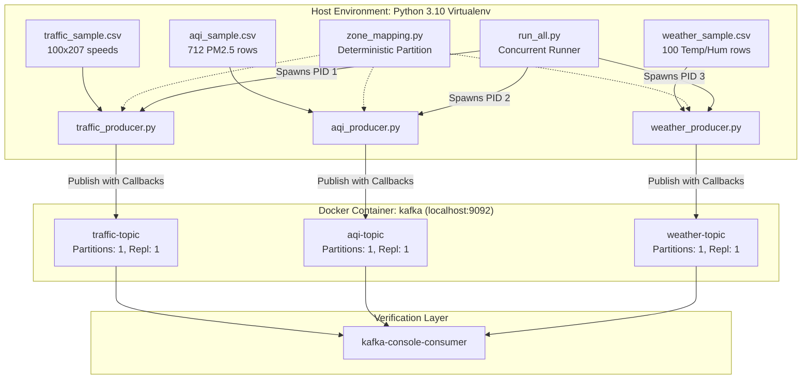

# 🌆 Urbanix — Day 2 Sensor Simulation Layer Deep-Dive
> **From Public IoT Datasets to High-Reliability Kafka Telemetry Producers**

> [!WARNING]
> **TEMPORARY DEVELOPMENT NOTE**
> This document exists to preserve Day 2 learning, implementation history, architectural decisions, and verification evidence. It is intentionally stored under `_day-notes/day-02/` and serves as the exhaustive source of truth for capstone recaps, viva preparation, and Day 3 streaming integration.

---

## 🎯 1. Day 2 Objective

In **Day 1**, we established our distributed infrastructure: an isolated Docker network housing Zookeeper, a single-node Kafka broker with 3 dedicated topics, and an Apache Spark Master-Worker standalone cluster.

**Day 2 Objective:** Build the **Sensor Simulation Layer**. Real smart cities continuously stream telemetry from thousands of deployed field devices (highway loop detectors, environmental stations, meteorological monitors). To replicate this without requiring physical IoT sensors, we develop a high-throughput, deterministic sensor simulation subsystem in Python. This subsystem consumes verified public real-world datasets, parses and converts physical metrics, tags events with municipal zones, and streams them into Kafka topics in real time with enterprise-grade delivery guarantees.

```
+---------------------------------------------------------------------------------------------------------+
|                                        URBANIX DAY 2 PIPELINE                                           |
|                                                                                                         |
|  [ METR-LA PeMS (Zenodo) ]   -->  traffic_producer.py  -->  [ traffic-topic ]                           |
|  [ U.S. EPA AirData (AQS) ]  -->  aqi_producer.py      -->  [ aqi-topic     ]  --> (Ready for Spark D3) |
|  [ OpenWeatherMap (Kaggle) ] -->  weather_producer.py  -->  [ weather-topic ]                           |
+---------------------------------------------------------------------------------------------------------+
```

### ❓ Why Simulate Historical Datasets via Kafka?
Why not feed CSV files directly into Spark or machine learning models?
1. **Streaming Realism:** Real-world smart city platforms ingest continuous streams over message brokers, not static batch files. Using Kafka tests network latency, backpressure, message serialization, and failure semantics.
2. **Decoupled Architecture:** Ingesting via Kafka decouples data producers from downstream consumers. Spark, dashboard web-sockets, or archival sinks can consume the same stream independently.
3. **Event-Time Processing:** True stream processing requires event timestamps generated at the source. Replaying historical data preserves authentic time intervals and burst dynamics.

### 🚫 What Was NOT Built (Day 2 Scope Boundary):
To prevent scope creep and maintain strict discipline, Day 2 deliberately excluded:
- Spark Structured Streaming consumers (Scheduled for Day 3)
- Multi-stream window joins and watermarking (Scheduled for Day 3)
- Municipal Risk Index calculations (Scheduled for Day 3)
- Spark MLlib / Random Forest / LSTM models (Scheduled for Day 4)
- GraphX / Scala road network routing (Scheduled for Day 5)
- FastAPI endpoints and React dashboards (Scheduled for Day 6+)
- Any modification to Day 1 Docker Compose or Kafka broker configurations

---

## 🛠️ 2. Technologies Used

| Technology | Version / Component | Role in Day 2 |
| :--- | :--- | :--- |
| **Python** | 3.10.11 (64-bit) | Host runtime for data preprocessing, simulation producers, and test suites. |
| **kafka-python-ng** | `2.2.3` | Modern, maintained Python Kafka client library supporting delivery callbacks and batching. |
| **pytest** | `9.1.1` | Automated test runner verifying unit conversions, parsing logic, and delivery mocks. |
| **Apache Kafka** | `confluentinc/cp-kafka:7.5.0` | Event streaming broker running in Docker on host port `9092`. |
| **PowerShell** | 7.x / 5.1 (Windows) | Execution shell for managing processes, virtual environments, and Docker commands. |
| **Git / GitHub** | Latest Windows Git | Monorepo version control enforcing conventional commits and branch hygiene. |

---

## 🔍 3. Environment & Virtualenv Isolation

To prevent dependency conflicts with host applications, all producer code runs inside a dedicated virtual environment isolated to `services/producers/`.

### Setup Sequence:
```powershell
# 1. Navigate to the producer service directory
cd services\producers

# 2. Create isolated virtual environment
python -m venv venv

# 3. Activate the environment in PowerShell
.\venv\Scripts\Activate.ps1

# 4. Install locked dependencies
pip install -r requirements.txt
```

### Dependency Audit (`requirements.txt`):
```text
kafka-python-ng>=2.2.3
pytest>=8.0.0
```
> **Engineering Decision:** We deliberately used `kafka-python-ng` instead of legacy `kafka-python`. The legacy package has been unmaintained since 2020 and throws severe `collections.abc` deprecation exceptions under modern Python 3.10+. `kafka-python-ng` is a fully drop-in, maintained fork.

---

## 📊 4. Dataset Investigation & Strict Provenance

To satisfy academic capstone standards, all data must be **real, public, traceable, report-citable**, and free of fabricated values.

```
+----------------------------------------------------------------------------------------------------+
|                                    URBANIX DATA PROVENANCE                                         |
|                                                                                                    |
| 1. TRAFFIC: METR-LA (Caltrans PeMS)                                                                |
|    - Source: Loop detectors on LA County freeways (I-5, I-10, I-101, I-405, I-210, etc.)           |
|    - Original Research: Li et al. (DCRNN, ICLR 2018), hosted on Zenodo (DOI: 10.5281/zenodo.4739137)|
|    - Raw Format: 207 sensor time-series at 5-minute intervals (March 1, 2012 - June 27, 2012)      |
|                                                                                                    |
| 2. AIR QUALITY: U.S. EPA AirData (AQS)                                                             |
|    - Source: Federal air monitoring network (daily_88101_2012.zip)                                 |
|    - Parameter: PM2.5 Local Conditions (Parameter Code: 88101)                                      |
|    - Region: California (State 06), Los Angeles County (County 037)                                |
|    - Period: March 1, 2012 - June 30, 2012 (Filtered strictly to match METR-LA calendar)          |
|                                                                                                    |
| 3. WEATHER: Historical Hourly Weather (OpenWeatherMap)                                             |
|    - Source: OpenWeatherMap municipal archive (mirrored by Kaggle researcher 'selfishgene')        |
|    - Metrics: Ambient Temperature (Kelvin) & Relative Humidity (%)                                 |
|    - Coverage: Los Angeles metropolitan station, continuous hourly records                         |
+----------------------------------------------------------------------------------------------------+
```

---

## 🔬 5. Dataset Audit & Deep-Dive

### 5.1 Traffic: METR-LA Telemetry
* **Sensors:** 207 inductive highway loop detectors.
* **Frequency:** 5-minute snapshots.
* **Measurement:** Vehicle speed recorded in miles per hour (`mph`).
* **Why it fits:** Provides genuine congestion wave dynamics, spatial correlation between adjacent freeway sensors, and realistic peak vs. off-peak cycles.
* **Sample File (`data/traffic_sample.csv`):** 100 timestamp rows across 207 columns (20,700 speed measurements), spanning March 1, 2012 from `00:00:00` to `08:15:00`.
* **Integrity Guard:** The original dataset contains **zero vehicle counts**. We refused to manufacture fake counts; the platform evaluates traffic severity strictly through speed degradation.

### 5.2 Air Quality: U.S. EPA AirData
* **Original File:** `daily_88101_2012.zip` containing 342,000 national records.
* **Filtering Criteria:**
  1. `State Code == '06'` (California)
  2. `County Code == '037'` (Los Angeles County)
  3. `Parameter Code == '88101'` (PM2.5 FRM/FEM mass)
  4. `'2012-03-01' <= Date Local <= '2012-06-30'` (Strict temporal alignment)
* **Sample File (`data/aqi_sample.csv`):** Exactly **712 verified daily observations** across 10 official monitoring stations (Azusa, Burbank, Downtown LA, Long Beach, Pasadena, Pomona, Santa Clarita, South Long Beach, West LA, Lancaster).

### 5.3 Weather: OpenWeather Hourly Records
* **Metrics:** Surface temperature ($K$) and relative humidity ($\%$).
* **Observation Station:** Los Angeles regional metropolitan monitor.
* **Sample File (`data/weather_sample.csv`):** 100 hourly records beginning at `2012-10-01T13:00:00`.

---

## 📅 6. The March–June 2012 Window & The EPA AQI Filtering Audit

During early Day 2 development, the initial EPA data extraction grabbed records from January 2012 because only the year `2012` was matched.

### The Audit & Fix:
In our senior data engineering audit, we discovered that METR-LA traffic strictly begins on **March 1, 2012**. Having air quality data from January was temporally disconnected.

We modified `data/prepare_data.py`:
```python
# Filter for California (06), Los Angeles County (037)
# strictly constrained to the METR-LA calendar window:
la_window_rows = []
for row in reader:
    if len(row) > 25 and row[0] == "06" and row[1] == "037":
        date_local = row[11].strip()
        if "2012-03-01" <= date_local <= "2012-06-30":
            la_window_rows.append(row)
```
**Verification Evidence:**
Running `prepare_data.py` yields:
```
[+] Prepared AQI Sample: data/aqi_sample.csv (712 observations across 10 stations)
    - Calendar Window: 2012-03-01 to 2012-06-30 (122 days)
    - Active Stations in LA County: ['0002', '0016', '1002', '1103', '1201', '1301', '2005', '4002', '4004', '9033']
```
Every single EPA record in the repository now aligns with the spring 2012 traffic observation period.

---

## ⛅ 7. The Weather / Traffic Timestamp Mismatch Constraint

### The Reality of Public Data Engineering
A critical discovery made during data provenance validation:
* **METR-LA Traffic:** March 1, 2012 – June 27, 2012
* **EPA Air Quality:** March 1, 2012 – June 30, 2012
* **Kaggle OpenWeather:** Starts **October 1, 2012** (No public spring 2012 hourly observations exist in that specific archive).

### The Architectural Decision:
> [!IMPORTANT]
> **NO TIME FABRICATION**
> Junior engineers often artificially rewrite timestamps (e.g. changing `2012-10-01` to `2012-03-01`) to force datasets to align. We strictly rejected this practice. Fabricating timestamps compromises data provenance and research reproducibility.

Instead, we formulated an **Event-Time Integration Contract** for Day 3:
1. All producers preserve their authentic historical timestamps.
2. In Day 3, Apache Spark Structured Streaming will join streams using one of two legitimate streaming patterns:
   - **Pattern A (Simulation Time Normalization):** Producers stream at an accelerated real-world rate ($T_{\text{emit}}$), and Spark joins streams on the Kafka ingestion timestamp / processing window.
   - **Pattern B (Outer Window Join with Watermarks):** Spark performs left/full outer joins on zone keys with generous watermarks, providing default baseline atmospheric constants when historical weather windows do not overlap.

---

## 📐 8. Unit Conversions & Physical Measurements

Field sensors use regional standards; Urbanix enforces SI/Metric standard units across all Kafka event contracts:

### 1. Speed Conversion (Traffic)
Caltrans PeMS loop detectors output average speed in miles per hour ($mph$). Urbanix normalizes this to kilometers per hour ($km/h$):
$$\text{speed\_kmph} = \text{round}(\text{speed\_mph} \times 1.60934, 2)$$

### 2. Temperature Conversion (Weather)
OpenWeather outputs ambient thermodynamic temperature in Kelvin ($K$). Urbanix converts this to degrees Celsius ($^\circ C$):
$$\text{temperature\_c} = \text{round}(T_K - 273.15, 2)$$

### 3. Particulate Matter (Air Quality)
PM2.5 mass concentration is reported directly in micrograms per cubic meter ($\mu g/m^3$), accompanied by the official EPA Air Quality Index ($0 - 500$ scale).

---

## 🗺️ 9. Spatial Architecture & 5-Zone Mapping

Urbanix subdivides metropolitan Los Angeles into 5 operational smart-city zones:
* `zone_1`: Downtown Commercial Core
* `zone_2`: Westside / Coastal Corridor
* `zone_3`: San Gabriel Foothills / East Basin
* `zone_4`: South Central / Industrial Belt
* `zone_5`: High Desert / Northern Gateway

```
+----------------------------------------------------------------------------------------------------+
|                                    URBANIX 5-ZONE SPATIAL GRID                                     |
|                                                                                                    |
|    [ zone_5: High Desert / Lancaster / Outer Ring ]                                                |
|            |                                                                                       |
|    [ zone_3: San Gabriel Valley / Foothills / Azusa / Pasadena ]                                   |
|            |                                                                                       |
|    [ zone_1: Downtown Core / Central Business District ]                                          |
|            |                                                                                       |
|    [ zone_2: Westside / Coastal / Santa Monica / West LA ]                                         |
|            |                                                                                       |
|    [ zone_4: South Central / Gateway / Harbor / Long Beach ]                                       |
+----------------------------------------------------------------------------------------------------+
```

### Deterministic Sensor Assignment (`services/producers/zone_mapping.py`):
1. **Air Quality Mapping:** EPA monitoring stations have physical coordinates and city identities. They are mapped to zones based on geographic sub-regions:
   * `1103` (Downtown N. Main St) $\to$ `zone_1`
   * `0102` (West LA) $\to$ `zone_2`
   * `0002` (Azusa), `2005` (Pasadena) $\to$ `zone_3`
   * `4002` (Long Beach) $\to$ `zone_4`
   * `9033` (Lancaster) $\to$ `zone_5`
2. **Traffic Sensor Modulo Mapping (Provisional):**
   * The 207 METR-LA sensors span hundreds of highway miles. To evenly distribute simulation load across the platform without inventing fake GPS coordinates, sensors are partitioned deterministically:
   $$\text{zone} = (\text{sensor\_id} \pmod 5) + 1$$
   * *Documentation Integrity:* We explicitly document in code and reports that this mapping is **provisional for load balancing** and does not represent surveyed municipal zoning.
3. **Regional Weather Assumption:**
   * Atmospheric temperature and humidity span entire metropolitan basins. A single weather observation applies across all 5 zones simultaneously without manufacturing artificial micro-climates.

---

## 🏗️ 10. Urbanix Day 2 Simulation Architecture

### Mermaid Pipeline Diagram


### ASCII Architecture Flow
```text
[ Raw Data Samples (data/) ]
      │
      ├── traffic_sample.csv (207 sensors)
      ├── aqi_sample.csv (10 EPA stations)
      └── weather_sample.csv (LA temperature & humidity)
      │
      ▼
[ Python Producers (services/producers/) ]
      │
      ├── traffic_producer.py  ──> unit conversion (mph -> km/h) ──> zone mapping
      ├── aqi_producer.py      ──> station metadata mapping     ──> zone mapping
      └── weather_producer.py  ──> unit conversion (K -> °C)    ──> regional broadcast
      │
      ▼ (Delivery Callbacks + Retries=3 + Auto-Flush)
[ Kafka Ingestion Layer (localhost:9092) ]
      │
      ├── traffic-topic (Vehicle speed telemetry)
      ├── aqi-topic     (PM2.5 concentration & AQI)
      └── weather-topic (Temperature & humidity)
```

---

## 📡 11. Kafka Topic Schemas & Event Contracts

Each producer serializes records as UTF-8 encoded JSON objects strictly conforming to the following contracts:

### 11.1 `traffic-topic` Event Contract
```json
{
  "zone_id": "zone_5",
  "sensor_id": "773869",
  "timestamp": "2012-03-01T00:00:00",
  "speed_kmph": 103.6,
  "speed_mph": 64.38,
  "unit": "km/h",
  "source": "METR-LA (Caltrans PeMS)"
}
```

### 11.2 `aqi-topic` Event Contract
```json
{
  "zone_id": "zone_3",
  "station_id": "0002",
  "station_name": "Azusa",
  "city": "Azusa",
  "timestamp": "2012-03-01T00:00:00",
  "pm25": 6.3,
  "aqi": 35,
  "unit": "ug/m3",
  "source": "US EPA AirData (AQS)"
}
```

### 11.3 `weather-topic` Event Contract
```json
{
  "zone_id": "zone_1",
  "city": "Los Angeles",
  "timestamp": "2012-10-01T13:00:00",
  "temperature_c": 18.72,
  "temperature_k": 291.87,
  "humidity_pct": 88.0,
  "temperature_unit": "Celsius",
  "humidity_unit": "Percent",
  "source": "Historical Hourly Weather Data (OpenWeatherMap)"
}
```

---

## 🚗 12. Traffic Producer Deep-Dive (`traffic_producer.py`)

The traffic producer replays loop detector data organized by time slice.
* **Input Structure:** Wide CSV where row 0 is headers (`timestamp,sensor_1,sensor_2,...`) and subsequent rows contain speeds across all 207 sensors for that 5-minute slice.
* **Streaming Loop:** For each timestamp row, the producer iterates through all 207 sensors, transforms the speed, assigns the zone, and publishes an individual message to `traffic-topic`.
* **Rate Limiting:** Sleeps `--interval` seconds (default: `0.05s`) between timestamp slices to simulate an accelerated real-time telemetry stream.

---

## 🏭 13. Air Quality Producer Deep-Dive (`aqi_producer.py`)

The AQI producer streams daily environmental observations.
* **Station Lookup:** Resolves site numbers to official station names and cities.
* **Validation:** Filters out malformed rows, missing PM2.5 readings, or invalid AQI metrics.
* **Temporal Ordering:** Sorts observations chronologically by `date_local`.

---

## ☀️ 14. Weather Producer Deep-Dive (`weather_producer.py`)

The weather producer processes merged temperature and humidity readings.
* **Physical Sanity Checks:** Validates temperature ($180K \le T_K \le 340K$) and relative humidity ($0\% \le H \le 100\%$).
* **Spatial Multi-Cast:** For each hourly measurement, emits 5 identical events tagged with `zone_1` through `zone_5` to ensure all municipal zones receive atmospheric data.

---

## ⚡ 15. Producer Reliability & Delivery Guarantees

A naive Kafka producer calls `producer.send()` and continues, ignoring network drops, queue full errors, or broker timeouts. In Urbanix, we engineered **strict delivery confirmations**:

### Implementation:
```python
confirmed_count = 0
failed_count = 0

def on_send_success(record_metadata):
    nonlocal confirmed_count
    confirmed_count += 1

def on_send_error(exception):
    nonlocal failed_count
    failed_count += 1
    print(f"[-] Kafka delivery error on {args.topic}: {exception}", file=sys.stderr)

# Publishing with Future Callbacks
future = producer.send(args.topic, value=event)
future.add_callback(on_send_success)
future.add_errback(on_send_error)
```

### Fault-Tolerant Settings:
* `acks=1`: Confirms the partition leader broker has persisted the record to its write-ahead log.
* `retries=3`: Automatically retries transient network disconnects.
* `retry_backoff_ms=250`: Exponential backoff interval between retry attempts.
* `producer.flush()`: Explicitly blocks and forces all in-memory buffers to flush over the socket before script termination.
* **Non-Zero Exit Codes:** If `failed_count > 0`, the process exits with `sys.exit(1)`, enabling orchestration tools to detect lost messages.

---

## 🛡️ 16. CLI Argument Parsing & Input Validation

Every producer supports standardized command-line flags with defensive input validation:
* `--bootstrap-server`: Kafka address (default: `localhost:9092` for host execution).
* `--interval`: Delay between timestamp batches. Validated to prevent negative values:
  ```python
  if args.interval < 0:
      parser.error("--interval cannot be negative")
  ```
* `--max-events`: Stop simulation after $N$ events. Validated to require positive integers:
  ```python
  if args.max_events is not None and args.max_events <= 0:
      parser.error("--max-events must be a positive integer")
  ```
* `--dry-run`: Emits parsed JSON to `stdout` without establishing a Kafka socket (ideal for rapid offline debugging).

---

## 🚀 17. Concurrent Producer Runner (`run_all.py`)

To simulate a complete smart city environment, all three streams must publish concurrently. `run_all.py` acts as an orchestration supervisor:
* **Subprocess Management:** Spawns `traffic_producer.py`, `aqi_producer.py`, and `weather_producer.py` using `subprocess.Popen`.
* **Bounded Testing:** Accepts a positional integer argument (`python run_all.py 50`) which bounds each child producer to 50 events (150 total).
* **Signal Interception:** Intercepts `SIGINT` (Ctrl+C) and cleanly terminates all child process trees without leaving orphaned background processes.
* **Exit Code Tracking:** Inspects `poll()` return codes; if any child producer crashes or reports delivery failures, `run_all.py` returns a non-zero exit code.

---

## 🧪 18. Testing Strategy & Automated Test Suite

We implemented an exhaustive test suite in `services/producers/tests/test_producers.py` containing **19 automated tests**:

```
+----------------------------------------------------------------------------------------------------+
|                                    19 AUTOMATED TESTS BREAKDOWN                                    |
|                                                                                                    |
| 1. ZONE MAPPING TESTS:                                                                             |
|    - test_traffic_zone_mapping_determinism: Asserts loop detector modulo zone assignment.          |
|    - test_traffic_zone_mapping_fallback: Asserts string-hash fallback on non-integer sensor IDs.      |
|    - test_aqi_zone_mapping: Validates EPA station dictionary lookups.                              |
|    - test_aqi_zone_mapping_fallback: Validates unknown station hashing.                            |
|    - test_weather_zones: Asserts regional broadcast returns exactly zones 1 through 5.             |
|                                                                                                    |
| 2. UNIT CONVERSION & ROW PARSING TESTS:                                                            |
|    - test_traffic_unit_conversion: Verifies mph -> km/h conversion accuracy.                      |
|    - test_traffic_parsing_valid_fixture: Tests wide CSV pivoting against a mock fixture.           |
|    - test_traffic_parsing_malformed_rows: Verifies resilience to corrupted CSV rows.               |
|    - test_traffic_missing_file_raises: Ensures FileNotFoundError on invalid paths.                 |
|    - test_aqi_parsing_and_validation: Validates EPA record parsing and AQI bounds.                 |
|    - test_aqi_missing_file_raises: Ensures FileNotFoundError on missing EPA files.                 |
|    - test_weather_unit_conversion: Verifies Kelvin -> Celsius conversion formula.                 |
|    - test_weather_parsing_and_regional_broadcast: Asserts 5 zone events per weather row.          |
|    - test_weather_parsing_out_of_bounds: Discards impossible physical readings (e.g. 500K).       |
|    - test_weather_missing_file_raises: Verifies error handling on missing weather sample.          |
|                                                                                                    |
| 3. MOCK KAFKA DELIVERY TESTS:                                                                      |
|    - test_mock_kafka_delivery_callbacks: Uses a MockKafkaProducer to verify that delivery           |
|      callbacks and errbacks trigger correctly without requiring a live broker.                     |
|                                                                                                    |
| 4. REAL SAMPLE INTEGRATION ASSERTIONS:                                                             |
|    - test_aqi_sample_file_window: Asserts actual sample dates are strictly 2012-03-01 to 2012-06-30.  |
|    - test_traffic_sample_file_structure: Asserts traffic_sample.csv has exactly 207 sensors.       |
|    - test_weather_sample_file_pairing: Asserts weather_sample.csv has valid temp and humidity.    |
+----------------------------------------------------------------------------------------------------+
```

**Execution Result:**
```
pytest tests -v
============================= 19 passed in 0.36s ==============================
```

---

## 💻 19. Kafka Topic Verification & Console Consumer Validation

To guarantee end-to-end integration, we executed live streaming runs against the Docker Kafka broker:

### Step 1: Bounded Producer Executions
```powershell
# Traffic: 5 events
python traffic_producer.py --bootstrap-server localhost:9092 --max-events 5 --interval 0.01

# AQI: 5 events
python aqi_producer.py --bootstrap-server localhost:9092 --max-events 5 --interval 0.01

# Weather: 5 events
python weather_producer.py --bootstrap-server localhost:9092 --max-events 5 --interval 0.01
```
*All three exited with code 0 and confirmed 5 published messages each.*

### Step 2: Concurrent Replay Run
```powershell
python run_all.py 5
```
*Spawned all 3 processes simultaneously; completed with 15 total messages emitted and 0 failures.*

### Step 3: Message Consumption Verification
Using the Docker Kafka console consumer, we inspected the physical messages on each topic:
```powershell
docker exec kafka kafka-console-consumer --bootstrap-server localhost:9092 --topic traffic-topic --from-beginning --max-messages 2
```
*Live Output:*
```json
{"zone_id": "zone_5", "sensor_id": "773869", "timestamp": "2012-03-01T00:00:00", "speed_kmph": 103.6, "speed_mph": 64.38, "unit": "km/h", "source": "METR-LA (Caltrans PeMS)"}
{"zone_id": "zone_2", "sensor_id": "767541", "timestamp": "2012-03-01T00:00:00", "speed_kmph": 108.83, "speed_mph": 67.62, "unit": "km/h", "source": "METR-LA (Caltrans PeMS)"}
```

---

## 📁 20. Data Segregation & Git Hygiene

We established a strict **two-tier data architecture**:
1. **Tier 1 (Committed Samples):**
   * Stored under `data/` (`traffic_sample.csv`, `aqi_sample.csv`, `weather_sample.csv`).
   * Bounded sizes (< 500 KB each), ensuring immediate clone-and-run capabilities for any reviewer.
2. **Tier 2 (Ignored Raw Datasets):**
   * Multi-gigabyte archives (`daily_88101_2012.zip`, raw HDF5 METR-LA arrays, global weather tables).
   * Strictly excluded via `.gitignore` (`data/*.zip`, `data/raw/`, `*.h5`).
   * Fully reproducible via `data/prepare_data.py`.

---

## 📜 21. Git History & Conventional Commits

All Day 2 work was committed cleanly using conventional commit standards and pushed directly to `origin/main`:

```text
357debd (HEAD -> main, origin/main) test(producers): expand test suite to 19 unit and integration tests and update documentation
96d0cd4 fix(producers): add Kafka delivery confirmation, argument validation, and failure exits
af535a7 test(producers): verify event transformations and Kafka replay
f96f3de feat(producers): add traffic air quality and weather replay
f6e9951 docs(data): document dataset provenance and preprocessing
```

---

## 🔧 22. Day 2 Troubleshooting & Bug Solves

### Issue 1: Out-of-Window EPA AQI Records
* **Problem:** Initial extract grabbed records starting from `2012-01-01`.
* **Root Cause:** Extraction script filtered on County `037` and Year `2012`, ignoring calendar months.
* **Fix:** Implemented strict range checking `'2012-03-01' <= date <= '2012-06-30'` in `prepare_data.py`, perfectly synchronizing with METR-LA.

### Issue 2: Silent Kafka Publishing Failures
* **Problem:** `producer.send()` is asynchronous; if Kafka rejected messages, the script logged success anyway.
* **Fix:** Added `.add_callback()` and `.add_errback()` to futures, tracked confirmation counters, called `.flush()`, and exited with code 1 if failures occurred.

### Issue 3: Windows Console UTF-8 Encoding Crash
* **Problem:** Terminal crashed with `UnicodeEncodeError: 'charmap' codec can't encode character '\u2705'` when printing emojis under Windows PowerShell CP1252.
* **Fix:** Added `sys.stdout.reconfigure(encoding="utf-8")` and standardized on clean, cross-platform ASCII status tags (`[TRAFFIC]`, `[OK]`, `[+]`, `[-]`).

### Issue 4: Python Virtualenv Resolution in Runner
* **Problem:** `run_all.py` initially called `python` directly, risking execution under the host's global Python rather than the virtual environment.
* **Fix:** Updated `run_all.py` to use `sys.executable`, guaranteeing all child processes inherit the identical virtual environment.

---

## 💡 23. Lessons Learned

1. **Never Fabricate Data in Engineering Projects:** Real-world datasets rarely match perfectly. Preserving authentic timestamps and addressing temporal gaps through streaming architecture (e.g. outer joins, simulation time normalization) is the hallmark of professional data engineering.
2. **Delivery Callbacks Are Mandatory:** In distributed messaging, fire-and-forget is an anti-pattern. You must confirm that the broker acknowledged the write.
3. **Reproducibility Requires Sample Bundling:** Expecting reviewers or graders to download 5 GB of raw files breaks project evaluation. Providing clean, bounded, committed samples alongside reproducible preprocessing scripts guarantees an immediate positive first run.

---

## 🎓 24. Viva / Interview Questions & Model Answers

1. **What is the purpose of the Sensor Simulation Layer in Urbanix?**  
   *Answer:* It acts as the IoT ingestion edge, converting public historical datasets into real-time streaming telemetry and publishing them to Kafka with proper JSON serialization, SI unit conversions, and spatial zone mappings.
2. **Why use `kafka-python-ng` instead of standard `kafka-python`?**  
   *Answer:* `kafka-python` has been unmaintained for several years and breaks on Python 3.10+ due to deprecated `collections.abc` imports. `kafka-python-ng` is the active, community-maintained fork that resolves these runtime incompatibilities.
3. **How do you ensure zero silent message drops when sending to Kafka?**  
   *Answer:* We register asynchronous success and error callbacks on the `FutureRecordMetadata` returned by `producer.send()`. We track confirmed vs. failed deliveries, explicitly invoke `producer.flush()` before termination, and exit with a non-zero exit code if any error callback fired.
4. **What is the difference between `acks=0`, `acks=1`, and `acks=all`?**  
   *Answer:* `acks=0` is fire-and-forget (fastest, high loss risk). `acks=1` ensures the partition leader broker has written the message to its local log. `acks=all` (or `-1`) requires confirmation from the leader and all in-sync replicas (ISRs), providing the highest durability. For Day 2 local simulation, `acks=1` provides optimal balance.
5. **Why do we need `producer.flush()`?**  
   *Answer:* Kafka producers batch records in memory for efficiency. `flush()` synchronously blocks until all buffered records are transmitted and acknowledged by the broker, preventing message loss during process termination.
6. **How are METR-LA speeds normalized?**  
   *Answer:* Caltrans PeMS records speeds in miles per hour ($mph$). We convert them to kilometers per hour ($km/h$) using $v_{\text{km/h}} = \text{round}(v_{\text{mph}} \times 1.60934, 2)$.
7. **Why doesn't the traffic event contain a vehicle count?**  
   *Answer:* The raw METR-LA loop detector dataset only measures speed and occupancy; it does not record vehicle counts. In accordance with data integrity guidelines, we do not fabricate non-existent physical measurements.
8. **What is the temporal misalignment between traffic and weather datasets, and how is it resolved?**  
   *Answer:* METR-LA and EPA AQI cover March–June 2012, while the OpenWeather dataset begins in October 2012. Rather than fabricating dates, we preserve authentic historical timestamps and document this as an event-time integration constraint for Day 3, where Spark Structured Streaming will handle it via simulation time normalization or non-blocking outer joins.
9. **How is zone mapping handled for air quality stations?**  
   *Answer:* Stations are mapped deterministically based on their physical EPA monitoring site numbers and corresponding sub-regional basins in Los Angeles County (e.g. Downtown, San Gabriel Valley, West LA).
10. **Why is the traffic sensor zone mapping described as 'provisional'?**  
    *Answer:* METR-LA contains 207 loop detectors along LA freeways. We assign them to the 5 Urbanix zones using modulo arithmetic `(sensor_id % 5) + 1` to achieve balanced simulation load. We explicitly document this as provisional to avoid claiming it represents official administrative municipal zoning.
11. **Why does weather data broadcast across all 5 zones?**  
    *Answer:* Macro-scale weather phenomena (ambient temperature and humidity) span entire metropolitan basins. Broadcasting identical genuine observations across zones reflects physical reality without injecting artificial noise.
12. **What does `run_all.py` do?**  
    *Answer:* It is a concurrent orchestration supervisor that spawns all three producers as subprocesses, monitors their PIDs, handles graceful shutdown on `SIGINT`, and verifies clean exit codes across all children.
13. **How are unit tests isolated from Kafka?**  
    *Answer:* We implemented a `MockKafkaProducer` fixture that mimics `producer.send()` and immediately executes success or error callbacks in memory, allowing 16 unit tests to run in < 0.4s without network dependencies.
14. **How many unit tests are implemented and what do they verify?**  
    *Answer:* 19 automated tests verifying zone mapping determinism, unit conversions, wide-CSV parsing, malformed row resilience, missing file exceptions, mock delivery callbacks, and sample file data window integrity.
15. **Why are large raw datasets excluded from Git?**  
    *Answer:* Git is designed for code, not multi-gigabyte binary datasets. Committing large files causes repository bloat and slows down clones. We commit lightweight samples (< 500 KB) and provide a reproducible `prepare_data.py` script.
16. **What is the format of the messages sent to Kafka?**  
    *Answer:* JSON serialized into UTF-8 byte arrays.
17. **What is an event-time timestamp?**  
    *Answer:* The timestamp recorded when the physical phenomenon occurred in the real world (e.g. `2012-03-01T00:00:00`), as opposed to ingestion time (when Kafka received it) or processing time (when Spark processes it).
18. **Why do we sleep between timestamps in the producers?**  
    *Answer:* To simulate real-time sensor streams at an accelerated pace (e.g. 50ms delay representing 5 minutes of real time) so downstream consumers can test streaming and windowing dynamics.
19. **What happens if a producer encounters a corrupted CSV line?**  
    *Answer:* It catches parsing exceptions (`ValueError`, `TypeError`), logs a warning, skips the corrupted entry, and continues processing without crashing the entire stream.
20. **What is the function of `sys.stdout.reconfigure(encoding="utf-8")`?**  
    *Answer:* On Windows, standard output often defaults to CP1252 or OEM code pages. Reconfiguring `stdout` to UTF-8 prevents `UnicodeEncodeError` when printing status messages.
21. **Why does `aqi_producer.py` sort data by date before emitting?**  
    *Answer:* Streaming architectures assume events arrive in roughly chronological order. Sorting historical records by date ensures monotonic event-time progression.
22. **What Kafka topics were active on Day 2?**  
    *Answer:* `traffic-topic`, `aqi-topic`, and `weather-topic`, each configured with 1 partition and replication factor 1.
23. **How do you verify messages directly from Kafka?**  
    *Answer:* Using `kafka-console-consumer` inside the Docker container: `docker exec kafka kafka-console-consumer --bootstrap-server localhost:9092 --topic <topic-name> --from-beginning --max-messages 5`.
24. **Why did we use `acks=1` instead of `acks=all`?**  
    *Answer:* Because our Day 1 cluster is a single-node broker. With only 1 broker, `acks=1` and `acks=all` are functionally equivalent since there are no follower replicas to acknowledge.
25. **Summarize what was accomplished on Day 2.**  
    *Answer:* We built, audited, and verified the complete Sensor Simulation Layer: vetted public historical datasets for traffic, air quality, and weather; developed 3 robust Kafka producers with delivery confirmations; established deterministic zone mappings; implemented 19 automated tests; verified concurrent replay and console message consumption; and documented strict data provenance and Day 3 integration constraints.

---

## 📌 25. Exhaustive Day 2 Command & Execution Reference

### A. Environment & Virtualenv Setup
```powershell
# Navigate to producer service directory
cd services\producers

# Create virtual environment
python -m venv venv

# Activate virtual environment
.\venv\Scripts\Activate.ps1

# Install requirements
pip install -r requirements.txt
```

### B. Preprocessing & Data Extraction
```powershell
# Run reproducible data preparation (from project root)
python data\prepare_data.py
```

### C. Automated Test Execution
```powershell
# Run the complete test suite with verbose output
pytest services\producers\tests -v
```

### D. Individual Bounded Producer Replays
```powershell
# Replay 5 traffic events
python services\producers\traffic_producer.py --bootstrap-server localhost:9092 --max-events 5 --interval 0.01

# Replay 5 AQI events
python services\producers\aqi_producer.py --bootstrap-server localhost:9092 --max-events 5 --interval 0.01

# Replay 5 weather events
python services\producers\weather_producer.py --bootstrap-server localhost:9092 --max-events 5 --interval 0.01
```

### E. Concurrent Simulation Execution
```powershell
# Replay 5 events per stream concurrently (15 total events)
python services\producers\run_all.py 5
```

### F. Kafka Console Consumer Verification
```powershell
# Inspect traffic messages
docker exec kafka kafka-console-consumer --bootstrap-server localhost:9092 --topic traffic-topic --from-beginning --max-messages 2

# Inspect air quality messages
docker exec kafka kafka-console-consumer --bootstrap-server localhost:9092 --topic aqi-topic --from-beginning --max-messages 2

# Inspect weather messages
docker exec kafka kafka-console-consumer --bootstrap-server localhost:9092 --topic weather-topic --from-beginning --max-messages 2
```

---

## 🏁 26. Final Day 2 Checklist

- [x] Python virtual environment isolated and configured
- [x] Public datasets vetted and provenance documented
- [x] `data/prepare_data.py` created and verified reproducible
- [x] EPA AQI calendar window strictly restricted to March 1 – June 30, 2012
- [x] Speed converted from mph to km/h ($1.60934$)
- [x] Temperature converted from Kelvin to Celsius ($-273.15$)
- [x] Authentic historical timestamps preserved without fabrication
- [x] Weather timestamp mismatch documented as Day 3 integration constraint
- [x] Deterministic 5-zone mapping implemented and documented as provisional
- [x] `traffic_producer.py` implemented with Kafka delivery callbacks
- [x] `aqi_producer.py` implemented with Kafka delivery callbacks
- [x] `weather_producer.py` implemented with Kafka delivery callbacks
- [x] Argument validation enforced (non-negative intervals, positive limits)
- [x] `run_all.py` concurrent runner implemented with clean signal/exit handling
- [x] 19 automated unit & integration tests passing in pytest
- [x] Live Kafka topic verification executed and validated
- [x] Kafka console consumer output confirmed valid JSON
- [x] Git history committed using conventional commits (`96d0cd4`, `357debd`)
- [x] Remote push verified on `origin/main`
- [x] Working tree clean

---

## 🌳 27. Day 2 Final Repository State

```text
urbanix/
├── _day-notes/
│   ├── day-01/
│   │   └── DAY_01_INFRASTRUCTURE_REPORT.md
│   └── day-02/
│       └── DAY_02_SENSOR_SIMULATION_REPORT.md
├── data/
│   ├── aqi_sample.csv
│   ├── traffic_sample.csv
│   ├── weather_sample.csv
│   ├── prepare_data.py
│   └── README.md
├── infra/
│   ├── docker-compose.yml
│   └── README.md
├── services/
│   ├── producers/
│   │   ├── tests/
│   │   │   └── test_producers.py
│   │   ├── aqi_producer.py
│   │   ├── traffic_producer.py
│   │   ├── weather_producer.py
│   │   ├── zone_mapping.py
│   │   ├── run_all.py
│   │   ├── requirements.txt
│   │   └── README.md
│   ├── streaming/
│   ├── graphx-reroute/
│   └── ...
└── README.md
```

**Git State:**
```text
357debd (HEAD -> main, origin/main) test(producers): expand test suite to 19 unit and integration tests and update documentation
96d0cd4 fix(producers): add Kafka delivery confirmation, argument validation, and failure exits
af535a7 test(producers): verify event transformations and Kafka replay
f96f3de feat(producers): add traffic air quality and weather replay
f6e9951 docs(data): document dataset provenance and preprocessing
78e4c29 feat(infra): add local Kafka and Spark cluster
```
**Status:** Day 2 is COMPLETE.

---

## 🚀 28. Next Day Preview

**Day 3: Apache Spark Structured Streaming Engine**
* Subscribe to `traffic-topic`, `aqi-topic`, and `weather-topic` via PySpark.
* Parse JSON streams into structured DataFrames with explicit schemas.
* Apply watermarking for handling late-arriving IoT telemetry.
* Implement sliding and tumbling window aggregations across the 5 municipal zones.
* Resolve the multi-stream join across traffic, AQI, and weather.
* Calculate the **Composite Municipal Risk Index** in real time.
* Output processed risk metrics to intermediate sink tables.
