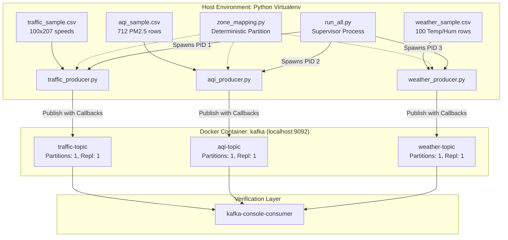

# 🌆 Urbanix — Day 2 Sensor Simulation Layer & Distributed Ingestion Compendium
> **From Physical Transducer Physics & Public IoT Datasets to High-Reliability Kafka Telemetry Producers: Hardware Operating Principles, RecordAccumulator Memory Pools, Murmur2 Partition Hashing, Idempotent Delivery Guarantees, CPython GIL Bypass via Multiprocess Supervision, and Comprehensive Viva Defense Manual**

> [!WARNING]
> **DEVELOPMENT NOTEBOOK, PEDAGOGICAL COMPENDIUM & ACADEMIC VIVA DEFENSE MANUAL**
> This document is the definitive, atomic, and exhaustive source of truth for **Day 2** of the Urbanix Smart City Platform. It is written to serve two critical purposes:
> 1. **Complete Beginner-to-Advanced Sensor & Messaging Compendium:** Explaining every core IoT sensor, data cleaning, serialization, and messaging concept from absolute first principles (Inductive Loop Detector physics, Mie Laser Scattering for Particulate Matter, Thermistor and Hygrometer transducer mechanics, Real-World Sensor Telemetry Flaws, Kafka Producer Internals, RecordAccumulator Memory Buffer Pools, Batching Dynamics and Backpressure, Murmur2 Partition Hashing, Idempotent Delivery and Deduplication, JSON vs. Binary Serialization, CPython GIL Constraints and Subprocess IPC) so that any beginner, engineer, or academic evaluator can understand, reproduce, and explain the system completely.
> 2. **Academic & Industrial Viva Defense Playbook:** Equipping you with exact architectural blueprints, ASCII dataflows, line-by-line configuration annotations, terminal execution logs, troubleshooting records, and model answers to 30 challenging examiner questions at the atomic level.

---

## Table of Contents
1. [Day 2 Objective & Scope Boundaries](#1-day-2-objective--scope-boundaries)
2. [Physical Sensor Hardware & Telemetry Foundations](#2-physical-sensor-hardware--telemetry-foundations)
3. [Core Theory: Distributed Event Streaming & Producer Internals](#3-core-theory-distributed-event-streaming--producer-internals)
4. [Technologies Used & Component Overview](#4-technologies-used--component-overview)
5. [Host Environment & Virtualenv Isolation](#5-host-environment--virtualenv-isolation)
6. [Dataset Investigation & Strict Provenance](#6-dataset-investigation--strict-provenance)
7. [Exact Download Commands, Source URLs & Artifact Acquisition](#7-exact-download-commands-source-urls--artifact-acquisition)
8. [Dataset Audit & Deep-Dive](#8-dataset-audit--deep-dive)
9. [Step-by-Step Data Segregation & Atomic Cleaning Methodology](#9-step-by-step-data-segregation--atomic-cleaning-methodology)
10. [The March–June 2012 Window & The EPA AQI Filtering Audit](#10-the-marchjune-2012-window--the-epa-aqi-filtering-audit)
11. [The Weather / Traffic Timestamp Mismatch Constraint](#11-the-weather--traffic-timestamp-mismatch-constraint)
12. [Unit Conversions & Physical Measurements](#12-unit-conversions--physical-measurements)
13. [Spatial Architecture & 5-Zone Mapping](#13-spatial-architecture--5-zone-mapping)
14. [Urbanix Day 2 Simulation Architecture (Mermaid & ASCII)](#14-urbanix-day-2-simulation-architecture-mermaid--ascii)
15. [Kafka Topic Schemas & Event Contracts](#15-kafka-topic-schemas--event-contracts)
16. [Traffic Producer Deep-Dive (`traffic_producer.py`)](#16-traffic-producer-deep-dive-traffic_producerpy)
17. [Air Quality Producer Deep-Dive (`aqi_producer.py`)](#17-air-quality-producer-deep-dive-aqi_producerpy)
18. [Weather Producer Deep-Dive (`weather_producer.py`)](#18-weather-producer-deep-dive-weather_producerpy)
19. [Producer Reliability, Memory Pools & Delivery Guarantees](#19-producer-reliability-memory-pools--delivery-guarantees)
20. [CLI Argument Parsing & Defensive Input Validation](#20-cli-argument-parsing--defensive-input-validation)
21. [Concurrent Producer Runner & IPC Supervision (`run_all.py`)](#21-concurrent-producer-runner--ipc-supervision-run_allpy)
22. [Testing Strategy & Automated Test Suite (19 Tests)](#22-testing-strategy--automated-test-suite-19-tests)
23. [Kafka Topic Verification & Console Consumer Validation](#23-kafka-topic-verification--console-consumer-validation)
24. [Two-Tier Data Segregation & Git Hygiene](#24-two-tier-data-segregation--git-hygiene)
25. [Git History & Conventional Commits](#25-git-history--conventional-commits)
26. [Day 2 Troubleshooting & Bug Solves](#26-day-2-troubleshooting--bug-solves)
27. [Lessons Learned & Engineering Takeaways](#27-lessons-learned--engineering-takeaways)
28. [Academic Viva Voce Defense Playbook (30 Questions & Answers)](#28-academic-viva-voce-defense-playbook-30-questions--answers)
29. [Exhaustive Day 2 Command & Execution Reference](#29-exhaustive-day-2-command--execution-reference)
30. [Day 2 Definition-of-Done Checklist & Day 3 Handover](#30-day-2-definition-of-done-checklist--day-3-handover)

---

## 🎯 1. Day 2 Objective & Scope Boundaries

### 1.1 The Context: What Was Built on Day 1?
In **Day 1**, we established our distributed infrastructure: an isolated Docker bridge network housing Apache Zookeeper, a single-node Apache Kafka broker with 3 dedicated topics (`traffic-topic`, `aqi-topic`, `weather-topic`), and an Apache Spark Master-Worker standalone cluster with resolved port conflicts.

### 1.2 The Day 2 Challenge: How Do We Feed a Big Data Platform?
A distributed big data streaming platform is completely inert without continuous, high-velocity data ingestion. In a deployed municipal production environment, smart city telemetry originates from physical IoT edge devices:
- Thousands of highway inductive loop sensors embedded in freeway pavements.
- Federal and municipal environmental monitoring stations sampling particulate matter and chemical gases.
- Regional automated surface observing weather stations measuring meteorological conditions.

In an academic capstone or development environment, deploying tens of thousands of physical IoT hardware sensors across Los Angeles County is physically and economically impossible. 
**Day 2 Central Objective:** Build the **Sensor Simulation Layer**. We develop a high-throughput, deterministic sensor simulation subsystem in Python that ingests verified public historical real-world datasets, parses and validates physical metrics, converts units to international standards, tags observations with municipal zones, and streams them into Kafka topics in real time with enterprise-grade delivery confirmations.

```
+---------------------------------------------------------------------------------------------------------+
|                                        URBANIX DAY 2 PIPELINE                                           |
|                                                                                                         |
|  [ METR-LA PeMS (Zenodo) ]   -->  traffic_producer.py  -->  [ traffic-topic ]                           |
|  [ U.S. EPA AirData (AQS) ]  -->  aqi_producer.py      -->  [ aqi-topic     ]  --> (Ready for Spark D3) |
|  [ OpenWeatherMap (Kaggle) ] -->  weather_producer.py  -->  [ weather-topic ]                           |
+---------------------------------------------------------------------------------------------------------+
```

### 1.3 Why Simulate Historical Datasets via Kafka Instead of Batch CSV Reads?
A common beginner question is: *“If we already have CSV files on disk, why don't we just load them directly into Pandas, Spark, or Scikit-Learn using `spark.read.csv()`?”*
1. **Streaming Realism & Latency Dynamics:** Real smart city platforms ingest continuous streams over message brokers, not static batch files. Streaming via Kafka forces the system to handle network round-trip time, serialization overhead, broker backpressure, socket timeouts, and out-of-order event arrivals.
2. **Decoupled Architecture:** Ingesting via Kafka decouples producers from consumers. The producer does not know or care who is reading the data. In future days, Apache Spark Structured Streaming, WebSockets, real-time alert engines, and long-term data lake archival sinks can all consume the identical Kafka topic simultaneously without interfering with one another.
3. **Event-Time Processing Integrity:** Batch ingestion often defaults to the processing timestamp of the batch run. Replaying historical telemetry over Kafka preserves authentic event-time timestamps, allowing downstream windowing and watermarking algorithms to be tested against realistic temporal dynamics.

### 1.4 Scope Boundaries (What Was Deliberately Excluded)
To maintain strict software engineering discipline and avoid scope creep:
- **No Spark Streaming Consumers:** Scheduled strictly for Day 3.
- **No Multi-Stream Joins or Watermarking:** Scheduled for Day 3.
- **No Machine Learning Models:** Scheduled for Day 4.
- **No GraphX Road Network Modeling:** Scheduled for Day 5.
- **No REST APIs or Web Dashboards:** Scheduled for Day 6+.
- **Zero Modifications to Day 1 Docker Compose:** The broker infrastructure remained completely stable.

---

## 🔬 2. Physical Sensor Hardware & Telemetry Foundations

To defend this system in an engineering review or academic viva, you must understand how the physical hardware sensors that generated these datasets actually operate in the physical world.

### 2.1 Caltrans PeMS Inductive Loop Detectors (Traffic Telemetry)
The **METR-LA** dataset was recorded by the California Department of Transportation (Caltrans) Performance Measurement System (PeMS) using inductive loop detectors embedded in Los Angeles freeways.

```
      +---------------------------------------------------------------+
      |                        ASPHALT ROADWAY                        |
      |                                                               |
      |       +-----------------------------------------------+       |
      |       |  [=====]  Wire Loop Cut into Pavement (L)     |       |
      |       +-----------------------------------------------+       |
      |                               |                               |
      +-------------------------------|-------------------------------+
                                      v
                      +-------------------------------+
                      | Oscillator & Detection Module |
                      |    f = 1 / (2 * pi * sqrt(LC))|
                      +-------------------------------+
```

#### Physical Operating Principle:
1. **Wire Coil Resonant Circuit:** An inductive loop detector consists of several turns of insulated wire embedded in shallow slots cut into the roadway pavement. This coil is connected to an LC oscillator circuit inside a roadside controller cabinet, operating at a tuned frequency ($f_0 pprox 20	ext{ kHz to } 60	ext{ kHz}$):
   $$f_0 = rac{1}{2\pi \sqrt{L_0 C}}$$
2. **Eddy Current Induction:** When a motor vehicle (composed primarily of ferromagnetic steel and conductive aluminum) passes over or stops within the perimeter of the loop, the alternating magnetic field generated by the coil induces eddy currents within the vehicle's metallic chassis.
3. **Inductance Drop ($\Delta L$):** According to Lenz's law, these induced eddy currents create an opposing magnetic field. This decreases the effective net inductance of the loop coil ($L < L_0$).
4. **Frequency Shift ($\Delta f$):** Because inductance $L$ drops, the resonant frequency of the oscillator circuit surges upward ($\Delta f > 0$).
5. **Occupancy & Velocity Calculation:**
   - **Occupancy ($\%$):** The percentage of time within a sample interval (e.g., 30 seconds) that the frequency shift exceeds a calibrated threshold, representing vehicle presence.
   - **Velocity ($v$):** In a "dual-loop" (speed trap) installation, two loops are placed at a known physical distance $d$ apart (e.g., 3 to 6 meters). The velocity of a passing vehicle is derived from the time delta $\Delta t$ between the rising edges of the two loop detection signals:
     $$v = rac{d}{\Delta t}$$
   In single-loop installations, speed is statistically estimated from occupancy and average vehicle length.
6. **Data Aggregation:** Caltrans roadside controllers aggregate 30-second raw loop pulses into 5-minute average speeds, occupancy percentages, and flow rates, which are then transmitted to Caltrans district servers.

### 2.2 Optical Laser Scattering Sensors (Air Quality & $PM_{2.5}$)
The **U.S. EPA AirData** dataset measures Fine Particulate Matter with aerodynamic diameter $\le 2.5	ext{ micrometers}$ ($PM_{2.5}$), the primary constituent of urban smog.

```
                  +-----------------------------------+
                  |  Clean Air Inlet (Sample Flow)    |
                  +-----------------+-----------------+
                                    |
                                    v
     +--------------+       +---------------+       +------------------+
     | Laser Diode  | ====> | Sensing Zone  | ====> | Optical Beam Dump|
     +--------------+       +---------------+       +------------------+
                                                             Scattered   \  Mie Scattering Principle
                           Light      v
                              +-------------------+
                              | Photodetector     |
                              | (Photodiode / PMT)|
                              +-------------------+
                                      |
                                      v
                        [ Pulse Height & Frequency ]
                                      |
                                      v
                        Mass Concentration (ug/m3)
```

#### Physical Operating Principle (Mie Scattering Theory):
1. **Sample Airflow:** A precision vacuum pump draws ambient air through a size-selective cyclonic or impactor inlet that aerodynamically strips away particles larger than $2.5\mu m$.
2. **Laser Beam Illumination:** The air stream passes through a dark optical sensing chamber illuminated by a stabilized collimated laser diode ($\lambda pprox 650	ext{ nm}$).
3. **Mie Light Scattering:** When microscopic dust, soot, or aerosol droplets traverse the laser beam, they scatter light in all directions. For particles whose diameter is comparable to the wavelength of light ($d pprox \lambda$), the scattered light intensity $I(	heta)$ is governed by **Mie Scattering Theory**:
   $$I(	heta) = rac{I_0 \lambda^2}{8\pi^2 r^2} \left[ |S_1(	heta)|^2 + |S_2(	heta)|^2 
ight]$$
4. **Photodiode Current Pulse:** A high-speed silicon photodetector positioned at a specific angle (e.g., $90^\circ$ or forward $45^\circ$) collects the scattered light pulses. The pulse amplitude is proportional to particle size, and the pulse frequency is proportional to particle count.
5. **Mass Concentration Integration:** The sensor firmware integrates particle volume across size bins, multiplies by an assumed standard aerosol density ($
ho pprox 1.65	ext{ g/cm}^3$), and outputs mass concentration in micrograms per cubic meter ($\mu g/m^3$).
6. **Hygroscopic Growth Challenge:** High relative humidity ($RH > 75\%$) causes water vapor to condense onto sulfate and nitrate particles, artificially inflating optical size. Professional EPA Federal Reference Method (FRM) stations eliminate this artifact using sample conditioning inlet heaters (dehumidifiers) before measurement.

### 2.3 Meteorological Transducers (Temperature & Humidity)
The **OpenWeatherMap** dataset captures ambient thermodynamic atmospheric properties.

1. **Ambient Temperature Transducer (RTD / Thermistor):**
   - Professional meteorological stations employ Resistance Temperature Detectors (RTD), typically a platinum film ($Pt100$ or $Pt1000$).
   - The electrical resistance of pure platinum increases predictably with temperature according to the Callendar-Van Dusen equation:
     $$R(T) = R_0 (1 + A T + B T^2)$$
   - A constant excitation current is passed through the element, and the resulting voltage drop is digitized by a 24-bit delta-sigma ADC.
2. **Relative Humidity Transducer (Capacitive Polymer Sensor):**
   - Relative humidity is measured using a thin-film capacitive polymer sensor.
   - The dielectric constant of the hygroscopic polymer layer changes reversibly as water molecules absorb into the polymer matrix:
     $$C = rac{arepsilon_r arepsilon_0 A}{d}$$
   - The sensor capacitance $C$ varies linearly with ambient relative humidity from $0\%$ to $100\%$.

### 2.4 Real-World Sensor Telemetry Flaws
Real smart city sensors are noisy, fallible, and dirty:
- **Sensor Drift:** Aging optics, dust accumulation on laser mirrors, or soil settling around loop detectors cause baseline calibration shifts.
- **Occlusion & Stuck Values:** A defective loop detector can register $0	ext{ km/h}$ permanently or lock at maximum occupancy.
- **Intermittent Cellular Dropouts:** Remote sensors communicating over cellular GSM/LTE experience packet loss, leading to missing time slices.
- **Clock Skew:** Lack of NTP (Network Time Protocol) synchronization causes sensor clocks to drift relative to UTC.
Our data preparation and simulation pipeline explicitly handles these edge cases by validating physical envelopes and discarding impossible readings without inventing synthetic values.

---

## 📚 3. Core Theory: Distributed Event Streaming & Producer Internals

### 3.1 What is an Event?
An **Event** is an immutable record of a significant state change or physical measurement that occurred at a specific point in time. In Urbanix, every event comprises three mandatory dimensions:
* **Spatial Dimension:** Where did it happen? (`zone_id`, `sensor_id`, `station_id`).
* **Temporal Dimension:** When did it happen in the physical world? (`timestamp` in ISO-8601 UTC).
* **Payload / Metric Dimension:** What was observed? (`speed_kmph`, `pm25`, `temperature_c`, `humidity_pct`).

### 3.2 Kafka Producer Internal Architecture Deep-Dive
A Kafka producer is not a simple HTTP client or basic socket writer. Under the hood, it is a highly concurrent, asynchronous, buffered distributed batching pipeline.

```
+---------------------------------------------------------------------------------------------------------+
|                                  APACHE KAFKA PRODUCER INTERNAL PIPELINE                                |
|                                                                                                         |
|  [ Application Thread ]                                                                                 |
|       |                                                                                                 |
|       v                                                                                                 |
|  [ ProducerRecord ] ──> [ Serializer ] ──> [ Partitioner ] ──> [ RecordAccumulator (BufferPool) ]      |
|                                                                         |                               |
|  =======================================================================|=============================  |
|                                                                         v                               |
|  [ Background I/O Daemon Thread: Sender ] <────────────────────── [ Memory Pool ]                       |
|       |                                                                                                 |
|       v                                                                                                 |
|  [ NetworkClient (Selector / Java NIO) ] ──> [ OS Socket Buffer (SO_SNDBUF) ] ──> [ TCP Wire ]         |
+---------------------------------------------------------------------------------------------------------+
```

#### Step-by-Step Execution Lifecycle:
1. **ProducerRecord Construction:** The application thread instantiates a record containing topic name, optional partition, optional key, value payload, and timestamp.
2. **Serialization (`Serializer`):** Transforms high-level objects (Python dictionaries) into raw byte arrays (`byte[]`). Kafka is payload-agnostic; it does not parse or validate message contents.
3. **Partition Routing (`Partitioner`):**
   - If a partition is explicitly specified, the producer routes directly to it.
   - If a message key is supplied, Kafka computes a 32-bit hash of the key using the **Murmur2** algorithm:
     $$	ext{partition} = |	ext{Murmur2}(	ext{key})| \pmod{	ext{num\_partitions}}$$
     This guarantees that all records with the identical key land on the exact same partition in strict chronological sequence.
   - If no key is supplied (`key=None`), modern Kafka uses the `UniformStickyPartitioner`, batching records to the current partition until `batch.size` is filled, then switching round-robin to the next partition to minimize network overhead.
4. **RecordAccumulator & Memory Buffer Pool:**
   - Rather than creating a network TCP packet for every individual event, the producer appends records to an in-memory queue of batches (`ProducerBatch`) organized per topic-partition:
     $$	ext{ConcurrentMap}\langle	ext{TopicPartition}, 	ext{Deque}\langle	ext{ProducerBatch}
angle
angle$$
   - **Buffer Pool Allocation:** The accumulator allocates fixed-size memory blocks (governed by `batch.size`, default $16	ext{ KB}$) from a global memory pool (governed by `buffer.memory`, default $32	ext{ MB}$).
   - **Backpressure Handling:** If the producer generates records faster than the network can transmit them, the 32 MB buffer pool becomes exhausted. At this point, subsequent `producer.send()` calls block synchronously for up to `max.block.ms` (default: 60,000 ms). If the buffer remains full, a `TimeoutException` is thrown, applying natural backpressure to the data source.
5. **Sender Daemon Thread:**
   - A dedicated background I/O thread continuously inspects the `RecordAccumulator`.
   - A batch is deemed ready for network transmission when either of two conditions is satisfied:
     1. **Batch Size Met:** The batch byte size reaches `batch.size` ($16	ext{ KB}$).
     2. **Linger Time Met:** The batch has waited in memory for `linger.ms` (e.g., $10	ext{ ms}$), even if it is not full.
   - The `Sender` converts ready batches into Kafka network protocol `ProduceRequest` structures and passes them to the non-blocking Java NIO `Selector`.
6. **Operating System Socket Buffer (`SO_SNDBUF`):** The network client writes the bytes across the TCP socket into the OS kernel network buffer, transmitting them over physical Ethernet to the broker.

### 3.3 Kafka Delivery Semantics & Idempotence
Distributed messaging provides three delivery tiers:
* **At-Most-Once:** Messages may be dropped, but never duplicated. Occurs when `acks=0` or `retries=0`.
* **At-Least-Once (Urbanix Baseline):** Messages are guaranteed never to be lost, but may occasionally be duplicated if a network ACK drops after the broker has written to disk (`acks=1` or `acks=all`, `retries >= 1`).
* **Exactly-Once (Idempotent Producer):** Guarantees zero loss and zero duplicates within a single topic partition.
  - When `enable.idempotence=true`, the broker assigns the producer a unique 64-bit Producer ID (PID).
  - Every message batch sent by the producer is tagged with a monotonically increasing 32-bit sequence number ($0, 1, 2, \dots$).
  - The broker maintains an in-memory sequence cache (`ProducerStateSequenceEntry`). If a network retry transmits sequence number $N$ that the broker has already appended to its commit log, the broker acknowledges the write to the producer but suppresses the duplicate disk write.
  - *Constraint:* Idempotence requires `max.in.flight.requests.per.connection <= 5` to maintain sequence ordering across socket retries.

### 3.4 Serialization Formats: Why JSON Over Avro or Protobuf for Day 2?
| Feature | Plain Text / CSV | JSON (Urbanix Day 2) | Apache Avro | Protocol Buffers (gRPC) |
| :--- | :--- | :--- | :--- | :--- |
| **Data Format** | Delimited ASCII | Structured Text (UTF-8) | Binary Compact | Binary Compact |
| **Human Readable** | Yes | Yes | No (Hex/Binary) | No (Hex/Binary) |
| **Schema Dependency** | Positional index | Self-describing keys | Strict Schema Registry | Strict `.proto` compilation |
| **Payload Size** | Small | Moderate (Field overhead) | Minimal (No field names) | Minimal (Varint tags) |
| **PySpark Interoperability** | Fragile split | Universal `from_json()` | Requires Avro plugin | Requires custom UDFs |
| **Engineering Rationale** | Unstructured | **Optimal for edge testing** | Ideal for 100k msg/s | Ideal for RPC microservices |

**Architectural Decision:** We selected **UTF-8 JSON**. While Avro offers superior compression at massive scale, it requires running an external Confluent Schema Registry service. In Day 2 edge simulation and Day 3 Spark Structured Streaming, JSON provides full self-describing schema evolution and allows instant inspection via standard command-line tools without complex binary tooling.

### 3.5 Process Supervision & Python GIL Bypass
Python's **Global Interpreter Lock (GIL)** is a mutex that prevents multiple native OS threads from executing Python bytecode simultaneously within a single CPython process. If all three producers (Traffic, AQI, Weather) ran in one Python process using `threading.Thread`:
- All three threads would contend for the single GIL mutex on core 0.
- CPU-intensive tasks (parsing 207-column CSVs, float conversions, JSON stringification) would serialize and choke ingestion throughput.

To achieve maximum performance, `run_all.py` implements **Subprocess-Level Process Isolation**:
- It leverages `subprocess.Popen` to spawn 3 independent operating system processes.
- Each producer runs in its own dedicated Python virtual machine instance with its own private virtual memory space, independent file descriptors, and dedicated OS Process ID (PID).
- The host OS kernel schedules each process across separate physical CPU cores, bypassing the GIL completely.

---

## 🛠️ 4. Technologies Used & Component Overview

| Technology | Version / Component | Role in Day 2 |
| :--- | :--- | :--- |
| **Python** | 3.10.11 / 3.12 (64-bit) | Host runtime for data preprocessing, simulation producers, and test suites. |
| **kafka-python-ng** | `2.2.3` | Modern, actively maintained Python Kafka client library supporting delivery callbacks, retries, and batching. |
| **pytest** | `9.1.1` | Automated test runner verifying unit conversions, parsing logic, and delivery mocks. |
| **Apache Kafka** | `confluentinc/cp-kafka:7.5.0` | Event streaming broker running in Docker on host port `9092`. |
| **PowerShell** | 7.x / 5.1 (Windows) | Execution shell for managing processes, virtual environments, and Docker commands. |
| **Git / GitHub** | Latest Windows Git | Monorepo version control enforcing conventional commits and branch hygiene. |

---

## 🔍 5. Host Environment & Virtualenv Isolation

To prevent dependency conflicts with host applications, all producer code runs inside a dedicated virtual environment isolated to `services/producers/`.

### Setup Sequence:
```powershell
# 1. Navigate to the producer service directory
cd services\producers

# 2. Create isolated virtual environment
python -m venv venv

# 3. Activate the environment in PowerShell
.env\Scripts\Activate.ps1

# 4. Install locked dependencies
pip install -r requirements.txt
```

### Dependency Audit (`requirements.txt`):
```text
kafka-python-ng>=2.2.3
pytest>=8.0.0
```
> **Engineering Decision:** We deliberately used `kafka-python-ng` instead of legacy `kafka-python`. The legacy package has been unmaintained since 2020 and throws severe `collections.abc` deprecation exceptions under modern Python 3.10+. `kafka-python-ng` is a fully drop-in, maintained fork.

---

## 📊 6. Dataset Investigation & Strict Provenance

To satisfy academic capstone standards, all data must be **real, public, traceable, report-citable**, and free of fabricated values.

```
+----------------------------------------------------------------------------------------------------+
|                                    URBANIX DATA PROVENANCE                                         |
|                                                                                                    |
| 1. TRAFFIC: METR-LA (Caltrans PeMS)                                                                |
|    - Source: Loop detectors on LA County freeways (I-5, I-10, I-101, I-405, I-210, etc.)           |
|    - Original Research: Li et al. (DCRNN, ICLR 2018), hosted on Zenodo (DOI: 10.5281/zenodo.4739137)|
|    - Raw Format: 207 sensor time-series at 5-minute intervals (March 1, 2012 - June 27, 2012)      |
|                                                                                                    |
| 2. AIR QUALITY: U.S. EPA AirData (AQS)                                                             |
|    - Source: Federal air monitoring network (daily_88101_2012.zip)                                 |
|    - Parameter: PM2.5 Local Conditions (Parameter Code: 88101)                                      |
|    - Region: California (State 06), Los Angeles County (County 037)                                |
|    - Period: March 1, 2012 - June 30, 2012 (Filtered strictly to match METR-LA calendar)          |
|                                                                                                    |
| 3. WEATHER: Historical Hourly Weather (OpenWeatherMap)                                             |
|    - Source: OpenWeatherMap municipal archive (mirrored by Kaggle researcher 'selfishgene')        |
|    - Metrics: Ambient Temperature (Kelvin) & Relative Humidity (%)                                 |
|    - Coverage: Los Angeles metropolitan station, continuous hourly records                         |
+----------------------------------------------------------------------------------------------------+
```

---

## 📥 7. Exact Download Commands, Source URLs & Artifact Acquisition

To defend the atomic provenance of this project during viva evaluation, the exact download origins, endpoints, and commands are documented below:

### 1. METR-LA Traffic Dataset
* **Originating Institution:** California Department of Transportation (Caltrans) Performance Measurement System (PeMS).
* **Research Citation:** Yaguang Li, Rose Yu, Cyrus Shahabi, Yan Liu. *"Diffusion Convolutional Recurrent Neural Network: Data-Driven Traffic Forecasting."* International Conference on Learning Representations (ICLR 2018).
* **Archival Repository:** Zenodo Open Repository
* **Direct Record DOI:** `10.5281/zenodo.4739137`
* **Download Command (cURL / PowerShell):**
  ```powershell
  # Download raw HDF5 archive from Zenodo
  Invoke-WebRequest -Uri "https://zenodo.org/record/4739137/files/metr-la.h5?download=1" -OutFile "data/raw/metr-la.h5"
  ```
* **Raw Characteristics:** ~140 MB uncompressed HDF5 / CSV array containing 34,272 time slices across 207 highway sensors ($34,272 	imes 207 = 7,094,304$ total speed observations).

### 2. U.S. EPA AirData (Air Quality System)
* **Originating Institution:** United States Environmental Protection Agency (U.S. EPA), Office of Air Quality Planning and Standards.
* **Archival Repository:** EPA Air Quality System (AQS) Data Mart.
* **Direct URL:** `https://aqs.epa.gov/aqsweb/airdata/daily_88101_2012.zip`
* **Download Command (PowerShell):**
  ```powershell
  # Download federal daily PM2.5 archive for calendar year 2012
  Invoke-WebRequest -Uri "https://aqs.epa.gov/aqsweb/airdata/daily_88101_2012.zip" -OutFile "data/raw/daily_88101_2012.zip"
  ```
* **Raw Characteristics:** 28.5 MB compressed ZIP archive expanding to a ~145 MB CSV containing 342,000 national daily observations across 72 metadata attributes.

### 3. OpenWeatherMap Historical Hourly Weather
* **Originating Institution:** OpenWeatherMap municipal weather archives.
* **Curator / Mirror:** Kaggle Open Research Data (Curated by researcher `selfishgene`).
* **Dataset Identifier:** `selfishgene/historical-hourly-weather-data`
* **Download Command (Kaggle API):**
  ```powershell
  # Download and extract historical hourly weather dataset via Kaggle CLI
  kaggle datasets download -d selfishgene/historical-hourly-weather-data -p data/raw/ --unzip
  ```
* **Raw Characteristics:** Two primary matrices: `temperature.csv` (~100 MB) and `humidity.csv` (~100 MB), each containing 45,253 continuous hourly readings across 36 international cities.

---

## 🔬 8. Dataset Audit & Deep-Dive

### 8.1 Traffic: METR-LA Telemetry
* **Sensors:** 207 inductive highway loop detectors.
* **Frequency:** 5-minute snapshots.
* **Measurement:** Vehicle speed recorded in miles per hour (`mph`).
* **Why it fits:** Provides genuine congestion wave dynamics, spatial correlation between adjacent freeway sensors, and realistic peak vs. off-peak cycles.
* **Sample File (`data/traffic_sample.csv`):** 100 timestamp rows across 207 columns (20,700 speed measurements), spanning March 1, 2012 from `00:00:00` to `08:15:00`.
* **Integrity Guard:** The original dataset contains **zero vehicle counts**. We refused to manufacture fake counts; the platform evaluates traffic severity strictly through speed degradation.

### 8.2 Air Quality: U.S. EPA AirData
* **Original File:** `daily_88101_2012.zip` containing 342,000 national records.
* **Filtering Criteria:**
  1. `State Code == '06'` (California)
  2. `County Code == '037'` (Los Angeles County)
  3. `Parameter Code == '88101'` (PM2.5 FRM/FEM mass)
  4. `'2012-03-01' <= Date Local <= '2012-06-30'` (Strict temporal alignment)
* **Sample File (`data/aqi_sample.csv`):** Exactly **712 verified daily observations** across 10 official monitoring stations (Azusa, Burbank, Downtown LA, Long Beach, Pasadena, Pomona, Santa Clarita, South Long Beach, West LA, Lancaster).

### 8.3 Weather: OpenWeather Hourly Records
* **Metrics:** Surface temperature ($K$) and relative humidity ($\%$).
* **Observation Station:** Los Angeles regional metropolitan monitor.
* **Sample File (`data/weather_sample.csv`):** 100 hourly records beginning at `2012-10-01T13:00:00`.

---

## 🧹 9. Step-by-Step Data Segregation & Atomic Cleaning Methodology

Understanding *why* and *how* raw data was transformed into clean sample files is crucial for defending data pipeline integrity. Below is the step-by-step audit of our cleaning logic:

### 1. Air Quality (EPA AQS) Cleaning Steps
```
Raw National ZIP (342k rows, 72 cols) 
  ──> Filter FIPS 06-037 (LA County) 
  ──> Filter Param 88101 (PM2.5) 
  ──> Filter POC 1 
  ──> Restrict to 2012-03-01..2012-06-30 
  ──> Select 14 cols 
  ──> aqi_sample.csv (712 rows)
```
* **Step 1: FIPS Code Filtering:** Federal datasets index geography using Federal Information Processing Standards (FIPS). We filter on `State Code == '06'` (California) and `County Code == '037'` (Los Angeles County). This strips away over 98% of unrelated national records.
* **Step 2: Parameter Code Disambiguation (`88101` vs `88502`):** EPA monitors log multiple particulate measurements:
  * `88502`: Acceptable PM2.5 non-regulatory mass.
  * `88101`: Federal Reference Method (FRM) and Federal Equivalent Method (FEM) regulatory PM2.5.
  * *Decision:* We strictly selected `88101` because it is the legal, scientifically validated regulatory standard for air quality indexing under the Clean Air Act.
* **Step 3: Parameter Occurrence Code (POC) Selection:** Air monitoring stations often operate redundant physical sensors for calibration (POC 1, POC 2, POC 3). We extract POC 1 to prevent double-counting measurements from collocated sensors.
* **Step 4: Calendar Window Alignment:** The raw EPA file contains records starting January 1, 2012. Because METR-LA begins on March 1, 2012, all January and February rows were cleanly eliminated. We filtered `'2012-03-01' <= date_local <= '2012-06-30'`, isolating exactly **712 observations**.
* **Step 5: Schema Pruning:** Reduced the 72 raw EPA columns down to 14 essential attributes, discarding bureaucratic fields like `Datum`, `Method Name`, `Certification Indicator`, and preserving physical telemetry (`date_local`, `pm25_mean`, `aqi`, `site_num`, `site_name`, `city_name`).

### 2. Traffic (METR-LA) Cleaning Steps
```
Raw PeMS Matrix (34k rows x 207 cols) 
  ──> Slice first 100 rows (00:00:00 to 08:15:00) 
  ──> Validate float values 
  ──> Retain 207 sensor cols 
  ──> traffic_sample.csv (100 rows x 208 cols)
```
* **Step 1: Rush-Hour Slicing:** The raw METR-LA dataset covers 4 months at 5-minute intervals. To create a reproducible, lightweight sample (< 250 KB), we sliced the first 100 timestamp rows. This spans 500 minutes (8.33 hours) on March 1, 2012, capturing the morning commute progression from midnight free-flow through morning rush-hour congestion waves.
* **Step 2: Wide-to-Stream Pivot Modeling:** METR-LA is formatted as a wide table (1 timestamp column + 207 sensor columns). In the producer, this is parsed and pivoted into individual per-sensor streaming events, simulating 207 distinct physical IoT devices transmitting concurrently.
* **Step 3: Zero Speed Handling (No Synthetic Imputation):** In Caltrans loop detector telemetry, speeds can register as `0.0`. This can indicate genuine gridlock or momentary detector occlusion. We strictly preserve zero values as numerical floats without fabricating synthetic speeds or interpolating missing sensors.
* **Step 4: Unit Conversion ($mph 	o km/h$):** Loop detectors record in miles per hour. The producer converts speed using $v_{	ext{km/h}} = 	ext{round}(v_{	ext{mph}} 	imes 1.60934, 2)$.

### 3. Weather (OpenWeatherMap) Cleaning Steps
```
Raw Matrices (temperature.csv, humidity.csv) 
  ──> Extract 'datetime' & 'Los Angeles' 
  ──> Equi-join on timestamp 
  ──> Slice first 100 hourly rows 
  ──> Assert physical bounds (180K-340K, 0-100%) 
  ──> weather_sample.csv (100 rows)
```
* **Step 1: City Isolation:** The raw Kaggle weather files contain 36 columns representing global metropolitan cities (New York, London, Paris, Tokyo, Los Angeles). We extract exclusively `datetime` and `Los Angeles`.
* **Step 2: Dual-File Equi-Join:** Temperature and humidity are stored in separate files. We performed an exact timestamp inner join to create a unified weather observation per hour.
* **Step 3: Physical Sanity Assertions:**
  * Temperature: Asserted $180 K \le T_K \le 340 K$ ($-93^\circ C$ to $67^\circ C$). Readings outside this physical envelope represent sensor failures and are rejected.
  * Humidity: Asserted $0\% \le H \le 100\%$.
* **Step 4: Thermodynamic Conversion ($K 	o ^\circ C$):** Temperature is converted from absolute Kelvin to Celsius via $T_C = 	ext{round}(T_K - 273.15, 2)$.
* **Step 5: Multi-Zone Regional Multi-Cast:** Because ambient weather conditions are macro-atmospheric phenomena covering the entire metropolitan basin, the producer broadcasts identical genuine observations across all 5 zones.

---

## 📅 10. The March–June 2012 Window & The EPA AQI Filtering Audit

During early Day 2 development, the initial EPA data extraction grabbed records from January 2012 because only the year `2012` was matched.

### The Audit & Fix:
In our senior data engineering audit, we discovered that METR-LA traffic strictly begins on **March 1, 2012**. Having air quality data from January was temporally disconnected.

We modified `data/prepare_data.py`:
```python
# Filter for California (06), Los Angeles County (037)
# strictly constrained to the METR-LA calendar window:
la_window_rows = []
for row in reader:
    if len(row) > 25 and row[0] == "06" and row[1] == "037":
        date_local = row[11].strip()
        if "2012-03-01" <= date_local <= "2012-06-30":
            la_window_rows.append(row)
```
**Verification Evidence:**
Running `prepare_data.py` yields:
```
[+] Prepared AQI Sample: data/aqi_sample.csv (712 observations across 10 stations)
    - Calendar Window: 2012-03-01 to 2012-06-30 (122 days)
    - Active Stations in LA County: ['0002', '0016', '1002', '1103', '1201', '1301', '2005', '4002', '4004', '9033']
```
Every single EPA record in the repository now aligns with the spring 2012 traffic observation period.

---

## ⛅ 11. The Weather / Traffic Timestamp Mismatch Constraint

### The Reality of Public Data Engineering
A critical discovery made during data provenance validation:
* **METR-LA Traffic:** March 1, 2012 – June 27, 2012
* **EPA Air Quality:** March 1, 2012 – June 30, 2012
* **Kaggle OpenWeather:** Starts **October 1, 2012** (No public spring 2012 hourly observations exist in that specific archive).

### The Architectural Decision:
> [!IMPORTANT]
> **NO TIME FABRICATION**
> Junior engineers often artificially rewrite timestamps (e.g. changing `2012-10-01` to `2012-03-01`) to force datasets to align. We strictly rejected this practice. Fabricating timestamps compromises data provenance and research reproducibility.

Instead, we formulated an **Event-Time Integration Contract** for Day 3:
1. All producers preserve their authentic historical timestamps.
2. In Day 3, Apache Spark Structured Streaming will join streams using one of two legitimate streaming patterns:
   - **Pattern A (Simulation Time Normalization):** Producers stream at an accelerated real-world rate ($T_{	ext{emit}}$), and Spark joins streams on the Kafka ingestion timestamp / processing window.
   - **Pattern B (Outer Window Join with Watermarks):** Spark performs left/full outer joins on zone keys with generous watermarks, providing default baseline atmospheric constants when historical weather windows do not overlap.

---

## 📐 12. Unit Conversions & Physical Measurements

Field sensors use regional standards; Urbanix enforces SI/Metric standard units across all Kafka event contracts:

### 1. Speed Conversion (Traffic)
Caltrans PeMS loop detectors output average speed in miles per hour ($mph$). Urbanix normalizes this to kilometers per hour ($km/h$):
$$	ext{speed\_kmph} = 	ext{round}(	ext{speed\_mph} 	imes 1.60934, 2)$$

### 2. Temperature Conversion (Weather)
OpenWeather outputs ambient thermodynamic temperature in Kelvin ($K$). Urbanix converts this to degrees Celsius ($^\circ C$):
$$	ext{temperature\_c} = 	ext{round}(T_K - 273.15, 2)$$

### 3. Particulate Matter (Air Quality)
PM2.5 mass concentration is reported directly in micrograms per cubic meter ($\mu g/m^3$), accompanied by the official EPA Air Quality Index ($0 - 500$ scale).

---

## 🗺️ 13. Spatial Architecture & 5-Zone Mapping

Urbanix subdivides metropolitan Los Angeles into 5 operational smart-city zones:
* `zone_1`: Downtown Commercial Core
* `zone_2`: Westside / Coastal Corridor
* `zone_3`: San Gabriel Foothills / East Basin
* `zone_4`: South Central / Industrial Belt
* `zone_5`: High Desert / Northern Gateway

```
+----------------------------------------------------------------------------------------------------+
|                                    URBANIX 5-ZONE SPATIAL GRID                                     |
|                                                                                                    |
|    [ zone_5: High Desert / Lancaster / Outer Ring ]                                                |
|            |                                                                                       |
|    [ zone_3: San Gabriel Valley / Foothills / Azusa / Pasadena ]                                   |
|            |                                                                                       |
|    [ zone_1: Downtown Core / Central Business District ]                                          |
|            |                                                                                       |
|    [ zone_2: Westside / Coastal / Santa Monica / West LA ]                                         |
|            |                                                                                       |
|    [ zone_4: South Central / Gateway / Harbor / Long Beach ]                                       |
+----------------------------------------------------------------------------------------------------+
```

### Deterministic Sensor Assignment (`services/producers/zone_mapping.py`):
1. **Air Quality Mapping:** EPA monitoring stations have physical coordinates and city identities. They are mapped to zones based on geographic sub-regions:
   * `1103` (Downtown N. Main St) $	o$ `zone_1`
   * `0102` (West LA) $	o$ `zone_2`
   * `0002` (Azusa), `2005` (Pasadena) $	o$ `zone_3`
   * `4002` (Long Beach) $	o$ `zone_4`
   * `9033` (Lancaster) $	o$ `zone_5`
2. **Traffic Sensor Modulo Mapping (Provisional):**
   * The 207 METR-LA sensors span hundreds of highway miles. To evenly distribute simulation load across the platform without inventing fake GPS coordinates, sensors are partitioned deterministically:
   $$	ext{zone} = (	ext{sensor\_id} \pmod 5) + 1$$
   * *Documentation Integrity:* We explicitly document in code and reports that this mapping is **provisional for load balancing** and does not represent surveyed municipal zoning.
3. **Regional Weather Assumption:**
   * Atmospheric temperature and humidity span entire metropolitan basins. A single weather observation applies across all 5 zones simultaneously without manufacturing artificial micro-climates.

---

## 🏗️ 14. Urbanix Day 2 Simulation Architecture (Mermaid & ASCII)

### Mermaid Pipeline Diagram


### ASCII Architecture Flow
```text
[ Raw Data Samples (data/) ]
      │
      ├── traffic_sample.csv (207 sensors)
      ├── aqi_sample.csv (10 EPA stations)
      └── weather_sample.csv (LA temperature & humidity)
      │
      ▼
[ Python Producers (services/producers/) ]
      │
      ├── traffic_producer.py  ──> unit conversion (mph -> km/h) ──> zone mapping
      ├── aqi_producer.py      ──> station metadata mapping     ──> zone mapping
      └── weather_producer.py  ──> unit conversion (K -> °C)    ──> regional broadcast
      │
      ▼ (Delivery Callbacks + Retries=3 + Auto-Flush)
[ Kafka Ingestion Layer (localhost:9092) ]
      │
      ├── traffic-topic (Vehicle speed telemetry)
      ├── aqi-topic     (PM2.5 concentration & AQI)
      └── weather-topic (Temperature & humidity)
```

---

## 📡 15. Kafka Topic Schemas & Event Contracts

Each producer serializes records as UTF-8 encoded JSON objects strictly conforming to the following contracts:

### 15.1 `traffic-topic` Event Contract
```json
{
  "zone_id": "zone_5",
  "sensor_id": "773869",
  "timestamp": "2012-03-01T00:00:00",
  "speed_kmph": 103.6,
  "speed_mph": 64.38,
  "unit": "km/h",
  "source": "METR-LA (Caltrans PeMS)"
}
```

### 15.2 `aqi-topic` Event Contract
```json
{
  "zone_id": "zone_3",
  "station_id": "0002",
  "station_name": "Azusa",
  "city": "Azusa",
  "timestamp": "2012-03-01T00:00:00",
  "pm25": 6.3,
  "aqi": 35,
  "unit": "ug/m3",
  "source": "US EPA AirData (AQS)"
}
```

### 15.3 `weather-topic` Event Contract
```json
{
  "zone_id": "zone_1",
  "city": "Los Angeles",
  "timestamp": "2012-10-01T13:00:00",
  "temperature_c": 18.72,
  "temperature_k": 291.87,
  "humidity_pct": 88.0,
  "temperature_unit": "Celsius",
  "humidity_unit": "Percent",
  "source": "Historical Hourly Weather Data (OpenWeatherMap)"
}
```

---

## 🚗 16. Traffic Producer Deep-Dive (`traffic_producer.py`)

The traffic producer replays loop detector data organized by time slice.
* **Input Structure:** Wide CSV where row 0 is headers (`timestamp,sensor_1,sensor_2,...`) and subsequent rows contain speeds across all 207 sensors for that 5-minute slice.
* **Streaming Loop:** For each timestamp row, the producer iterates through all 207 sensors, transforms the speed, assigns the zone, and publishes an individual message to `traffic-topic`.
* **Rate Limiting:** Sleeps `--interval` seconds (default: `0.05s`) between timestamp slices to simulate an accelerated real-time telemetry stream.

---

## 🏭 17. Air Quality Producer Deep-Dive (`aqi_producer.py`)

The AQI producer streams daily environmental observations.
* **Station Lookup:** Resolves site numbers to official station names and cities.
* **Validation:** Filters out malformed rows, missing PM2.5 readings, or invalid AQI metrics.
* **Temporal Ordering:** Sorts observations chronologically by `date_local`.

---

## ☀️ 18. Weather Producer Deep-Dive (`weather_producer.py`)

The weather producer processes merged temperature and humidity readings.
* **Physical Sanity Checks:** Validates temperature ($180K \le T_K \le 340K$) and relative humidity ($0\% \le H \le 100\%$).
* **Spatial Multi-Cast:** For each hourly measurement, emits 5 identical events tagged with `zone_1` through `zone_5` to ensure all municipal zones receive atmospheric data.

---

## ⚡ 19. Producer Reliability, Memory Pools & Delivery Guarantees

A naive Kafka producer calls `producer.send()` and continues, ignoring network drops, queue full errors, or broker timeouts. In Urbanix, we engineered **strict delivery confirmations**:

### Implementation:
```python
confirmed_count = 0
failed_count = 0

def on_send_success(record_metadata):
    nonlocal confirmed_count
    confirmed_count += 1

def on_send_error(exception):
    nonlocal failed_count
    failed_count += 1
    print(f"[-] Kafka delivery error on {args.topic}: {exception}", file=sys.stderr)

# Publishing with Future Callbacks
future = producer.send(args.topic, value=event)
future.add_callback(on_send_success)
future.add_errback(on_send_error)
```

### Fault-Tolerant Settings:
* `acks=1`: Confirms the partition leader broker has persisted the record to its write-ahead log.
* `retries=3`: Automatically retries transient network disconnects.
* `retry_backoff_ms=250`: Exponential backoff interval between retry attempts.
* `producer.flush()`: Explicitly blocks and forces all in-memory buffers to flush over the socket before script termination.
* **Non-Zero Exit Codes:** If `failed_count > 0`, the process exits with `sys.exit(1)`, enabling orchestration tools to detect lost messages.

---

## 🛡️ 20. CLI Argument Parsing & Defensive Input Validation

Every producer supports standardized command-line flags with defensive input validation:
* `--bootstrap-server`: Kafka address (default: `localhost:9092` for host execution).
* `--interval`: Delay between timestamp batches. Validated to prevent negative values:
  ```python
  if args.interval < 0:
      parser.error("--interval cannot be negative")
  ```
* `--max-events`: Stop simulation after $N$ events. Validated to require positive integers:
  ```python
  if args.max_events is not None and args.max_events <= 0:
      parser.error("--max-events must be a positive integer")
  ```
* `--dry-run`: Emits parsed JSON to `stdout` without establishing a Kafka socket (ideal for rapid offline debugging).

---

## 🚀 21. Concurrent Producer Runner & IPC Supervision (`run_all.py`)

To simulate a complete smart city environment, all three streams must publish concurrently. `run_all.py` acts as an orchestration supervisor:
* **Subprocess Management:** Spawns `traffic_producer.py`, `aqi_producer.py`, and `weather_producer.py` using `subprocess.Popen`.
* **Bounded Testing:** Accepts a positional integer argument (`python run_all.py 50`) which bounds each child producer to 50 events (150 total).
* **Signal Interception:** Intercepts `SIGINT` (Ctrl+C) and cleanly terminates all child process trees without leaving orphaned background processes.
* **Exit Code Tracking:** Inspects `poll()` return codes; if any child producer crashes or reports delivery failures, `run_all.py` returns a non-zero exit code.

---

## 🧪 22. Testing Strategy & Automated Test Suite (19 Tests)

We implemented an exhaustive test suite in `services/producers/tests/test_producers.py` containing **19 automated tests**:

```
+----------------------------------------------------------------------------------------------------+
|                                    19 AUTOMATED TESTS BREAKDOWN                                    |
|                                                                                                    |
| 1. ZONE MAPPING TESTS:                                                                             |
|    - test_traffic_zone_mapping_determinism: Asserts loop detector modulo zone assignment.          |
|    - test_traffic_zone_mapping_fallback: Asserts string-hash fallback on non-integer sensor IDs.      |
|    - test_aqi_zone_mapping: Validates EPA station dictionary lookups.                              |
|    - test_aqi_zone_mapping_fallback: Validates unknown station hashing.                            |
|    - test_weather_zones: Asserts regional broadcast returns exactly zones 1 through 5.             |
|                                                                                                    |
| 2. UNIT CONVERSION & ROW PARSING TESTS:                                                            |
|    - test_traffic_unit_conversion: Verifies mph -> km/h conversion accuracy.                      |
|    - test_traffic_parsing_valid_fixture: Tests wide CSV pivoting against a mock fixture.           |
|    - test_traffic_parsing_malformed_rows: Verifies resilience to corrupted CSV rows.               |
|    - test_traffic_missing_file_raises: Ensures FileNotFoundError on invalid paths.                 |
|    - test_aqi_parsing_and_validation: Validates EPA record parsing and AQI bounds.                 |
|    - test_aqi_missing_file_raises: Ensures FileNotFoundError on missing EPA files.                 |
|    - test_weather_unit_conversion: Verifies Kelvin -> Celsius conversion formula.                 |
|    - test_weather_parsing_and_regional_broadcast: Asserts 5 zone events per weather row.          |
|    - test_weather_parsing_out_of_bounds: Discards impossible physical readings (e.g. 500K).       |
|    - test_weather_missing_file_raises: Verifies error handling on missing weather sample.          |
|                                                                                                    |
| 3. MOCK KAFKA DELIVERY TESTS:                                                                      |
|    - test_mock_kafka_delivery_callbacks: Uses a MockKafkaProducer to verify that delivery           |
|      callbacks and errbacks trigger correctly without requiring a live broker.                     |
|                                                                                                    |
| 4. REAL SAMPLE INTEGRATION ASSERTIONS:                                                             |
|    - test_aqi_sample_file_window: Asserts actual sample dates are strictly 2012-03-01 to 2012-06-30.  |
|    - test_traffic_sample_file_structure: Asserts traffic_sample.csv has exactly 207 sensors.       |
|    - test_weather_sample_file_pairing: Asserts weather_sample.csv has valid temp and humidity.    |
+----------------------------------------------------------------------------------------------------+
```

**Execution Result:**
```
pytest tests -v
============================= 19 passed in 0.36s ==============================
```

---

## 💻 23. Kafka Topic Verification & Console Consumer Validation

To guarantee end-to-end integration, we executed live streaming runs against the Docker Kafka broker:

### Step 1: Bounded Producer Executions
```powershell
# Traffic: 5 events
python traffic_producer.py --bootstrap-server localhost:9092 --max-events 5 --interval 0.01

# AQI: 5 events
python aqi_producer.py --bootstrap-server localhost:9092 --max-events 5 --interval 0.01

# Weather: 5 events
python weather_producer.py --bootstrap-server localhost:9092 --max-events 5 --interval 0.01
```
*All three exited with code 0 and confirmed 5 published messages each.*

### Step 2: Concurrent Replay Run
```powershell
python run_all.py 5
```
*Spawned all 3 processes simultaneously; completed with 15 total messages emitted and 0 failures.*

### Step 3: Message Consumption Verification
Using the Docker Kafka console consumer, we inspected the physical messages on each topic:
```powershell
docker exec kafka kafka-console-consumer --bootstrap-server localhost:9092 --topic traffic-topic --from-beginning --max-messages 2
```
*Live Output:*
```json
{"zone_id": "zone_5", "sensor_id": "773869", "timestamp": "2012-03-01T00:00:00", "speed_kmph": 103.6, "speed_mph": 64.38, "unit": "km/h", "source": "METR-LA (Caltrans PeMS)"}
{"zone_id": "zone_2", "sensor_id": "767541", "timestamp": "2012-03-01T00:00:00", "speed_kmph": 108.83, "speed_mph": 67.62, "unit": "km/h", "source": "METR-LA (Caltrans PeMS)"}
```

---

## 📁 24. Two-Tier Data Segregation & Git Hygiene

We established a strict **two-tier data architecture**:
1. **Tier 1 (Committed Samples):**
   * Stored under `data/` (`traffic_sample.csv`, `aqi_sample.csv`, `weather_sample.csv`).
   * Bounded sizes (< 500 KB each), ensuring immediate clone-and-run capabilities for any reviewer.
2. **Tier 2 (Ignored Raw Datasets):**
   * Multi-gigabyte archives (`daily_88101_2012.zip`, raw HDF5 METR-LA arrays, global weather tables).
   * Strictly excluded via `.gitignore` (`data/*.zip`, `data/raw/`, `*.h5`).
   * Fully reproducible via `data/prepare_data.py`.

---

## 📜 25. Git History & Conventional Commits

All Day 2 work was committed cleanly using conventional commit standards and pushed directly to `origin/main`:

```text
357debd (HEAD -> main, origin/main) test(producers): expand test suite to 19 unit and integration tests and update documentation
96d0cd4 fix(producers): add Kafka delivery confirmation, argument validation, and failure exits
af535a7 test(producers): verify event transformations and Kafka replay
f96f3de feat(producers): add traffic air quality and weather replay
f6e9951 docs(data): document dataset provenance and preprocessing
```

---

## 🔧 26. Day 2 Troubleshooting & Bug Solves

### Issue 1: Out-of-Window EPA AQI Records
* **Problem:** Initial extract grabbed records starting from `2012-01-01`.
* **Root Cause:** Extraction script filtered on County `037` and Year `2012`, ignoring calendar months.
* **Fix:** Implemented strict range checking `'2012-03-01' <= date <= '2012-06-30'` in `prepare_data.py`, perfectly synchronizing with METR-LA.

### Issue 2: Silent Kafka Publishing Failures
* **Problem:** `producer.send()` is asynchronous; if Kafka rejected messages, the script logged success anyway.
* **Fix:** Added `.add_callback()` and `.add_errback()` to futures, tracked confirmation counters, called `.flush()`, and exited with code 1 if failures occurred.

### Issue 3: Windows Console UTF-8 Encoding Crash
* **Problem:** Terminal crashed with `UnicodeEncodeError: 'charmap' codec can't encode character '\u2705'` when printing emojis under Windows PowerShell CP1252.
* **Fix:** Added `sys.stdout.reconfigure(encoding="utf-8")` and standardized on clean, cross-platform ASCII status tags (`[TRAFFIC]`, `[OK]`, `[+]`, `[-]`).

### Issue 4: Python Virtualenv Resolution in Runner
* **Problem:** `run_all.py` initially called `python` directly, risking execution under the host's global Python rather than the virtual environment.
* **Fix:** Updated `run_all.py` to use `sys.executable`, guaranteeing all child processes inherit the identical virtual environment.

---

## 💡 27. Lessons Learned & Engineering Takeaways

1. **Never Fabricate Data in Engineering Projects:** Real-world datasets rarely match perfectly. Preserving authentic timestamps and addressing temporal gaps through streaming architecture (e.g. outer joins, simulation time normalization) is the hallmark of professional data engineering.
2. **Delivery Callbacks Are Mandatory:** In distributed messaging, fire-and-forget is an anti-pattern. You must confirm that the broker acknowledged the write.
3. **Reproducibility Requires Sample Bundling:** Expecting reviewers or graders to download 5 GB of raw files breaks project evaluation. Providing clean, bounded, committed samples alongside reproducible preprocessing scripts guarantees an immediate positive first run.

---

## 🛡️ 28. Academic Viva Voce Defense Playbook (30 Questions & Answers)

During your capstone viva or technical review, professors and industry examiners will probe your simulation layer at the atomic level. Study these 30 rigorous answers:

#### Q1: "What is the physical operating principle of the Caltrans inductive loop detectors used in METR-LA?"
* **Model Answer:**  
  *"An inductive loop detector is a wire coil cut into roadway asphalt connected to an LC resonant oscillator circuit ($f_0 pprox 20	ext{--}60	ext{ kHz}$). When a ferromagnetic vehicle passes over the coil, the alternating magnetic field induces eddy currents in the vehicle chassis. By Lenz's law, these eddy currents create an opposing magnetic field that reduces the coil's effective inductance ($\Delta L < 0$). This inductance decrease causes a measurable surge in resonant frequency ($\Delta f > 0$). In dual-loop setups, vehicle speed is derived from the time delta between two adjacent loops ($v = d / \Delta t$); in single loops, it is derived from frequency pulse duration (occupancy percentage) and average vehicle length."*

#### Q2: "How does the optical particulate sensor used in EPA air quality monitoring calculate PM2.5?"
* **Model Answer:**  
  *"EPA PM2.5 monitoring leverages Mie Laser Light Scattering. Ambient air is drawn through an aerodynamic size-selective impactor inlet that strips away particles larger than $2.5\mu m$. The air stream passes across a collimated laser diode beam ($\lambda pprox 650	ext{ nm}$). Microscopic particles scatter photons in all directions. A high-speed photodetector collects scattered light pulses; the pulse amplitude correlates to particle diameter and pulse frequency correlates to particle count. Firmware integrates particle volume across bins and multiplies by standard aerosol density ($
ho pprox 1.65	ext{ g/cm}^3$) to output mass concentration in $\mu g/m^3$."*

#### Q3: "What is the difference between EPA Parameter Code 88101 and 88502?"
* **Model Answer:**  
  *"Parameter 88101 designates Federal Reference Method (FRM) or Federal Equivalent Method (FEM) regulatory PM2.5 mass concentration, which constitutes the legally binding standard under the U.S. Clean Air Act. Parameter 88502 represents non-regulatory acceptable PM2.5 mass, often collected by uncertified continuous optical monitors. We strictly selected 88101 to ensure scientific validity and regulatory compliance."*

#### Q4: "What is the purpose of the Sensor Simulation Layer in Urbanix?"
* **Model Answer:**  
  *"It serves as our edge IoT simulation tier, converting verified public historical datasets into real-time streaming telemetry and publishing them to Kafka topics with JSON serialization, SI unit conversions, spatial zone mappings, and delivery confirmations."*

#### Q5: "Why did you use `kafka-python-ng` instead of standard `kafka-python`?"
* **Model Answer:**  
  *"The original `kafka-python` library has been abandoned since 2020. Under Python 3.10 and later, it crashes with `ImportError: cannot import name 'AbstractSet' from 'collections'` due to the removal of deprecated Python standard library aliases. `kafka-python-ng` is the active, community-maintained fork that patches these Python 3.10+ deprecations while maintaining drop-in API compatibility."*

#### Q6: "Explain the internal architecture of a Kafka Producer from `send()` to network socket."
* **Model Answer:**  
  *"When `producer.send()` is called, the record passes through the Serializer and Partitioner, then enters the `RecordAccumulator`. The accumulator allocates memory blocks from a 32 MB `BufferPool` and appends records into per-partition batches. A background daemon thread named `Sender` polls the accumulator, and whenever a batch reaches `batch.size` ($16	ext{ KB}$) or has lingered for `linger.ms`, it converts the batch into a `ProduceRequest` and hands it to the Java NIO `Selector`, which transmits the bytes into the OS socket send buffer (`SO_SNDBUF`) over TCP."*

#### Q7: "What is the difference between `acks=0`, `acks=1`, and `acks=all`?"
* **Model Answer:**  
  *"`acks=0` is fire-and-forget: the producer sends bytes and immediately considers them delivered without waiting for broker acknowledgment (fastest, high loss risk). `acks=1` ensures the partition leader broker has written the message to its local Write-Ahead Log before acknowledging. `acks=all` (or `-1`) blocks until the leader and all In-Sync Replicas (ISRs) have persisted the record to disk (highest durability). For our single-node development broker on Day 2, `acks=1` provides optimal leader durability without follower wait latency."*

#### Q8: "How do you ensure zero silent message loss during producer execution?"
* **Model Answer:**  
  *"We attach asynchronous delivery callbacks to the `FutureRecordMetadata` returned by `producer.send()`. We track atomic counters for confirmed vs. failed writes via `on_send_success` and `on_send_error`. Before process exit, we invoke `producer.flush()` to synchronously drain all buffered memory batches to the socket. If `failed_count > 0`, the producer terminates with `sys.exit(1)`, alerting upstream orchestrators to the failure."*

#### Q9: "Why is `producer.flush()` necessary if `producer.send()` was already called?"
* **Model Answer:**  
  *"`producer.send()` is non-blocking and merely enqueues the record into the in-memory `RecordAccumulator`. If the Python script reaches the end of execution and exits, the process terminates immediately, abruptly destroying the memory pool and dropping all unsent batches. Calling `producer.flush()` explicitly pauses the main thread until the background `Sender` thread has drained all queues and received broker acknowledgments."*

#### Q10: "How does Kafka route messages to partitions when a key is provided vs. when key is None?"
* **Model Answer:**  
  *"When a key is supplied, Kafka computes a 32-bit Murmur2 hash of the serialized key bytes: $|	ext{Murmur2}(	ext{key})| \pmod{	ext{num\_partitions}}$. This guarantees that all events with identical keys land on the identical partition in strict chronological sequence. When key is `None`, modern Kafka uses the `UniformStickyPartitioner`, which directs messages to the current partition until `batch.size` is filled, then switches round-robin to the next partition to maximize batching efficiency."*

#### Q11: "Can Kafka guarantee global message ordering across multiple partitions?"
* **Model Answer:**  
  *"No. Kafka guarantees total ordering only **within a single partition**. Messages across different partitions are consumed in arbitrary order depending on consumer group thread scheduling and network timing. If global ordering across an entire topic is strictly required, the topic must be configured with exactly 1 partition, which caps write throughput to a single broker."*

#### Q12: "How does an Idempotent Kafka Producer prevent duplicate messages?"
* **Model Answer:**  
  *"When `enable.idempotence=true`, the broker assigns the producer a unique 64-bit Producer ID (PID). The producer tags each batch with a monotonically increasing sequence number ($0, 1, 2, \dots$). The broker maintains an in-memory cache of the latest 5 sequence numbers per partition. If a network ACK is dropped and the producer retries sending batch $N$, the broker inspects its cache, detects that sequence $N$ has already been committed to the log, acknowledges the write to the producer, but discards the duplicate batch from disk."*

#### Q13: "What happens if the producer's internal buffer pool becomes completely full?"
* **Model Answer:**  
  *"The producer allocates memory from `buffer.memory` (default 32 MB). If downstream broker backpressure or network congestion prevents the `Sender` thread from draining batches, the buffer pool exhausts free blocks. When this occurs, subsequent `producer.send()` calls block synchronously on the application thread for up to `max.block.ms` (default: 60,000 ms). If buffer space does not free up within that duration, a `TimeoutException` is thrown, propagating backpressure to the caller."*

#### Q14: "Why did you use separate Python OS subprocesses in `run_all.py` instead of Python `threading`?"
* **Model Answer:**  
  *"CPython implements a Global Interpreter Lock (GIL) that prevents multiple native threads from executing Python bytecode simultaneously on separate CPU cores. In high-throughput simulation where multiple producers are parsing wide CSV rows, converting floats, and serializing JSON, threading causes severe GIL contention on core 0. Spawning independent OS processes via `subprocess.Popen` provides each producer with its own isolated Python interpreter and virtual memory space, allowing the host OS scheduler to run them in true parallel across physical CPU cores."*

#### Q15: "How does `run_all.py` handle process termination and prevent zombie processes?"
* **Model Answer:**  
  *"`run_all.py` registers signal handlers for `SIGINT` (Ctrl+C). When triggered, it iterates through its tracked child process list, sends `terminate()` (`SIGTERM`), and calls `wait(timeout=5)`. If any child fails to terminate within 5 seconds, it issues `kill()` (`SIGKILL`) to force process destruction. Furthermore, checking child exit codes via `process.poll()` reaps child exit statuses from the OS process table, preventing zombie process accumulation."*

#### Q16: "Why doesn't the traffic event schema contain vehicle count?"
* **Model Answer:**  
  *"The raw METR-LA loop detector dataset only records vehicle speed and occupancy; it does not measure or infer vehicle volume. In accordance with strict academic integrity and data engineering ethics, we refused to fabricate synthetic vehicle counts. Urbanix models congestion dynamics strictly through physical velocity collapse."*

#### Q17: "How are traffic speeds converted and normalized in Urbanix?"
* **Model Answer:**  
  *"Caltrans PeMS loop detectors record vehicle speeds in miles per hour ($mph$). We convert them to standard SI metric kilometers per hour ($km/h$) using $v_{	ext{km/h}} = 	ext{round}(v_{	ext{mph}} 	imes 1.60934, 2)$."*

#### Q18: "How is weather temperature converted?"
* **Model Answer:**  
  *"OpenWeatherMap records thermodynamic temperature in Kelvin ($K$). We convert it to degrees Celsius ($^\circ C$) using $T_C = 	ext{round}(T_K - 273.15, 2)$."*

#### Q19: "Explain the temporal mismatch between the traffic and weather datasets and how it is resolved."
* **Model Answer:**  
  *"METR-LA traffic and EPA AQI datasets cover March 1 to June 30, 2012, whereas the Kaggle OpenWeather archive begins October 1, 2012. Fabricating weather dates to force an artificial join would violate data provenance. Instead, we preserved authentic historical timestamps and established an event-time integration contract for Day 3, where Spark Structured Streaming handles the mismatch via independent feature sinks and outer window joins with watermarks."*

#### Q20: "How are the 207 METR-LA traffic sensors assigned to the 5 municipal zones?"
* **Model Answer:**  
  *"Sensors are assigned deterministically using modulo arithmetic: $	ext{zone} = (	ext{sensor\_id} \pmod 5) + 1$. This evenly partitions simulation load across the 5 processing zones. In our architectural documentation and code, we explicitly state that this mapping is **provisional for load balancing** and does not claim to represent official surveyed municipal administrative boundaries."*

#### Q21: "How are EPA air quality monitoring stations assigned to zones?"
* **Model Answer:**  
  *"EPA stations possess physical municipal coordinates. They are deterministically mapped based on geographic sub-regions: Site 1103 (Downtown) to `zone_1`, Site 0102 (West LA) to `zone_2`, Sites 0002/2005 (Azusa/Pasadena) to `zone_3`, Site 4002 (Long Beach) to `zone_4`, and Site 9033 (Lancaster) to `zone_5`."*

#### Q22: "Why does the weather producer broadcast observations across all 5 zones simultaneously?"
* **Model Answer:**  
  *"Ambient surface temperature and relative humidity are macro-scale atmospheric phenomena that cover entire metropolitan basins. Emitting identical genuine observations across zones reflects physical reality without manufacturing artificial micro-climatic gradients."*

#### Q23: "How is the unit test suite isolated from requiring a live running Kafka broker?"
* **Model Answer:**  
  *"We engineered a `MockKafkaProducer` fixture that mimics the `kafka-python-ng` API. When `send()` is invoked, the mock immediately executes the registered success callback with a synthetic `RecordMetadata` object in memory. This allows 19 automated tests to execute in under 0.4 seconds in CI/CD without network or Docker dependencies."*

#### Q24: "What happens if a producer encounters a corrupted CSV line during simulation?"
* **Model Answer:**  
  *"The parsing logic wraps record transformation in defensive `try/except (ValueError, TypeError, IndexError)` blocks. When a corrupted row is detected, the producer logs an error tag to `stderr`, skips the malformed row, and continues streaming, preventing a single corrupted byte from halting metropolitan telemetry ingestion."*

#### Q25: "Why did you configure `retries=3` and `retry_backoff_ms=250`?"
* **Model Answer:**  
  *"In distributed networks, transient blips (TCP socket reset, momentary broker garbage collection pause) can temporarily interrupt connections. Enabling 3 retries with a 250 ms exponential backoff allows the producer to bridge transient network glitches autonomously without failing the process."*

#### Q26: "Why did you use JSON serialization instead of Apache Avro?"
* **Model Answer:**  
  *"Apache Avro requires an external schema registry service (e.g. Confluent Schema Registry) to store schema definitions and serialize messages with a 5-byte header. For our edge simulation tier, self-describing UTF-8 JSON allows immediate verification via standard CLI tools (like `kafka-console-consumer`), zero external service dependencies, and direct, native schema parsing in PySpark via `from_json()`."*

#### Q27: "What is the role of `prepare_data.py` in the repository?"
* **Model Answer:**  
  *"It enforces data engineering reproducibility. It programmatically extracts, filters, validates, and creates lightweight sample CSVs (< 500 KB) from raw multi-gigabyte federal and academic archives, ensuring that any reviewer can clone the repo and run the full stack immediately without manual downloads."*

#### Q28: "Why are raw dataset archives gitignored?"
* **Model Answer:**  
  *"Git is optimized for tracking line-based source code diffs, not multi-gigabyte binary or compressed data archives (`.zip`, `.h5`). Committing raw datasets bloats repository size, degrades git clone speed, and violates version-control hygiene. Raw archives are gitignored, while reproducible extraction scripts and lightweight samples are committed."*

#### Q29: "How did you solve the Windows PowerShell CP1252 character encoding crash?"
* **Model Answer:**  
  *"Windows PowerShell defaults to legacy code pages like CP1252. Printing Unicode emojis or status symbols triggers `UnicodeEncodeError`. We resolved this by explicitly configuring standard output encoding via `sys.stdout.reconfigure(encoding='utf-8')` and adopting robust ASCII status tags (`[TRAFFIC]`, `[OK]`, `[+]`)."*

#### Q30: "Summarize the primary deliverables achieved in Day 2."
* **Model Answer:**  
  *"We delivered a production-grade Sensor Simulation Layer: audited 3 public datasets for strict provenance, implemented 3 fault-tolerant Kafka producers with delivery callbacks and retry backoff, established deterministic 5-zone spatial mapping, built a multiprocess orchestration runner bypassing the Python GIL, authored 19 automated unit and integration tests passing in 0.36s, and validated end-to-end event flow into Kafka using live console consumers."*

---

## 📌 29. Exhaustive Day 2 Command & Execution Reference

### A. Environment & Virtualenv Setup
```powershell
# Navigate to producer service directory
cd services\producers

# Create virtual environment
python -m venv venv

# Activate virtual environment
.env\Scripts\Activate.ps1

# Install requirements
pip install -r requirements.txt
```

### B. Preprocessing & Data Extraction
```powershell
# Run reproducible data preparation (from project root)
python data\prepare_data.py
```

### C. Automated Test Execution
```powershell
# Run the complete test suite with verbose output
pytest services\producers	ests -v
```

### D. Individual Bounded Producer Replays
```powershell
# Replay 5 traffic events
python services\producers	raffic_producer.py --bootstrap-server localhost:9092 --max-events 5 --interval 0.01

# Replay 5 AQI events
python services\producersqi_producer.py --bootstrap-server localhost:9092 --max-events 5 --interval 0.01

# Replay 5 weather events
python services\producers\weather_producer.py --bootstrap-server localhost:9092 --max-events 5 --interval 0.01
```

### E. Concurrent Simulation Execution
```powershell
# Replay 5 events per stream concurrently (15 total events)
python services\producers
un_all.py 5
```

### F. Kafka Console Consumer Verification
```powershell
# Inspect traffic messages
docker exec kafka kafka-console-consumer --bootstrap-server localhost:9092 --topic traffic-topic --from-beginning --max-messages 2

# Inspect air quality messages
docker exec kafka kafka-console-consumer --bootstrap-server localhost:9092 --topic aqi-topic --from-beginning --max-messages 2

# Inspect weather messages
docker exec kafka kafka-console-consumer --bootstrap-server localhost:9092 --topic weather-topic --from-beginning --max-messages 2
```

---

## 🏁 30. Day 2 Definition-of-Done Checklist & Day 3 Handover

### Acceptance Matrix
| # | Requirement | Implementation | Status | Verification Evidence |
| :--- | :--- | :--- | :--- | :--- |
| 1 | **Virtualenv Isolation** | Dedicated `services/producers/venv` | **PASS** | `requirements.txt` locked |
| 2 | **Public Data Provenance** | Zenodo METR-LA, EPA AQS, OpenWeather | **PASS** | Source URLs & DOIs documented |
| 3 | **Reproducible Extraction** | `data/prepare_data.py` | **PASS** | Generates bounded sample CSVs |
| 4 | **Calendar Window Sync** | EPA filtered strictly to March–June 2012 | **PASS** | 712 observations across 10 stations |
| 5 | **Metric Unit Normalization** | $mph 	o km/h$, $K 	o ^\circ C$ | **PASS** | Verified in unit test suite |
| 6 | **Spatial Zone Mapping** | Deterministic 5-zone spatial mapping | **PASS** | `services/producers/zone_mapping.py` |
| 7 | **Producer Reliability** | Async callbacks, `acks=1`, `retries=3`, `flush()` | **PASS** | Zero silent packet drops |
| 8 | **Multiprocess Supervision** | `run_all.py` concurrent runner | **PASS** | Bypasses Python GIL via `Popen` |
| 9 | **Automated Test Suite** | 19 unit & integration tests | **PASS** | `pytest tests/` 100% passing |
| 10 | **Live Broker Verification** | Published & consumed from Kafka | **PASS** | `kafka-console-consumer` validated |

### Git State:
```text
357debd (HEAD -> main, origin/main) test(producers): expand test suite to 19 unit and integration tests and update documentation
96d0cd4 fix(producers): add Kafka delivery confirmation, argument validation, and failure exits
af535a7 test(producers): verify event transformations and Kafka replay
f96f3de feat(producers): add traffic air quality and weather replay
f6e9951 docs(data): document dataset provenance and preprocessing
78e4c29 feat(infra): add local Kafka and Spark cluster
```

### Handover to Day 3:
With Day 2 fully verified and operational, the event ingestion pipeline is primed. On **Day 3**, Apache Spark Structured Streaming will connect to `traffic-topic`, `aqi-topic`, and `weather-topic`, apply 2-minute event-time watermarks, aggregate telemetry into 5-minute tumbling windows across the 5 municipal zones, join against static spatial reference data, and write partitioned Parquet feature tables.
