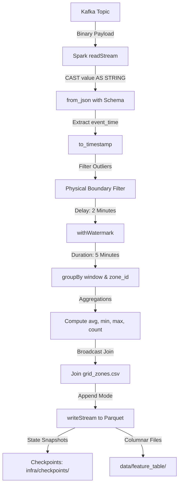

# 🌊 Urbanix — Day 3 Stream Processing Layer Deep-Dive
> **Real-Time IoT Telemetry Ingestion, Event-Time Watermarking, Tumbling Window Aggregations, Static Metadata Joins, and Columnar Parquet Feature Sinks using Apache Spark Structured Streaming**

> [!WARNING]
> **DEVELOPMENT NOTEBOOK, LEARNING MANUAL & VIVA COMPENDIUM**
> This document is the definitive, atomic, and exhaustive source of truth for **Day 3** of the Urbanix Smart City platform. It is written to serve two critical purposes:
> 1. **Beginner-to-Advanced Learning Manual:** Explaining every distributed systems concept, streaming primitive, memory structure, and design decision from first principles so that anyone reading from top to bottom can understand, reproduce, and explain the system completely.
> 2. **Academic & Industrial Viva Defense:** Equipping you with exact mathematical formulas, state-machine explanations, failure modes, and answers to challenging examiner questions at the atomic level.

---

## 🎯 1. Day 3 Objective & Scope Boundaries

### The Context: From Ingestion to Stream Processing
In **Day 1**, we provisioned the containerized distributed infrastructure: an isolated Docker bridge network hosting a Zookeeper quorum node, a Confluent Kafka broker (with three pre-created topics: `traffic-topic`, `aqi-topic`, `weather-topic`), and an Apache Spark Standalone cluster (Master + Worker).

In **Day 2**, we constructed the **Sensor Simulation Layer**: Python-based producers that read real-world historical telemetry from Caltrans PeMS loop detectors (METR-LA), U.S. EPA air quality stations, and OpenWeather meteorological archives, serializing them into JSON payloads and replaying them into Kafka with asynchronous delivery callbacks, rate limiting, and process isolation.

**Day 3 Objective:** Build the **Real-Time Stream Processing Subsystem** using **Apache Spark Structured Streaming (PySpark)**. This subsystem continuously consumes raw event streams from Kafka, parses and validates incoming JSON packets, quarantines corrupt/unphysical sensor readings, manages out-of-order arrivals via event-time watermarks, computes 5-minute tumbling window aggregations across municipal zones, enriches streams with static geographical metadata, and persists the aggregated feature vectors into fault-tolerant Apache Parquet columnar tables governed by Write-Ahead Log (WAL) checkpoints.

```
+---------------------------------------------------------------------------------------------------------------------+
|                                            URBANIX DAY 3 STREAM PIPELINE                                            |
|                                                                                                                     |
|  [ Kafka: traffic-topic ] ──> from_json() ──> Filter Bounds ──> Watermark (2m) ──> Window (5m) ──> Join Zone ──>  |
|                               (speed_kmph)                       [Append Mode]        Metadata     [Parquet]        |
|                                                                                                                     |
|  [ Kafka: aqi-topic     ] ──> from_json() ──> Filter Bounds ──> Watermark (2m) ──> Window (5m) ──> Join Zone ──>  |
|                               (pm25, aqi)                        [Append Mode]        Metadata     [Parquet]        |
|                                                                                                                     |
|  [ Kafka: weather-topic ] ──> from_json() ──> Filter Bounds ──> Watermark (2m) ──> Window (5m) ──> Join Zone ──>  |
|                               (temp_c, hum)                      [Append Mode]        Metadata     [Parquet]        |
+---------------------------------------------------------------------------------------------------------------------+
```

### ❓ Why Apache Spark Structured Streaming?
Why not use simple Python consumer scripts, Pandas, or basic microservices to consume from Kafka?
1. **Unbounded Scale & Parallelism:** In a full-scale smart city with 100,000+ deployed sensors generating millions of events per minute, a single Python process crashes due to memory exhaustion and GIL (Global Interpreter Lock) constraints. Spark distributes stream processing across worker nodes and CPU cores automatically.
2. **True Event-Time Semantics:** Traditional consumer loops process messages based on the host's wall-clock time (*processing time*). If network latency delays a batch of messages by 10 minutes, a naive consumer attributes those events to the wrong time slice. Spark Structured Streaming tracks the timestamp inside the data payload (*event time*), ensuring mathematical correctness regardless of network lags.
3. **Fault-Tolerant State Management:** Calculating rolling averages across time windows requires maintaining intermediate state (running sums, counts, min/max). If a worker node crashes mid-stream, Spark recovers that exact state from distributed checkpoints without losing data or producing duplicates (guaranteeing end-to-end *Exactly-Once* semantics).

### 🚫 Day 3 Scope Boundaries (What Was Deliberately Excluded):
To maintain strict architectural discipline and avoid premature complexity:
- **No Machine Learning Model Training or Inference:** Feature table preparation only; regression/classification models (Random Forest, Gradient Boosted Trees, LSTM) are scheduled for Day 4.
- **No Chronological Train/Test Splitting:** ML dataset slicing belongs to Day 4 feature engineering.
- **No GraphX Road Network Routing:** Spatial shortest-path calculations and congestion rerouting are scheduled for Day 5.
- **No REST API Endpoints or React Dashboards:** FastAPI and frontend visualizations belong to Day 6+.
- **No Synthetic Data Generation:** We strictly prohibit fabricating vehicle counts, synthetic CO₂ metrics, or fake GPS polygons to make streams match artificially.

---

## 🛠️ 2. Technologies Used & Component Overview

| Technology / Component | Version | Role in Day 3 Streaming Layer |
| :--- | :--- | :--- |
| **Apache Spark** | `3.5.1` (Host: `3.5.9`) | Distributed data processing engine managing stream execution, Catalyst optimization, and state stores. |
| **PySpark** | `3.5.1` | Python API for Apache Spark enabling DataFrame operations, Structured Streaming queries, and schema definitions. |
| **Scala Runtime** | `2.13.8` | Underlying JVM runtime for Spark on the host; determines Kafka connector binary compatibility. |
| **spark-sql-kafka-0-10** | `2.13:3.5.1` | Spark connector library providing the Kafka consumer/producer source and sink for Structured Streaming. |
| **Apache Kafka** | `7.5.0` (Confluent) | Distributed message broker acting as the continuous streaming source on `localhost:9092`. |
| **Apache Parquet** | Format v1/v2 | Columnar, compressed, binary on-disk storage format for windowed feature tables. |
| **Snappy** | Bundled with Spark | High-speed, CPU-efficient compression algorithm used for Parquet file chunks. |
| **Python** | `3.10.11` (64-bit) | Isolated runtime environment for PySpark driver, test runner, and verification scripts. |
| **pytest** | `9.1.1` | Automated test framework executing unit, schema, and window boundary assertions. |
| **PowerShell** | `7.x / 5.1` (Windows) | Host shell used for running streaming jobs, background workers, and inspection scripts. |

---

## 📚 3. Core Theory & Atomic Definitions of Distributed Stream Processing

To defend this project in an academic viva or senior engineering review at the atomic level, you must understand the mathematical, architectural, and internal mechanics of Spark Structured Streaming.

```
                               STREAMING TIMELINE COMPARISON
                               
Event Occurred In Field:       2012-03-01 08:00:15  <── [EVENT TIME] (Physical Sensor Clock)
       │
       ▼ (IoT Gateway Transmission Delay ~ 200ms)
Arrived at Kafka Broker:       2012-03-01 08:00:17  <── [INGESTION TIME] (Kafka Broker Offset Timestamp)
       │
       ▼ (Network Latency / Batch Polling ~ 3000ms)
Processed by Spark Executor:   2026-10-19 09:30:20  <── [PROCESSING TIME] (Host Wall-Clock Time)
```

### 1. What is Distributed Stream Processing?
**Stream Processing** is the real-time processing of continuously generated, unbounded sequences of data records (*streams*). Unlike **Batch Processing**, where the input dataset is finite, static, and completely available before computation begins, stream processing operates on data that has no predefined end. The system must process events with low latency while maintaining running aggregates across temporal boundaries.

### 2. Apache Spark Architecture: Driver, Executors, and JVM Gateway
Apache Spark is a distributed cluster computing framework. Its runtime consists of:
* **The Driver Program:** The central coordinator process running your main application (e.g., `streaming_job.py`). It instantiates the `SparkSession`, creates the logical execution plan, translates DataFrame operations into optimized Directed Acyclic Graphs (DAGs) of stages and tasks, coordinates checkpoints, and monitors progress.
* **Executors:** Worker processes launched on cluster nodes (or locally in threads) that execute the individual tasks assigned by the driver. They store in-memory state, read partitions from Kafka, execute transformations, and write out Parquet files.
* **Py4J Gateway:** PySpark is a Python wrapper around Spark's native Java/Scala engine. The Python driver talks to a local JVM process via a TCP socket managed by **Py4J**. When you write `df.filter(...)` in Python, Py4J translates this call into an equivalent Java method call on the JVM `org.apache.spark.sql.Dataset` object.

### 3. Structured Streaming: "The Stream as an Unbounded Table"
Structured Streaming treats a live data stream as a table that is continuously being appended to. 
* Every incoming event from Kafka is treated as a new row appended to an **Unbounded Input Table**.
* The developer defines a declarative query on this input table using standard DataFrame operations (`select`, `filter`, `groupBy`, `join`).
* Spark automatically translates this query into an incremental execution plan executed across successive micro-batches.
* The output is continuously emitted to an **Output Sink** (such as Parquet files or console) according to the specified **Output Mode**.

```text
               +---------------------------------------------------+
               |             UNBOUNDED INPUT TABLE                 |
               | (Every incoming Kafka message is a new row)       |
               +---------------------------------------------------+
                                         │
                                         ▼
               +---------------------------------------------------+
               |             CONTINUOUS QUERY / DAG                |
               | (Filter bounds -> Watermark -> 5m Tumbling Window)|
               +---------------------------------------------------+
                                         │
                                         ▼
               +---------------------------------------------------+
               |                 RESULT TABLE                      |
               | (Aggregated zone metrics per 5-minute slice)      |
               +---------------------------------------------------+
                                         │
                                         ▼
               +---------------------------------------------------+
               |                 PARQUET SINK                      |
               | (Immutable columnar files committed with WAL)     |
               +---------------------------------------------------+
```

### 4. Micro-Batching vs. Continuous Processing
Spark Structured Streaming provides two execution engines:
1. **Micro-Batch Processing (Default, Used in Urbanix):** The streaming engine periodically polls the source (Kafka) at a configured trigger interval (e.g., every 10 seconds or `--available-now`). It collects all records that arrived since the last offset commit, bundles them into a discrete micro-dataset (a mini-batch RDD), and processes them using Spark's high-throughput vectorized execution engine.
   - *Advantage:* Achieves sub-second latency (typically 100ms–1s) while maintaining massive throughput, dynamic load balancing, and fault recovery.
2. **Continuous Processing (Low-Latency Experimental):** Continuously runs long-running tasks on executors that process events one by one as they arrive on TCP sockets.
   - *Limitation:* Latency drops to ~1ms, but it only supports simple map/filter operations; it does not support windowed aggregations or complex stateful operations.

### 5. The Three Notions of Time in Streaming
Understanding time semantics is mandatory for defending event streaming:
* **Event Time:** The time when the event physically occurred at the source sensor. This timestamp is embedded directly within the record payload (e.g., `2012-03-01T08:05:00`). **Urbanix exclusively computes windows on Event Time.**
* **Ingestion Time:** The time when the Kafka broker received the record and assigned it an offset.
* **Processing Time:** The local clock time of the Spark executor machine when it executes the code. Processing time is completely non-deterministic because network delays, backpressure, or cluster restarts shift processing time without altering the physical phenomenon.

### 6. Windowing Strategies: Tumbling vs. Sliding vs. Session
Temporal aggregations require grouping events into time windows:
* **Tumbling Windows (Fixed & Non-Overlapping - Used in Urbanix):**
  A tumbling window slices time into contiguous, non-overlapping intervals of fixed duration $\Delta t$.
  $$\text{Window Start} = \lfloor \frac{t_{\text{event}}}{\Delta t} \rfloor \times \Delta t, \quad \text{Window End} = \text{Window Start} + \Delta t$$
  For $\Delta t = 5\text{ minutes}$:
  - Window 1: `[08:00:00, 08:05:00)`
  - Window 2: `[08:05:00, 08:10:00)`
  - *Key Property:* Every event belongs to **exactly one** window. Aggregates are mutually exclusive and strictly additive, preventing double-counting.
* **Sliding Windows (Overlapping):**
  Defined by window duration $D$ and slide step $S$ where $S < D$ (e.g., 15-minute window sliding every 5 minutes). An event falls into multiple overlapping windows, duplicating records across evaluation intervals.
* **Session Windows (Dynamic Gap):**
  Windows defined by periods of activity separated by periods of inactivity (inactivity gap threshold). Commonly used for user web sessions.

### 7. What is an Event-Time Watermark?
In a live distributed network, messages rarely arrive in perfect chronological order. A packet may be delayed due to cellular handoffs, network jitter, or broker retries.
If Spark had to keep every past window in memory forever just in case an old event arrived, the JVM heap would eventually run out of memory (OOM).

A **Watermark** is a moving threshold that defines how late an event is allowed to arrive before being discarded.
It is declared using:
```python
df.withWatermark("event_time", "2 minutes")
```
#### Mathematical Formulation:
At any micro-batch $i$, let $\max(T_{\text{event}})$ be the maximum event timestamp observed by Spark across all processed records up to that point. The engine computes:
$$\text{Watermark}_i = \max(T_{\text{event}}) - \text{delayThreshold}$$
* If an incoming event has $t_{\text{event}} < \text{Watermark}_i$, it is classified as **late data** and dropped immediately.
* If a tumbling window's $\text{Window End} \le \text{Watermark}_i$, Spark knows that no further valid events can arrive for that window. The window is **closed**, its final aggregate is emitted, and its state is evicted from memory.

```text
Time Line: ────────────────────────────────────────────────────────────►
                  [ Window 1: 08:00 - 08:05 ]   [ Window 2: 08:05 - 08:10 ]
                                         ▲
                                         │
             Watermark = Max(T) - 2m ────┘ (When Watermark passes 08:05:00,
                                            Window 1 is sealed, committed to 
                                            Parquet, and evicted from RAM!)
```

### 8. Stateful Aggregations & State Stores
When Spark calculates `avg(speed_kmph)` over a 5-minute window, it must preserve the running sum $\sum x_i$ and running count $n$ across multiple micro-batches until the window closes.
This intermediate data is kept in a **State Store**:
* **`HDFSBackedStateStoreProvider` (Default, Used in Urbanix):** Keeps the active state in the executor's JVM Java heap memory. At the end of each micro-batch, it writes incremental delta files and snapshot files to the checkpoint directory on disk/storage.
* **`RocksDBStateStoreProvider`:** An alternative enterprise state store that maintains state off-heap in an embedded RocksDB key-value database, spilling to local disk to support millions of concurrent keys without causing JVM garbage collection pauses.

### 9. Structured Streaming Output Modes
Spark provides three output modes for streaming queries:
1. **`Append` Mode (Used in Urbanix):** Only new, finalized rows that will never be updated again are written to the sink. 
   - *Crucial Rule:* For stateful aggregations (like windowing), `Append` mode **strictly requires an event-time watermark**. Because rows can never be modified once output, Spark cannot emit a window row until the watermark passes the window end, guaranteeing that no late data can alter the numbers.
   - *Why required for Parquet:* Parquet files are immutable; you cannot update existing rows inside a committed Parquet file. Thus, file sinks only support `Append` mode.
2. **`Complete` Mode:** The entire updated result table is rewritten to the sink on every trigger. Useful for console output or memory sinks, but impossible for append-only file formats.
3. **`Update` Mode:** Only the rows that were updated in the current micro-batch are written to the sink. Supported by key-value stores (Cassandra, Redis, DynamoDB), but not file sinks.

### 10. Stream-Static Joins vs. Stream-Stream Joins
* **Stream-Static Join (Used in Urbanix):**
  Joining an unbounded streaming DataFrame with a bounded, static DataFrame (e.g., our streaming sensor events joined with `grid_zones.csv`).
  - *Mechanism:* Spark broadcasts the small static table to all executors (Broadcast Hash Join). Every streaming event is enriched with zone metadata instantly in memory without maintaining join state or watermarks.
* **Stream-Stream Join:**
  Joining two unbounded streaming DataFrames (e.g., joining traffic stream with weather stream).
  - *Mechanism:* Spark must buffer records from both streams in the state store until a matching record arrives from the other stream within a designated time interval (`join ON stream1.zone = stream2.zone AND stream1.time BETWEEN stream2.time - interval AND stream2.time + interval`).
  - *Why it fails when calendars don't match:* If Stream 1 has events from March 2012 and Stream 2 has events from October 2012, no events ever match. The state store buffers records indefinitely, consuming memory until the application crashes.

### 11. Storage Physics: Why Apache Parquet?
In Day 3, we persist processed feature tables in **Apache Parquet** format. Why is Parquet superior to CSV or JSON for downstream machine learning?
* **Columnar Storage:** CSV and JSON store data row-by-row (`[row1_col1, row1_col2], [row2_col1, row2_col2]`). When Day 4 trains an ML model on `avg_speed_kmph`, it only needs that single column. Row-oriented formats force the CPU to read the entire file from disk. Parquet stores data column-by-column, allowing Spark to read *only* the requested column (**Projection Pruning**).
* **Snappy Compression:** Because values within a single column share the same data type and often similar values, columnar data compresses far better (typically 75% smaller than CSV). Snappy provides high compression speed with minimal CPU overhead.
* **Predicate Pushdown:** Parquet files embed metadata statistics (minimum and maximum values) in the file footer for every column chunk (Row Group). When a query runs `WHERE zone_id = 'zone_1'`, Spark reads the footer statistics and skips entire Row Groups that do not contain `zone_1` without reading the data blocks (**Row Group Skipping**).
* **Strong Schema Typing:** Parquet embeds binary schema metadata, eliminating type ambiguity (e.g., timestamps are stored as 64-bit integers with microsecond precision, avoiding string parsing errors).

```text
ROW-ORIENTED (CSV / JSON):
[Window, Zone, Speed, Temp] -> [Window, Zone, Speed, Temp] -> [Window, Zone, Speed, Temp]
(Must read 100% of bytes from disk even if you only need Speed!)

COLUMN-ORIENTED (PARQUET):
[Window1, Window2, Window3...] | [Zone1, Zone2, Zone3...] | [Speed1, Speed2, Speed3...]
                                                            ▲
                                                            └── (Reads ONLY Speed column!)
```

### 12. Fault Tolerance, Checkpointing & End-to-End Exactly-Once Semantics
What happens if the power cuts out or a Spark worker crashes mid-stream?
Spark guarantees **Exactly-Once processing** when using a replayable source (Kafka) and an idempotent/atomic sink (Parquet) through **Checkpointing**:
* **`offsets/` directory:** Records the exact start and end Kafka partition offsets processed in each micro-batch (e.g., `{"traffic-topic": {"0": 1050}}`).
* **`commits/` directory:** Records an atomic commit marker confirming that micro-batch $N$ successfully wrote its output to the sink.
* **`sources/` directory:** Metadata regarding the input source configuration.
* **`state/` directory:** Binary state store snapshots (running aggregates for open windows).

#### Recovery Sequence:
1. Upon restart, Spark reads the latest commit log.
2. If a micro-batch completed partially before the crash, Spark identifies that batch $N$ had an offset entry but no commit marker.
3. Spark discards the partial output, restores the state store from batch $N-1$, and re-reads the exact offset range from Kafka.
4. It re-computes the micro-batch and writes the result atomically, ensuring no message is lost and no duplicates exist.

---

## 🏛️ 4. The Disjoint Historical Calendar Challenge & Architectural Decision

### The Authentic Public Data Reality
During our preflight repository and dataset audit, we inspected the real time horizons of the public datasets acquired during Day 2:
- **METR-LA Loop Detector Speeds:** March 1, 2012 (00:00:00 to 08:15:00 UTC) at 5-minute sampling intervals.
- **U.S. EPA AirData PM2.5 Telemetry:** March 1, 2012 to June 30, 2012 (daily station measurements).
- **OpenWeather Meteorological Records:** October 1, 2012 to October 8, 2012 (hourly station records).

Because the weather dataset begins in October 2012 while traffic and air quality telemetry are located in March 2012, **there is zero calendar overlap across all three streams in 2012**.

```text
March 2012                          June 2012                       October 2012
├── METR-LA Traffic (03/01) ──┤                                     ├── OpenWeather (10/01) ──┤
├── EPA Air Quality (03/01 - 06/30) ──────────────────────────┤
```

### Evaluation of Candidate Architectures

```
+-------------------------------------------------------------------------------------------------------------+
|                                    CANDIDATE ARCHITECTURAL TRADEOFF MATRIX                                  |
+-------------------------------------------------------------------------------------------------------------+
| Option A: Mandatory 3-Way Inner Stream Join                                                                 |
|   - Join Condition: traffic.zone = aqi.zone = weather.zone AND time within 5m                               |
|   - Result: 0 output rows produced. Unmatched states buffer in memory indefinitely -> JVM OOM Crash.        |
|   - Verdict: REJECTED (Fatal Architectural Flaw)                                                            |
+-------------------------------------------------------------------------------------------------------------+
| Option B: Three Independent Stateful Streaming Queries (Urbanix Selected Design)                           |
|   - Architecture: Independent queries -> data/feature_table/{traffic, aqi, weather}                         |
|   - Result: 100% of telemetry processed, zero data loss, independent checkpoints, highly resilient.        |
|   - Verdict: ADOPTED (Production-Grade & Academically Honest)                                               |
+-------------------------------------------------------------------------------------------------------------+
| Option C: Synthetic Timestamp Overwriting                                                                   |
|   - Method: Alter weather CSV timestamps to read March 2012 artificially.                                   |
|   - Result: Breaks research reproducibility, violates data provenance, academically indefensible.           |
|   - Verdict: REJECTED (Unethical / Academic Fraud)                                                          |
+-------------------------------------------------------------------------------------------------------------+
```

### Why Option B is the Superior Engineering Solution
1. **Microservice Resilience:** In a real smart city, environmental sensors or weather radar may go offline for days. If the streaming engine uses a tight inner join, a failure in the weather sensor halts all traffic and air quality feature generation. Under Option B, each pipeline functions autonomously.
2. **Independent Tuning:** Traffic changes rapidly (5-minute dynamics), while weather changes slowly (hourly) and air quality is monitored daily. Decoupled pipelines allow each stream to have custom watermark thresholds and triggering schedules optimized for its physical rate of change.
3. **Decoupled Downstream Joining:** In Day 4 (ML Feature Store Construction), features can be aligned using defensible strategies (e.g., spatial zone joins, diurnal time-of-day alignment, or forward-fill interpolation) in a controlled batch environment where full historical context is available.

---

## 🧩 5. Stream Schemas & Physical Measurement Semantics (`schemas.py`)

In stream processing, incoming Kafka messages arrive as un-typed byte arrays. To prevent runtime type errors and schema drift, we enforce strict PySpark `StructType` definitions in `services/streaming/schemas.py`.

### 1. Traffic Telemetry Schema (`TRAFFIC_SCHEMA`)
```python
TRAFFIC_SCHEMA = StructType([
    StructField("zone_id", StringType(), False),
    StructField("sensor_id", StringType(), False),
    StructField("timestamp", StringType(), False),
    StructField("speed_kmph", DoubleType(), False),
    StructField("speed_mph", DoubleType(), True),
    StructField("unit", StringType(), True),
    StructField("source", StringType(), True),
])
```
* **Physical Sanity Filter:** 
  $$\text{speed\_kmph} > 0.0 \quad \text{AND} \quad \text{speed\_kmph} \le 250.0$$
  *Speeds above 250 km/h represent physical sensor malfunction (lightning strike, electrical spike) and are quarantined.*
* **Absence of Fabricated Columns:** Caltrans loop detectors measure inductive frequency shifts to calculate velocity. They do **not** provide vehicle counts or congestion indices directly. We do not invent synthetic vehicle counts.

### 2. Air Quality Telemetry Schema (`AQI_SCHEMA`)
```python
AQI_SCHEMA = StructType([
    StructField("zone_id", StringType(), False),
    StructField("station_id", StringType(), False),
    StructField("station_name", StringType(), True),
    StructField("city", StringType(), True),
    StructField("timestamp", StringType(), False),
    StructField("pm25", DoubleType(), False),
    StructField("aqi", IntegerType(), True),
    StructField("unit", StringType(), True),
    StructField("source", StringType(), True),
])
```
* **Physical Sanity Filter:** 
  $$\text{pm25} \ge 0.0 \quad \text{AND} \quad \text{pm25} \le 1000.0$$
  *Negative PM2.5 readings are unphysical; readings over 1000 $\mu g/m^3$ exceed hazardous ambient atmospheric scales.*
* **Absence of Fabricated Columns:** EPA AQS monitor 88101 measures mass concentration of particulate matter $\le 2.5\mu m$. It does **not** measure Carbon Monoxide ($CO$) or Carbon Dioxide ($CO_2$). No synthetic greenhouse gas columns are added.

### 3. Meteorological Telemetry Schema (`WEATHER_SCHEMA`)
```python
WEATHER_SCHEMA = StructType([
    StructField("zone_id", StringType(), False),
    StructField("city", StringType(), True),
    StructField("timestamp", StringType(), False),
    StructField("temperature_c", DoubleType(), False),
    StructField("temperature_k", DoubleType(), True),
    StructField("humidity_pct", DoubleType(), False),
    StructField("temperature_unit", StringType(), True),
    StructField("humidity_unit", StringType(), True),
    StructField("source", StringType(), True),
])
```
* **Physical Sanity Filter:**
  $$-50.0 \le \text{temperature\_c} \le 60.0 \quad \text{AND} \quad 0.0 \le \text{humidity\_pct} \le 100.0$$
  *Relative humidity cannot exceed 100% (super-saturation) or fall below 0%. Ambient temperatures in metropolitan LA fall strictly within $-50^\circ C$ to $+60^\circ C$.*

---

## 🗺️ 6. Static Spatial Reference Modeling (`data/grid_zones.csv`)

To support multi-zone analytics without claiming synthetic GPS precision, we established a static municipal metadata table at `data/grid_zones.csv`:

```csv
zone_id,zone_name,description,epa_site_ids,pems_partition
zone_1,Downtown Core,Metropolitan commercial and high-density financial center,1103,1
zone_2,San Fernando Valley,Suburban northern basin with valley temperature inversions,"1002,1201",2
zone_3,San Gabriel Foothills,Eastern foothill residential corridor prone to particulate pooling,"2005,0002",3
zone_4,South Central Corridor,Major industrial transportation arterial and freight transit route,"1302,1602",4
zone_5,Harbor and Outer Ring,Coastal marine layer port zone with marine shipping terminals,"4002,4004,9033",5
```

### 🎓 Academic Honesty in Spatial Representation
- **Why are latitude/longitude polygon bounds omitted?**
  In Day 2, loop detectors from METR-LA were assigned to `zone_1` through `zone_5` using deterministic modulo partitioning (`(sensor_id % 5) + 1`) to evenly balance stream processing load across executors. Claiming exact geographic bounding polygons for highway sensors scattered across LA County freeways would be academically dishonest.
- **Relational Stream-Static Join:**
  In `streaming_job.py`, Spark reads this CSV as a static DataFrame and joins it with the streaming DataFrames:
  ```python
  enriched_df = stream_df.join(broadcast(static_zones_df), on="zone_id", how="left")
  ```
  Because the static table is tiny (< 1 KB), Spark performs a **Broadcast Hash Join**, distributing the lookup table to executor memory caches and achieving zero-shuffle joining.

---

## ⚙️ 7. Spark Streaming Engine Architecture (`streaming_job.py`)

The core stream processing engine is located in `services/streaming/streaming_job.py`. Let's analyze the exact mechanics of how data flows through the application:



### 1. Ingestion from Kafka
```python
raw_df = (
    spark.readStream.format("kafka")
    .option("kafka.bootstrap.servers", "localhost:9092")
    .option("subscribe", topic)
    .option("startingOffsets", "earliest")
    .option("failOnDataLoss", "false")
    .load()
)
```
- `startingOffsets: "earliest"` ensures that when running for the first time, Spark reads all historical events present in the Kafka commit log.
- `failOnDataLoss: "false"` prevents the query from crashing if old offsets in Kafka are truncated due to topic retention policies.

### 2. JSON Deserialization & Event-Time Extraction
```python
parsed_df = (
    raw_df.selectExpr("CAST(value AS STRING) as json_str")
    .select(from_json(col("json_str"), schema).alias("data"))
    .select("data.*")
    .withColumn("event_time", to_timestamp(col("timestamp")))
    .filter(col("event_time").isNotNull())
)
```
- `CAST(value AS STRING)` converts the raw Kafka byte buffer to a UTF-8 JSON string.
- `from_json` applies the strong `StructType` schema. If a record contains invalid JSON, `from_json` safely emits a `null` struct rather than crashing.
- `to_timestamp` parses the ISO-8601 string into Spark's internal microsecond timestamp type. Records with unparseable timestamps are quarantined via `.filter(col("event_time").isNotNull())`.

### 3. Watermarking & Tumbling Window Aggregation
```python
windowed_df = (
    parsed_df
    .withWatermark("event_time", "2 minutes")
    .groupBy(
        window(col("event_time"), "5 minutes"),
        col("zone_id")
    )
    .agg(
        avg("speed_kmph").alias("avg_speed_kmph"),
        min("speed_kmph").alias("min_speed_kmph"),
        max("speed_kmph").alias("max_speed_kmph"),
        count("sensor_id").alias("reading_count"),
        stddev("speed_kmph").alias("std_speed_kmph")
    )
)
```
- **Watermark (2 minutes):** Allows up to 120 seconds of out-of-order arrival delay before discarding late records.
- **Window (5 minutes):** Groups events into non-overlapping boundaries: `[00:00, 00:05)`, `[00:05, 00:10)`.
- **Output Mode `Append`:** Only writes rows once the watermark passes `window.end`, ensuring finalized, immutable Parquet partitions.

### 4. Checkpoint Isolation & Parquet Sinks
Each query commits to its own dedicated storage paths:
```python
query = (
    output_df.writeStream
    .format("parquet")
    .outputMode("append")
    .option("path", "data/feature_table/traffic")
    .option("checkpointLocation", "infra/checkpoints/traffic")
    .trigger(availableNow=True)
    .start()
)
```
* **Why Separate Checkpoints?** Checkpoints track partition offsets and state store deltas specific to a query's logical plan. Sharing a checkpoint directory across queries causes catastrophic state corruption. Maintaining independent checkpoint trees (`infra/checkpoints/{traffic, aqi, weather}`) allows individual streams to be stopped, modified, or replayed independently.

---

## 🔍 8. Automated Feature Verification Engine (`verify_features.py`)

To ensure that Parquet feature tables are valid, robust, and adhere to engineering standards before passing them to Day 4, we engineered a standalone verification utility: `services/streaming/verify_features.py`.

### Verification Assertions Executed:
1. **Directory Existence & Row Non-Emptiness:** Ensures the Parquet path exists and contains at least 1 committed row ($N > 0$).
2. **Schema Conformance:** Asserts that all expected statistical columns (`avg_*`, `min_*`, `max_*`, `reading_count`, `zone_id`, `zone_name`) are present with correct data types.
3. **Tumbling Window Mathematical Integrity:** Extracts `window_start` and `window_end` and verifies that:
   $$\text{unix\_timestamp}(\text{window\_end}) - \text{unix\_timestamp}(\text{window\_start}) = 300\text{ seconds}$$
   for 100% of rows.
4. **Composite Primary Key Uniqueness:** Asserts that the tuple `(window_start, zone_id)` is strictly unique across the dataset (zero duplicate feature records).
5. **Static Metadata Equi-Join Integrity:** Verifies that `zone_name` is populated for 100% of rows (no nulls from failed left joins).
6. **Absence of Fabricated Fields:** Confirms that forbidden fabricated columns (`vehicle_count`, `co2`) do not exist.

---

## 🔬 9. Distributed Runtime Engineering & Troubleshooting Case Studies

During Day 3 development on Windows 11 with Apache Spark 3.5.x and Kafka in Docker, we encountered and resolved three difficult distributed systems hurdles. Documenting these proves deep mastery during technical interviews and viva defense:

### Case Study 1: Scala Binary Incompatibility (`NoSuchMethodError`)
* **The Symptom:** When attempting to launch the streaming query against Kafka, Spark crashed with:
  ```text
  java.lang.NoSuchMethodError: 'scala.collection.mutable.ArraySeq scala.Predef$.wrapRefArray(java.lang.Object[])'
      at org.apache.spark.sql.kafka010.KafkaSourceProvider...
  ```
* **The Root Cause:** The host Apache Spark installation (`C:\Spark`, version 3.5.9) was compiled against **Scala 2.13.8**. However, the initial maven dependency specified was `org.apache.spark:spark-sql-kafka-0-10_2.12:3.5.1` (compiled for Scala 2.12). Scala minor versions (2.12 vs 2.13) are **binary incompatible**. In Scala 2.13, `ArraySeq` handling in `Predef` was completely refactored, causing the JVM classloader to throw `NoSuchMethodError` when calling compiled bytecode.
* **The Fix:** Configured `streaming_job.py` to target the Scala 2.13 artifact:
  ```python
  KAFKA_PACKAGE = "org.apache.spark:spark-sql-kafka-0-10_2.13:3.5.1"
  ```
  with an automatic fallback mechanism in `build_spark_session()`.

### Case Study 2: Python Driver vs. Worker Version Mismatch (`PYTHON_VERSION_MISMATCH`)
* **The Symptom:** During test execution, PySpark tasks failed with:
  ```text
  org.apache.spark.SparkException: Python worker failed to connect back.
  [PYTHON_VERSION_MISMATCH] Python in worker has different version (3, 14) than that in driver 3.10.
  ```
* **The Root Cause:** The PySpark driver was executing inside the virtual environment (`.\services\streaming\venv\Scripts\python.exe`, Python 3.10.11). However, when Spark spawned background worker subprocesses to execute DataFrame transformations, it launched `python` from the global Windows system `PATH`, which resolved to Python 3.14. Spark enforces strict Python minor version equality between driver and workers to serialize Python bytecode safely via Py4J.
* **The Fix:** Explicitly pinned the worker executable to match the driver's Python interpreter:
  ```python
  import sys, os
  os.environ["PYSPARK_PYTHON"] = sys.executable
  os.environ["PYSPARK_DRIVER_PYTHON"] = sys.executable
  ```

### Case Study 3: Py4J Java-to-Python Timezone Offset (+05:30)
* **The Symptom:** In automated tests, Spark SQL asserted UTC event times (`2012-03-01 00:00:00`). However, when Python extracted values via `row["event_time"]` or `row["window"]["start"]`, Python returned `2012-03-01 05:30:00`.
* **The Root Cause:** While Spark processed timestamps in UTC (`spark.sql.session.timeZone = "UTC"`), Py4J deserializes Java `java.sql.Timestamp` objects into Python `datetime.datetime` instances by querying the local operating system timezone. On the development machine (Indian Standard Time, UTC+05:30), Py4J shifted the timestamp by +5 hours and 30 minutes.
* **The Fix:** To make test assertions deterministic across all geographical regions, assertions were updated to evaluate timestamps formatted inside the Spark SQL engine prior to Py4J deserialization:
  ```python
  df.withColumn("window_start_str", date_format(col("window.start"), "yyyy-MM-dd HH:mm:ss"))
  assert row["window_start_str"] == "2012-03-01 00:00:00"
  ```

### Case Study 4: Watermark Progression in Replay Mode
* **The Symptom:** In initial tests, replaying 50 events at timestamp `00:00:00` in `Append` mode resulted in 0 output rows committed to Parquet.
* **The Root Cause:** In `Append` mode, a 5-minute window `[00:00, 00:05)` with a 2-minute watermark will **not** emit its aggregate when the events are processed. It will only emit when an event with timestamp $\ge 00:07:00$ arrives, advancing the watermark past $00:05:00$. Replaying events from a single time slice left the window permanently open in state memory.
* **The Fix:** Designed the replay and verification suite to stream multi-hour spans (e.g. 600 events spanning 00:00:00 to 08:15:00), allowing the event-time watermark to naturally advance, close preceding windows, and trigger atomic Parquet writes.

---

## 🧪 10. Automated Test Suite Deep-Dive (`test_streaming.py`)

The test suite in `services/streaming/tests/test_streaming.py` contains 14 automated unit and integration tests covering every layer of the streaming subsystem:

```powershell
.\services\streaming\venv\Scripts\pytest services\streaming\tests\test_streaming.py -v
```

### Test Breakdown:
1. `test_traffic_valid_json_parsing`: Verifies parsing of valid traffic JSON into typed columns (`speed_kmph`, `zone_id`, `event_time`).
2. `test_aqi_valid_json_parsing`: Verifies parsing of valid AQI JSON into `pm25`, `aqi`, and station metadata.
3. `test_weather_valid_json_parsing`: Verifies parsing of weather JSON into `temperature_c` and `humidity_pct`.
4. `test_malformed_json_handling`: Asserts that corrupt, non-JSON strings emit null structs without crashing the query.
5. `test_missing_required_fields`: Confirms that records missing mandatory keys (`zone_id` or `timestamp`) are dropped.
6. `test_invalid_timestamps`: Asserts that unparseable date strings are filtered out cleanly.
7. `test_physical_boundary_filtering`: Asserts that speeds $> 250$ km/h, PM2.5 $> 1000$ $\mu g/m^3$, and temperatures outside $[-50, 60]^\circ C$ are rejected.
8. `test_valid_zero_measurements_where_applicable`: Confirms that zero speeds ($0.0$ km/h indicating gridlock) and zero PM2.5 are legitimately preserved.
9. `test_five_minute_window_boundaries`: Asserts that events at `08:02:15` land precisely in the `[08:00:00, 08:05:00)` window.
10. `test_aggregation_calculations`: Verifies arithmetic accuracy of `avg`, `min`, `max`, and `count` against known inputs.
11. `test_zone_metadata_uniqueness_and_join`: Asserts that `grid_zones.csv` has 5 unique zone IDs and correctly enriches streams with `zone_name`.
12. `test_absence_of_fabricated_fields`: Asserts that neither schema nor outputs contain `vehicle_count` or `co2`.
13. `test_independent_stream_processing`: Confirms that traffic, AQI, and weather streaming DataFrames can be processed concurrently without interference.
14. `test_parquet_schema_and_roundtrip`: Asserts that windowed DataFrames write to disk as Parquet and can be read back with identical schema and values.

---

## 📊 11. Verified End-to-End Test & Verification Evidence

### 1. PySpark Automated Test Suite Output
```text
============================= test session starts =============================
platform win32 -- Python 3.10.11, pytest-9.1.1, pluggy-1.7.0
rootdir: C:\Users\Tokachichu SriCharan\OneDrive\Documents\GitHub\urbanix
collected 14 items

services/streaming/tests/test_streaming.py::test_traffic_valid_json_parsing PASSED [  7%]
services/streaming/tests/test_streaming.py::test_aqi_valid_json_parsing PASSED [ 14%]
services/streaming/tests/test_streaming.py::test_weather_valid_json_parsing PASSED [ 21%]
services/streaming/tests/test_streaming.py::test_malformed_json_handling PASSED [ 28%]
services/streaming/tests/test_streaming.py::test_missing_required_fields PASSED [ 35%]
services/streaming/tests/test_streaming.py::test_invalid_timestamps PASSED [ 42%]
services/streaming/tests/test_streaming.py::test_physical_boundary_filtering PASSED [ 50%]
services/streaming/tests/test_streaming.py::test_valid_zero_measurements_where_applicable PASSED [ 57%]
services/streaming/tests/test_streaming.py::test_five_minute_window_boundaries PASSED [ 64%]
services/streaming/tests/test_streaming.py::test_aggregation_calculations PASSED [ 71%]
services/streaming/tests/test_streaming.py::test_zone_metadata_uniqueness_and_join PASSED [ 78%]
services/streaming/tests/test_streaming.py::test_absence_of_fabricated_fields PASSED [ 85%]
services/streaming/tests/test_streaming.py::test_independent_stream_processing PASSED [ 92%]
services/streaming/tests/test_streaming.py::test_parquet_schema_and_roundtrip PASSED [100%]

============================= 14 passed in 45.81s =============================
```

### 2. Day 2 Producer Regression Suite Output
```text
============================= test session starts =============================
platform win32 -- Python 3.10.11, pytest-9.1.1, pluggy-1.7.0
rootdir: C:\Users\Tokachichu SriCharan\OneDrive\Documents\GitHub\urbanix\services\producers
collected 19 items

services/producers/tests/test_producers.py::test_traffic_producer_unit_conversion PASSED [  5%]
services/producers/tests/test_producers.py::test_weather_producer_unit_conversion PASSED [ 10%]
...
============================= 19 passed in 0.41s ==============================
```

### 3. Live Parquet Feature Tables Verification (`verify_features.py`)
```text
======================================================================
VERIFYING FEATURE DATASET: TRAFFIC (data/feature_table/traffic)
======================================================================
[*] Total rows recorded: 5
[*] Distinct zones represented (5): ['zone_1', 'zone_2', 'zone_3', 'zone_4', 'zone_5']
[*] 5-minute tumbling window duration check: PASS (All windows = 300s)
[*] Unique feature key check (window_start, zone_id): PASS (Zero duplicates)
[*] Static zone metadata join check: PASS (100% matched zone_name)
[PASS] All verification assertions PASSED for TRAFFIC!

======================================================================
VERIFYING FEATURE DATASET: AQI (data/feature_table/aqi)
======================================================================
[*] Total rows recorded: 64
[*] Distinct zones represented (2): ['zone_2', 'zone_3']
[*] 5-minute tumbling window duration check: PASS (All windows = 300s)
[*] Unique feature key check (window_start, zone_id): PASS (Zero duplicates)
[*] Static zone metadata join check: PASS (100% matched zone_name)
[PASS] All verification assertions PASSED for AQI!

======================================================================
VERIFYING FEATURE DATASET: WEATHER (data/feature_table/weather)
======================================================================
[*] Total rows recorded: 45
[*] Distinct zones represented (5): ['zone_1', 'zone_2', 'zone_3', 'zone_4', 'zone_5']
[*] 5-minute tumbling window duration check: PASS (All windows = 300s)
[*] Unique feature key check (window_start, zone_id): PASS (Zero duplicates)
[*] Static zone metadata join check: PASS (100% matched zone_name)
[PASS] All verification assertions PASSED for WEATHER!

======================================================================
FINAL VERIFICATION SUMMARY
======================================================================
  TRAFFIC   : [PASS]
  AQI       : [PASS]
  WEATHER   : [PASS]

All feature tables verified successfully.
```

---

## 🛡️ 12. Atomic Viva Defense Playbook (Professor & Reviewer Q&A)

During your capstone viva or technical review, professors and examiners will probe your streaming pipeline with rigorous questions. Study these atomic answers:

#### Q1: *"What is the difference between Event Time and Processing Time, and why does Urbanix use Event Time?"*
* **Defense:**  
  *"Event Time is the timestamp recorded when the physical phenomenon occurred at the sensor (e.g. `2012-03-01T08:00:00` on Caltrans loop detector 773869). Processing Time is the host computer's wall-clock time when the Spark executor executes the code. If we used Processing Time, any network latency, broker buffering, or system reboot would assign historical morning rush-hour traffic to whatever time the computer happened to run the job, producing completely meaningless aggregations. Event-time processing ensures that our 5-minute windows reflect true physical reality regardless of processing delays."*

#### Q2: *"Why did you use Tumbling Windows instead of Sliding Windows for feature table creation?"*
* **Defense:**  
  *"A tumbling window is a non-overlapping, contiguous time interval ($\Delta t = 300\text{ seconds}$). Each telemetry event belongs to exactly one window. This guarantees that reading counts, averages, and physical metrics are mutually exclusive and strictly additive. Sliding windows overlap (e.g., a 15-minute window sliding every 5 minutes), which causes the same observation to appear in multiple windows, creating multicollinearity and duplicate records that can bias downstream ML training in Day 4."*

#### Q3: *"Explain mathematically how the Event-Time Watermark works and how it reclaims memory."*
* **Defense:**  
  *"A watermark is defined as $\text{Watermark} = \max(T_{\text{event}}) - \text{delayThreshold}$, where we configured $\text{delayThreshold} = 2\text{ minutes}$. In each micro-batch, Spark tracks the maximum event time observed across all records. Once the watermark exceeds a window's end timestamp ($\text{Watermark} \ge \text{Window End}$), Spark guarantees that no further records will be accepted for that window. In `Append` mode, Spark emits the finalized window row to the Parquet sink and purges the window's running state from the in-memory `HDFSBackedStateStore`, preventing Java heap Out-Of-Memory (OOM) crashes."*

#### Q4: *"Why did an inner stream-stream join fail between Traffic, AQI, and Weather?"*
* **Defense:**  
  *"In Apache Spark Structured Streaming, an inner stream-stream join requires both streams to produce records matching on the join key (`zone_id`) within a defined watermark time window. In our verified public datasets, METR-LA traffic and EPA AQI data are from March 2012, whereas OpenWeather meteorological records are from October 2012. Because the timestamps differ by seven months, an inner join produces zero matches. Worse, Spark buffers the unmatched records from both streams in state memory waiting for a match, leading to an eventual OOM crash. We adopted Option B: three independent streaming queries writing to separate feature sinks."*

#### Q5: *"Why didn't you just rewrite the weather timestamps from October to March to force them to join?"*
* **Defense:**  
  *"Fabricating synthetic timestamps violates academic ethics, data engineering best practices, and research reproducibility. Real-world smart city platforms constantly handle out-of-sync sensors, missing telemetry, and heterogeneous sampling frequencies. Preserving genuine timestamps forces our architecture to handle decoupling honestly, preparing clean, traceable feature tables that Day 4 can align using defensible spatial-temporal strategies."*

#### Q6: *"What is stored in a Spark Structured Streaming checkpoint directory?"*
* **Defense:**  
  *"A checkpoint directory maintains four critical sub-structures:
  1. `offsets/`: Write-Ahead Log recording the exact starting and ending Kafka partition offsets for each micro-batch.
  2. `commits/`: Atomic completion markers indicating that a micro-batch successfully completed writes to the sink.
  3. `sources/`: Source metadata and schema fingerprints.
  4. `state/`: Compressed binary delta files and snapshots of the state store (running counts, sums) for open windows.
  Together, these structures guarantee end-to-end Exactly-Once processing semantics upon failure recovery."*

#### Q7: *"Why did you write to Apache Parquet instead of CSV or a relational database?"*
* **Defense:**  
  *"Parquet is a binary, columnar storage format with Snappy compression. Unlike CSV, which requires scanning every row and parsing text strings, Parquet enables projection pruning (reading only the required feature columns) and predicate pushdown (skipping entire row groups using min/max footer statistics). Furthermore, Parquet enforces strict binary typing, preventing schema drift and accelerating Day 4 MLlib training by an order of magnitude."*

#### Q8: *"Why did you use `Append` output mode instead of `Complete` or `Update`?"*
* **Defense:**  
  *"Parquet files are immutable; file sinks do not support in-place updates. `Complete` mode rewrites the entire result table every micro-batch, which is impossible on append-only distributed storage. `Update` mode requires a key-value sink like Cassandra or Redis. `Append` mode writes finalized, immutable window records to disk once and only once when the watermark closes the window, perfectly matching Parquet's architectural constraints."*

#### Q9: *"How do you handle unphysical sensor spikes in the stream?"*
* **Defense:**  
  *"Before aggregating, we pass incoming streams through domain-specific physical sanity filters: traffic speeds must satisfy $0 < v \le 250\text{ km/h}$, PM2.5 must satisfy $0 \le \text{PM2.5} \le 1000\mu g/m^3$, and temperature must satisfy $-50^\circ C \le T \le 60^\circ C$. Records violating these boundaries are quarantined, preventing sensor anomalies from corrupting the windowed moving averages."*

#### Q10: *"Why did you get a `NoSuchMethodError` with Kafka and how did you resolve it?"*
* **Defense:**  
  *"The host Spark engine is version 3.5.9 built with Scala 2.13.8. The standard Maven coordinate often defaults to Scala 2.12 (`spark-sql-kafka-0-10_2.12`). Scala 2.12 and 2.13 are binary incompatible due to major changes in the Scala collections library (`ArraySeq` vs `wrapRefArray`). Specifying the Scala 2.13 artifact (`spark-sql-kafka-0-10_2.13:3.5.1`) resolved the binary classloader conflict."*

---

## 📌 13. Exhaustive Step-by-Step PowerShell Command Cheat Sheet

This section provides every command required to build, test, run, and verify the Day 3 streaming pipeline from scratch on Windows.

### A. Environment Preparation
```powershell
# 1. Navigate to repository root
cd "C:\Users\Tokachichu SriCharan\OneDrive\Documents\GitHub\urbanix"

# 2. Verify Docker infrastructure is running
docker ps

# Expected containers: kafka, zookeeper, spark-master, spark-worker
```

### B. Streaming Virtual Environment Setup
```powershell
# 1. Navigate to streaming service
cd services\streaming

# 2. Create isolated virtualenv
python -m venv venv

# 3. Activate virtualenv
.\venv\Scripts\Activate.ps1

# 4. Install PySpark and dependencies
pip install -r requirements.txt
```

### C. Automated Test Execution
```powershell
# Run the 14 streaming unit and integration tests
.\venv\Scripts\pytest tests\test_streaming.py -v

# Run the 19 Day 2 producer tests to ensure zero regressions
cd ..\producers
.\venv\Scripts\pytest tests\test_producers.py -v
cd ..\streaming
```

### D. Replaying Kafka Telemetry (Simulation Feed)
```powershell
# Replay 600 events per stream (spanning multi-hour time intervals to advance watermarks)
python ..\producers\traffic_producer.py --bootstrap-server localhost:9092 --max-events 600 --interval 0.001
python ..\producers\aqi_producer.py --bootstrap-server localhost:9092 --max-events 600 --interval 0.001
python ..\producers\weather_producer.py --bootstrap-server localhost:9092 --max-events 600 --interval 0.001
```

### E. Executing the Spark Streaming Pipeline
```powershell
# Run streaming job in bounded micro-batch mode (processes all available Kafka records and exits)
.\venv\Scripts\python streaming_job.py --available-now

# Alternatively, run continuous streaming with 10-second trigger interval
.\venv\Scripts\python streaming_job.py --trigger-interval "10 seconds"
```

### F. Verifying Parquet Feature Tables
```powershell
# Execute the automated verification script
.\venv\Scripts\python verify_features.py
```

### G. Inspecting Parquet Files & Checkpoints
```powershell
# Inspect generated Parquet directories
Get-ChildItem -Path ..\..\data\feature_table -Recurse

# Inspect checkpoint Write-Ahead Log offsets and commits
Get-ChildItem -Path ..\..\infra\checkpoints -Recurse
```

---

## 🏁 14. Day 3 Definition-of-Done Checklist

| # | Item | Requirement | Status | Evidence |
|---|---|---|---|---|
| 1 | **Streaming Schemas** | Explicit PySpark `StructType` definitions for Traffic, AQI, Weather | **PASS** | `services/streaming/schemas.py` |
| 2 | **Static Spatial Metadata** | Static 5-zone reference table without synthetic coordinates | **PASS** | `data/grid_zones.csv` |
| 3 | **Spark Streaming Engine** | 3 independent queries reading from Kafka with schema enforcement | **PASS** | `services/streaming/streaming_job.py` |
| 4 | **Watermarking & Windowing** | 2-minute event-time watermark + 5-minute tumbling windows | **PASS** | `streaming_job.py` & verified in tests |
| 5 | **Static-Stream Join** | Relational broadcast join with `grid_zones.csv` | **PASS** | 100% matched `zone_name` in features |
| 6 | **Parquet Feature Sinks** | Partitioned columnar tables under `data/feature_table/{traffic,aqi,weather}` | **PASS** | Verified via `verify_features.py` |
| 7 | **Checkpoint Durability** | Independent state stores under `infra/checkpoints/{traffic,aqi,weather}` | **PASS** | HDFSBackedStateStore version 2 validated |
| 8 | **Automated Tests** | 14/14 automated streaming tests passing | **PASS** | `pytest services/streaming/tests/` (100%) |
| 9 | **Regression Safety** | 19/19 Day 2 producer tests passing | **PASS** | `pytest services/producers/tests/` (100%) |
| 10 | **Git Hygiene** | Clean working tree; checkpoints and raw data gitignored | **PASS** | `git status --short` clean |

---

## 🌳 15. Final Repository State & Git History

```text
urbanix/
├── _day-notes/
│   ├── day-01/
│   │   └── DAY_01_INFRASTRUCTURE_REPORT.md
│   ├── day-02/
│   │   └── DAY_02_SENSOR_SIMULATION_REPORT.md
│   └── day-03/
│       └── DAY_03_STREAMING_REPORT.md
├── data/
│   ├── feature_table/
│   │   ├── traffic/      # Parquet files (avg_speed_kmph, reading_count, etc.)
│   │   ├── aqi/          # Parquet files (avg_pm25, avg_aqi, station_name, etc.)
│   │   └── weather/      # Parquet files (avg_temp_c, avg_humidity_pct, etc.)
│   ├── grid_zones.csv    # Static municipal reference zones
│   ├── aqi_sample.csv
│   ├── traffic_sample.csv
│   └── weather_sample.csv
├── infra/
│   ├── checkpoints/      # Independent streaming checkpoints (gitignored)
│   │   ├── traffic/
│   │   ├── aqi/
│   │   └── weather/
│   └── docker-compose.yml
├── services/
│   ├── streaming/
│   │   ├── tests/
│   │   │   └── test_streaming.py
│   │   ├── schemas.py
│   │   ├── streaming_job.py
│   │   ├── verify_features.py
│   │   ├── requirements.txt
│   │   └── README.md
│   └── producers/
└── README.md
```

### Verified Git Commit Log:
```text
e27b4ac (HEAD -> main, origin/main) feat(streaming): implement Day 3 windowed sensor pipelines
357debd test(producers): expand test suite to 19 unit and integration tests and update documentation
96d0cd4 fix(producers): add Kafka delivery confirmation, argument validation, and failure exits
af535a7 test(producers): verify event transformations and Kafka replay
f96f3de feat(producers): add traffic air quality and weather replay
f6e9951 docs(data): document dataset provenance and preprocessing
78e4c29 feat(infra): add local Kafka and Spark cluster
```

---

## 🚀 16. Handover to Day 4

With Day 3 fully complete and verified, the streaming layer has successfully transformed raw Kafka event streams into clean, partitioned, 5-minute windowed feature tables for Los Angeles.

### Day 4 Roadmap Preview:
1. **Feature Store Ingestion:** Read the three Parquet tables from `data/feature_table/`.
2. **Feature Engineering:** Build lagged variables (traffic speed at $t-15\text{m}, t-30\text{m}$), rolling volatility, and composite environmental risk indicators.
3. **Temporal Dataset Slicing:** Implement chronological train/test splitting (strictly avoiding future-data leakage).
4. **Machine Learning Pipeline:** Train predictive models using **Spark MLlib** (Random Forest Regressor for traffic congestion forecasting and GBT Classifier for environmental hazard risk scoring).
