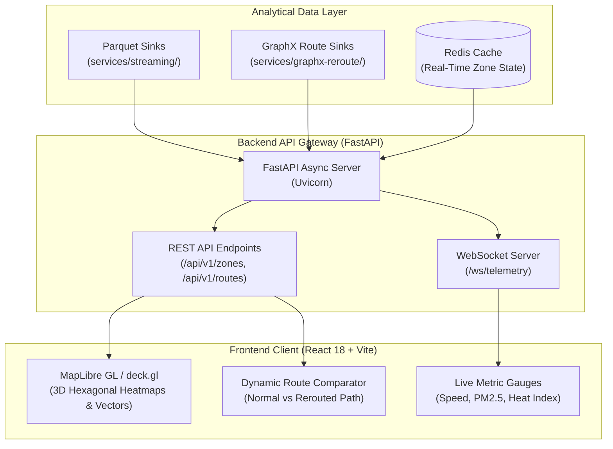

# 🗺️ Urbanix Geospatial & Risk Command Dashboard (`dashboard/`)

-success)


This directory houses the **Geospatial Command Dashboard** and **API Gateway** for the **Urbanix Smart City Platform**. It provides municipal operators with a real-time, unified graphical interface displaying live sensor telemetry, ML-forecasted congestion heatmaps, air quality hazard zones, and GraphX dynamic rerouting vectors across Los Angeles.

---

## 🏛️ 1. Dashboard System Architecture



---

## 🖥️ 2. Core Dashboard Features

1. **3D Geospatial Zone Heatmap:**
   * Visualizes the 5 Urbanix smart-city zones color-coded dynamically by the real-time **Composite Municipal Risk Index** ($0.0 \to \text{Green}$, $0.5 \to \text{Amber}$, $1.0 \to \text{Red}$).
   * Renders deck.gl hexagonal aggregation layers representing active highway loop detectors.
2. **Real-Time Telemetry Teleprompters:**
   * High-frequency gauges showing live vehicle speed ($km/h$), PM2.5 particulate mass ($\mu g/m^3$), ambient temperature ($^\circ C$), and relative humidity ($\%$) streamed over persistent WebSockets.
3. **Congestion-Aware Route Comparator:**
   * Allows operators to select origin-destination pairs on the Los Angeles road graph.
   * Renders the standard travel-time path (red/congested) side-by-side with the GraphX dynamically rerouted path (green/optimal).
4. **Historical Risk Trend Analytics:**
   * Time-series charting (Recharts) displaying multi-hour rolling trends in traffic degradation vs. environmental particulate concentration.

---

## 🔌 3. API Gateway Endpoints (`backend/`)

| Method | Endpoint | Protocol | Description |
| :--- | :--- | :--- | :--- |
| `GET` | `/api/v1/zones` | HTTP/REST | Retrieves current risk scores and sensor counts for all 5 zones. |
| `GET` | `/api/v1/zones/{zone_id}/history` | HTTP/REST | Retrieves hourly sliding-window historical aggregations for a zone. |
| `POST` | `/api/v1/reroute` | HTTP/REST | Queries GraphX engine for the lowest-hazard path between two coordinates. |
| `WS` | `/ws/live-telemetry` | WebSocket | Streams 1-second interval live telemetry events directly to the frontend. |

---

## 📂 4. Target Directory Layout (Days 10–11)

```text
dashboard/
├── README.md                 # Dashboard architecture and operational guide
├── backend/
│   ├── main.py               # FastAPI application entrypoint
│   ├── requirements.txt      # FastAPI, Uvicorn, Pydantic, Redis dependencies
│   ├── routers/
│   │   ├── zones.py          # Zone telemetry and risk score endpoints
│   │   └── routing.py        # GraphX route optimization interface
│   └── websocket.py          # Real-time WebSocket connection manager
└── frontend/
    ├── package.json          # React, Vite, TailwindCSS, deck.gl, MapLibre
    ├── vite.config.js        # Vite bundler configuration
    └── src/
        ├── App.jsx           # Main dashboard layout container
        ├── components/
        │   ├── MapView.jsx   # deck.gl / MapLibre geospatial canvas
        │   ├── ZoneCard.jsx  # Individual zone status card
        │   └── Gauges.jsx    # Live speed and AQI meters
        └── hooks/
            └── useWebSocket.js # Real-time streaming hook
```

---

## 🚀 5. Local Development Commands

```powershell
# 1. Run the FastAPI backend gateway
cd dashboard/backend
uvicorn main:app --host 0.0.0.0 --port 8000 --reload

# 2. Run the React frontend application
cd dashboard/frontend
npm install
npm run dev
```
