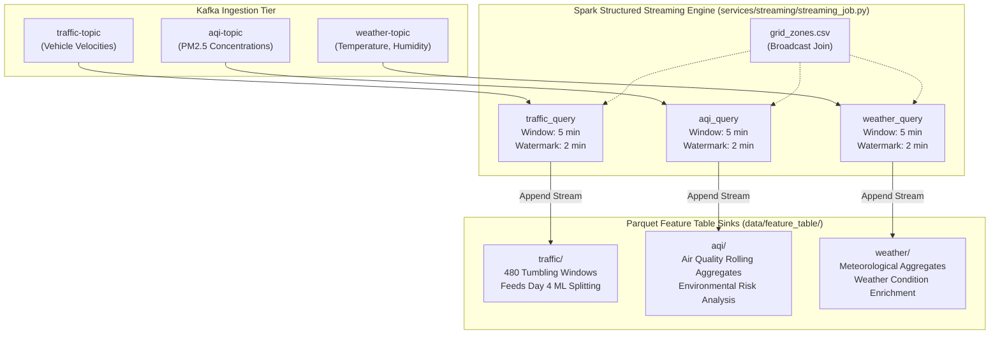

# 📊 Urbanix Streaming Feature Tables (`data/feature_table/`)

-brightgreen)


This directory serves as the **Streaming Feature Store** for the Urbanix Smart City Platform. It stores continuous, 5-minute windowed feature tables generated by Apache Spark Structured Streaming from real-time Kafka sensor feeds.

---

## 🏛️ 1. Architecture & Streaming Dataflow



---

## 📁 2. Subdirectory Directory Breakdown

| Subfolder | Stream Topic | Primary Metrics Aggregated | Downstream Consumer | Status |
| :--- | :--- | :--- | :--- | :---: |
| [`traffic/`](traffic/README.md) | `traffic-topic` | Average speed, min/max speed, speed spread, reading count | **Day 4 & 5 Machine Learning Pipeline** | **COMPLETE ✅** |
| [`aqi/`](aqi/README.md) | `aqi-topic` | Mean PM2.5 ($\mu g/m^3$), AQI calculation, reading count | Environmental Risk Sinks (Day 7) | **COMPLETE ✅** |
| [`weather/`](weather/README.md) | `weather-topic` | Temperature ($^\circ C$), Humidity (%), Wind Speed | Multimodal Risk Scoring (Day 7) | **COMPLETE ✅** |

---

## ⚙️ 3. Common Processing Rules Across All Tables

1. **Deterministic 5-Minute Tumbling Windows:**
   - Non-overlapping intervals: `[00:00, 00:05)`, `[00:05, 00:10)`, `[00:10, 00:15)`, etc.
   - Window boundaries align strictly to UTC 5-minute clock ticks:
     $$\text{window\_start} = \lfloor t / 300 \rfloor \times 300$$
2. **Event-Time Watermarking (2 Minutes):**
   - Handles out-of-order network telemetry. Events arriving more than 120 seconds after the current watermark are dropped, preventing unbounded state store bloat.
3. **Spatial Broadcast Join:**
   - Enriched at streaming ingest against `data/grid_zones.csv` to map physical detector IDs to 5 municipal zones (`zone_1` to `zone_5`).
4. **Append Output Mode with Checkpointing:**
   - Parquet part-files are written immutably once a tumbling window passes beyond the watermark threshold.
   - Guaranteed fault tolerance via Write-Ahead Logs in `infra/checkpoints/`.

---

## 🔬 4. Verification & Inspection Commands

To verify the integrity and row counts of all streaming feature tables:
```powershell
# Run independent feature table verifier
.\services\streaming\venv\Scripts\python services/streaming/verify_features.py
```
