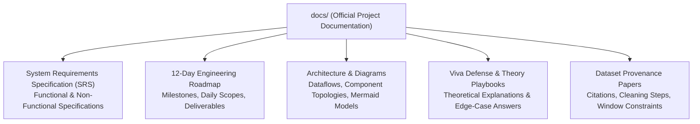

# 📚 Urbanix Documentation Repository (`docs/`)

This directory serves as the centralized knowledge base, academic repository, and technical documentation center for the **Urbanix Smart City IoT Traffic & Environmental Risk Forecasting Platform** final-year B.Tech capstone.

---

## 🏛️ 1. Documentation Index & Deliverables Catalog

| Document / Topic | Primary Content | Target Audience |
| :--- | :--- | :--- |
| **System Requirements Specification (SRS)** | Defines comprehensive functional requirements, non-functional latency/throughput constraints, hardware sizing, and data schemas. | Reviewers, Evaluators, Developers |
| **12-Day Development Roadmap** | Step-by-step engineering schedule detailing daily milestones from Day 1 infrastructure to Day 12 capstone finalization. | Project Reviewers, Pair Programmers |
| **Architectural Diagrams & Models** | Visual Mermaid diagrams depicting Docker networking, Kafka streaming pipelines, Spark window joins, and GraphX graph routing. | System Architects, Viva Examiners |
| **Dataset Provenance & Cleaning Audits** | Full citations for METR-LA, EPA AirData, and OpenWeather, documenting cleaning steps, unit conversions, and temporal contracts. | Data Engineers, Academic Evaluators |
| **Day-by-Day Implementation Reports (`_day-notes/`)** | Comprehensive retrospective deep-dive reports (e.g. `DAY_01_INFRASTRUCTURE_REPORT.md`, `DAY_02_SENSOR_SIMULATION_REPORT.md`). | Capstone Viva Defense, Code Reviewers |

---

## 📐 2. Documentation Standards & Style Guide

All documentation in Urbanix adheres to strict academic and open-source engineering standards:
1. **GitHub Flavored Markdown (GFM):** Formatted with clean typography, tables, and standard headings.
2. **High-Contrast Mermaid Diagrams:** All Mermaid diagrams use explicit styling with contrasting borders and dark text to ensure perfect readability in both GitHub Light Mode and GitHub Dark Mode.
3. **Structured Alert Callouts:** Strategic use of GitHub alert blocks (`> [!NOTE]`, `> [!TIP]`, `> [!IMPORTANT]`, `> [!WARNING]`).
4. **Clickable Source Links:** Direct markdown links pointing to local source files (e.g. [data/prepare_data.py](file:///c:/Users/Tokachichu%20SriCharan/OneDrive/Documents/GitHub/urbanix/data/prepare_data.py)) using `file:///` URIs.
5. **Traceable Citations:** All datasets, algorithms (DCRNN, Dijkstra, Pregel), and formulas carry formal academic citations.

---

## 📂 3. Related Documentation Locations

* **Day 1 Infrastructure Deep-Dive:** [`_day-notes/day-01/DAY_01_INFRASTRUCTURE_REPORT.md`](file:///c:/Users/Tokachichu%20SriCharan/OneDrive/Documents/GitHub/urbanix/_day-notes/day-01/DAY_01_INFRASTRUCTURE_REPORT.md)
* **Day 2 Sensor Simulation Deep-Dive:** [`_day-notes/day-02/DAY_02_SENSOR_SIMULATION_REPORT.md`](file:///c:/Users/Tokachichu%20SriCharan/OneDrive/Documents/GitHub/urbanix/_day-notes/day-02/DAY_02_SENSOR_SIMULATION_REPORT.md)
* **Dataset Management Guide:** [`data/README.md`](file:///c:/Users/Tokachichu%20SriCharan/OneDrive/Documents/GitHub/urbanix/data/README.md)
* **Producer Execution Guide:** [`services/producers/README.md`](file:///c:/Users/Tokachichu%20SriCharan/OneDrive/Documents/GitHub/urbanix/services/producers/README.md)
