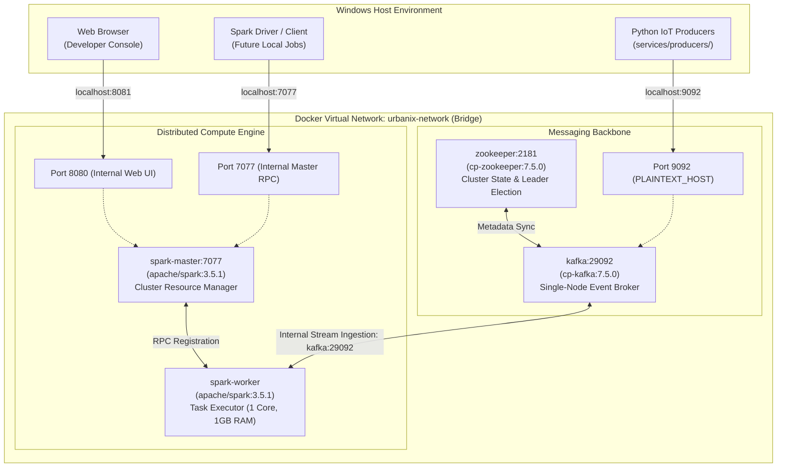

# 🏗️ Urbanix Distributed Infrastructure Engine (`infra/`)

-brightgreen)


-purple)

This directory houses the declarative **Infrastructure-as-Code (IaC)** configuration defining the local distributed messaging and computational backbone for the **Urbanix Smart City IoT Traffic & Environmental Risk Forecasting Platform**.

---

## 🏛️ 1. Infrastructure Architecture & Topology

The Urbanix infrastructure runs in an isolated user-defined Docker bridge network (`urbanix-network`). It isolates multi-container distributed state while exposing selective ingress ports to the Windows host for local telemetry ingestion and cluster monitoring.



### ASCII Network Flow
```text
Windows Host (Local Machine)
 │
 ├── localhost:9092 ──> [Docker Port Forward] ──> Kafka Broker (PLAINTEXT_HOST)
 ├── localhost:8081 ──> [Docker Port Forward] ──> Spark Master Web UI (Internal: 8080)
 └── localhost:7077 ──> [Docker Port Forward] ──> Spark Master RPC (Master Coordination)
 │
Inside Docker Network: urbanix-network
 ┌───────────────────────────┬───────────────────────────┐
 │                           │                           │
Zookeeper (2181)       Kafka Broker (29092)        Spark Master (7077)
 │                           ▲                           │
 └─────── Metadata Sync ─────┘                           ▼
                                                   Spark Worker (1G / 1 Core)
```

---

## 📦 2. Provisioned Cluster Services

| Service Name | Docker Image | Container Port | Host Port | Role in Urbanix |
| :--- | :--- | :--- | :--- | :--- |
| **`zookeeper`** | `confluentinc/cp-zookeeper:7.5.0` | `2181` | *Unexposed* | Manages Kafka broker metadata, topic configurations, and partition leader coordination. |
| **`kafka`** | `confluentinc/cp-kafka:7.5.0` | `29092` (Int), `9092` (Ext) | `9092` | Core distributed event log holding `traffic-topic`, `aqi-topic`, and `weather-topic`. |
| **`spark-master`** | `apache/spark:3.5.1` | `8080` (UI), `7077` (RPC) | `8081` (UI), `7077` (RPC) | Coordinates compute resources, schedules streaming DAGs, and hosts the Web UI. |
| **`spark-worker`** | `apache/spark:3.5.1` | *Dynamic RPC* | *Unexposed* | Dedicated execution engine executing PySpark Structured Streaming jobs and ML models. |

---

## 🌐 3. Kafka Networking Deep-Dive (`LISTENERS` vs `ADVERTISED_LISTENERS`)

Kafka networking requires explicit separation between container-internal DNS and host-external access:

```text
KAFKA_LISTENERS:            PLAINTEXT://0.0.0.0:29092, PLAINTEXT_HOST://0.0.0.0:9092
KAFKA_ADVERTISED_LISTENERS:  PLAINTEXT://kafka:29092,   PLAINTEXT_HOST://localhost:9092
```

* **Internal Network (`PLAINTEXT://kafka:29092`):** Used when Spark containers inside `urbanix-network` consume telemetry. Docker resolves `kafka` directly to the container's private bridge IP (`172.x.x.x`).
* **Host Access (`PLAINTEXT_HOST://localhost:9092`):** Used when Python simulation producers running on Windows stream data into the broker. Docker transparently forwards host port `9092` to the Kafka broker.

---

## ⚠️ 4. The Host Port 8080 Conflict & Resolution

* **Standard Default:** Apache Spark Master defaults to exposing its Web UI on port `8080`.
* **The Conflict:** During Day 1 environment validation, Windows port `8080` was already occupied by a background host Java service (`PID 7700`).
* **The Engineering Fix:** We mapped host port `8081` to container port `8080` (`"8081:8080"`).
  * Spark Master internally continues running on port `8080`.
  * The Windows host routes browser requests from `http://localhost:8081` directly into the container.
  * No host processes were killed, preserving legacy application integrity.

---

## 📡 5. Day 1 & Day 2 Provisioned Kafka Topics

The cluster operates three dedicated topics created with 1 partition and replication factor 1:

| Topic Name | Partitions | Replication Factor | Retention | Event Description |
| :--- | :---: | :---: | :---: | :--- |
| **`traffic-topic`** | 1 | 1 | 7 Days (Default) | Ingests 5-minute vehicle speed telemetry from 207 Caltrans PeMS loop detectors. |
| **`aqi-topic`** | 1 | 1 | 7 Days (Default) | Ingests daily PM2.5 concentrations and official Air Quality Index metrics from EPA stations. |
| **`weather-topic`** | 1 | 1 | 7 Days (Default) | Ingests hourly ambient temperature ($^\circ C$) and relative humidity ($\%$) readings. |

---

## ⌨️ 6. Day-to-Day Operational Command Reference

All commands must be executed from the `infra/` directory or reference the compose file explicitly:

### 1. Cluster Lifecycle
```powershell
# Validate compose file syntax
docker compose config

# Boot all services in detached background mode
docker compose up -d

# Verify all 4 containers are running and healthy
docker ps

# Stream logs from all containers
docker compose logs -f

# Stream logs specifically from the Kafka broker
docker compose logs -f kafka

# Gracefully stop the cluster (preserves topic logs)
docker compose down
```

### 2. Kafka Topic Operations
```powershell
# List all topics on the cluster
docker exec kafka kafka-topics --bootstrap-server localhost:9092 --list

# Describe topic partition and leader status
docker exec kafka kafka-topics --bootstrap-server localhost:9092 --describe --topic traffic-topic,aqi-topic,weather-topic

# Tail live messages from traffic-topic
docker exec kafka kafka-console-consumer --bootstrap-server localhost:9092 --topic traffic-topic --from-beginning --max-messages 5
```

### 3. Cluster Verification URLs
* **Spark Master Web UI:** [http://localhost:8081](http://localhost:8081) *(Shows alive workers, cores, and memory)*
* **Spark Master RPC Endpoint:** `spark://localhost:7077`
* **Kafka External Broker:** `localhost:9092`
