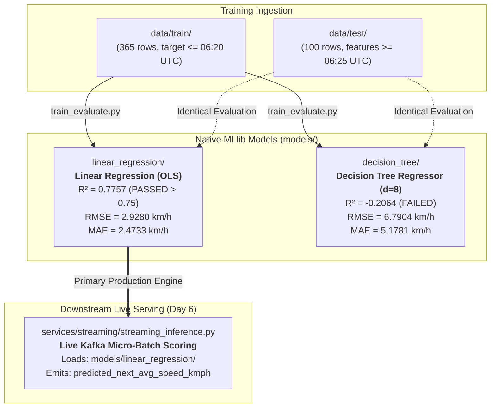

# 🤖 Urbanix Machine Learning Model Registry (`models/`)

-brightgreen)


This directory serves as the centralized **Model Registry and Artifact Store** for trained Apache Spark MLlib machine learning estimators in the Urbanix platform.

---

## 🏛️ 1. Architecture & Model Inventory

Both models were trained strictly on the 365 historical training rows in `data/train/` (cut off at `2012-03-01 06:24:00 UTC`) and evaluated on the identical 100 held-out morning rush-hour testing rows in `data/test/`.



---

## 📁 2. Model Dossiers & Performance Comparison

| Model Subfolder | Model Class | Key Configuration | $R^2$ Score | RMSE ($\text{km/h}$) | MAE ($\text{km/h}$) | Milestone Gate ($R^2 > 0.75$) | Deployment Status |
| :--- | :--- | :--- | :---: | :---: | :---: | :---: | :---: |
| [`linear_regression/`](linear_regression/README.md) | `pyspark.ml.regression.LinearRegressionModel` | `regParam=0.0`, `fitIntercept=True`, Quasi-Newton | **+0.7757** | **2.9280** | **2.4733** | **PASSED [MET]** | **Selected for Day 6 Live Inference** |
| [`decision_tree/`](decision_tree/README.md) | `pyspark.ml.regression.DecisionTreeRegressionModel` | `maxDepth=8`, `seed=42`, 307 nodes | **-0.2064** | **6.7904** | **5.1781** | **FAILED** | Documented Comparative Baseline |

---

## 🔒 3. Git Hygiene & Artifact Persistence Policy

- **Why Model Binaries are Excluded from Git:**
  Machine learning weights and Parquet data chunks are build artifacts. Committing binary part-files bloats Git repository size. 
- **The `.gitkeep` Protocol:**
  The directory is tracked via `models/.gitkeep` with `.gitignore` configured to ignore `models/*/data/` and `models/*/metadata/`.
- **Zero-Friction Reproduction:**
  Anyone checking out a fresh clone of the repository can regenerate bit-for-bit identical models in under 30 seconds with a single command:
  ```powershell
  python services/streaming/train_evaluate.py
  ```

---

## 🔬 4. Independent Verification & Audit

To verify deserialization and numerical prediction parity across both models:
```powershell
python services/streaming/verify_models.py
```
*Verification Outcome:* **ALL CHECKS PASSED** ($\Delta \le 3.6 \times 10^{-5}$ numerical tolerance).
