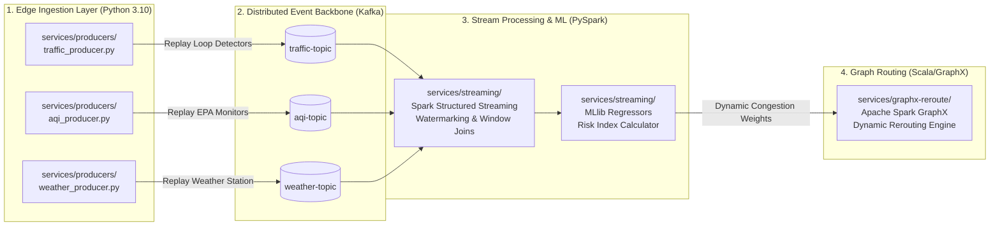

# ⚙️ Urbanix Computational Services Tier (`services/`)

-brightgreen)
-orange)
-blueviolet)

This directory houses the core computational engines, data generators, and analytical services that power the **Urbanix Smart City IoT Traffic & Environmental Risk Forecasting Platform**.

---

## 🏛️ 1. Services Tier Architecture & Dataflow

Urbanix enforces strict service decoupling through **Event-Driven Architecture (EDA)**. Rather than tight HTTP/RPC couplings between services, telemetry and predictions flow through asynchronous message queues (Kafka) and immutable analytical storage (Parquet / PostgreSQL).

---

## 📂 2. Sub-Service Directory Breakdown

| Service Directory | Primary Runtime | Core Technologies | Project Milestone | Responsibilities |
| :--- | :--- | :--- | :---: | :--- |
| **[`services/producers/`](file:///c:/Users/Tokachichu%20SriCharan/OneDrive/Documents/GitHub/urbanix/services/producers/)** | Python 3.10+ | `kafka-python-ng`, `pytest` | **Day 2 (Complete)** | Replays verified public historical telemetry (METR-LA, EPA AQS, OpenWeather) into Kafka topics with delivery confirmations, retries, and unit conversions. |
| **[`services/streaming/`](file:///c:/Users/Tokachichu%20SriCharan/OneDrive/Documents/GitHub/urbanix/services/streaming/)** | Python 3.10+ / JVM | Apache Spark 3.5.1, PySpark, MLlib | **Days 3–6 (Active)** | Subscribes to Kafka topics, handles out-of-order data via watermarking, computes sliding window aggregations, executes ML regression, and outputs the Municipal Risk Index. |
| **[`services/graphx-reroute/`](file:///c:/Users/Tokachichu%20SriCharan/OneDrive/Documents/GitHub/urbanix/services/graphx-reroute/)** | Scala 2.12 / JVM | Apache Spark GraphX, sbt | **Days 7–9 (Planned)** | Models the Los Angeles road network as a property graph (intersections = vertices, roads = edges). Dynamically recalibrates edge traversal weights based on ML risk forecasts to compute congestion-avoiding shortest paths. |

---

## 🔌 3. Inter-Service Communication Contracts

To ensure fault tolerance and zero cascading failures, services communicate via well-defined event contracts:

1. **Ingestion Contract (`producers` $\to$ `Kafka`):**
   * Payload format: UTF-8 encoded JSON.
   * Spatial tagging: Every message includes `zone_id` (`zone_1` to `zone_5`).
   * Guarantees: At-Least-Once delivery (`acks=1` with 3 retries and delivery callbacks).
2. **Streaming Contract (`Kafka` $\to$ `streaming`):**
   * Consumption pattern: Structured Streaming source with explicit schemas (`from_json`).
   * Temporal handling: Event-time watermarks (`10 minutes` delay tolerance) to discard late-arriving telemetry.
3. **Graph Integration Contract (`streaming` $\to$ `graphx-reroute`):**
   * Analytical bridge: Spark Structured Streaming writes updated 15-minute zone congestion weights to an intermediate state store.
   * Graph update: GraphX consumes updated edge weights to recalculate Dijkstra / A* route paths.

---

## 🛠️ 4. Local Development & Service Isolation

Each sub-service maintains its own dependency tree and runtime environment:
* **Producers:** Uses a dedicated Python virtualenv in `services/producers/venv/` with minimal, lightweight client libraries.
* **Streaming:** Executes via `spark-submit` against the Spark cluster (`localhost:7077`) or locally via PySpark.
* **GraphX:** Compiled with `sbt` targeting Scala 2.12 and packaged into a JAR for distributed cluster execution.
