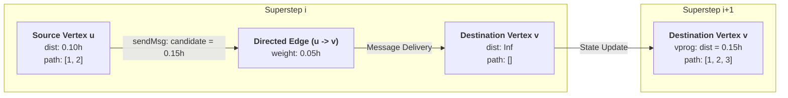

# 🛣️ Urbanix — GraphX Distributed Road Network Rerouting Engine

Welcome to the **Urbanix GraphX Routing Engine** (`services/graphx-reroute/`), the distributed graph intelligence core of the **Urbanix Smart City IoT Traffic and Environmental Risk Forecasting Platform**.

This service bridges real-time Spark MLlib predictive intelligence with **Apache Spark GraphX** to model dynamic metropolitan road corridors as a distributed property multigraph, recalculate optimal routes via custom **Pregel Bulk Synchronous Parallel (BSP) message passing**, and publish optimal detour recommendations to shared Parquet storage.

---

## 📑 Table of Contents
1. [Why is `src/main` Critical to Urbanix?](#1-why-is-srcmain-critical-to-urbanix)
2. [Why Scala & GraphX? (Technical Rationale)](#2-why-scala--graphx-technical-rationale)
3. [Deep Dive: The 5 Core Scala Files](#3-deep-dive-the-5-core-scala-files)
   - [3.1 RoadGraphBuilder.scala](#31-roadgraphbuilderscala--topology-construction--audit)
   - [3.2 CongestionWeight.scala](#32-congestionweightscala--travel-time-cost-calculator)
   - [3.3 ShortestPathPregel.scala](#33-shortestpathpregelscala--custom-weighted-sssp)
   - [3.4 FullGraphRoutingApp.scala](#34-fullgraphroutingappscala--multi-stage-oracle-validation)
   - [3.5 RouteRecommender.scala](#35-routerecommenderscala--closed-loop-parquet-consumer)
4. [Mathematical Formulation & Cost Function](#4-mathematical-formulation--cost-function)
5. [Pregel Message Passing Architecture](#5-pregel-message-passing-architecture)
6. [Data Contracts & Decoupled Parquet Interface](#6-data-contracts--decoupled-parquet-interface)
7. [Directory Structure](#7-directory-structure)
8. [Execution & Reproduction Runbook](#8-execution--reproduction-runbook)
9. [Automated Verification Suite (43 Tests)](#9-automated-verification-suite-43-tests)

---

## 1. Why is `src/main` Critical to Urbanix?

The files inside `services/graphx-reroute/src/main/scala/` represent the **computational decision-making engine** of Urbanix. 

- **Prediction without action is useless:** Predicting that a highway or corridor will suffer from gridlock (via PySpark and MLlib) only alerts operators. Without an automated, congestion-aware routing engine, traffic cannot be systematically diverted away from failing zones.
- **Why relational databases and flat SQL fail:** Traditional tabular systems represent roads as flat rows `(src, dst, distance)`. Computing multi-hop shortest paths across a city network requires iterative Cartesian self-joins that trigger massive distributed shuffles on every hop, exhausting memory and stalling clusters.
- **The GraphX solution:** `src/main` transforms raw road geometry and streaming MLlib velocity forecasts into an active, distributed property graph, computing optimal paths in parallel supersteps within milliseconds.

---

## 2. Why Scala & GraphX? (Technical Rationale)

1. **GraphX is Exclusively a JVM/Scala API:**
   Unlike Spark SQL, Structured Streaming, and MLlib (which provide Python bindings via Py4J), **Apache Spark GraphX has no official PySpark wrapper**. Writing this module in native Scala gives direct, zero-overhead access to GraphX primitives (`mapTriplets`, `aggregateMessages`, `Pregel`).
2. **Elimination of Py4J Serialization Latency:**
   Running graph iterations over Py4J would require serializing millions of graph messages between Python worker processes and the JVM. Scala runs natively inside the JVM executors, maximizing cache locality and throughput.
3. **Strict Compile-Time Type Safety:**
   Road intersections (`VertexId = Long`), vertex properties (`VD = (String, String)`), and edge weights (`ED = Double`) are checked at compile time, eliminating runtime type errors during distributed shuffles.

---

## 3. Deep Dive: The 5 Core Scala Files

All source files are located in [`src/main/scala/urbanix/graphx/`](src/main/scala/):

```
services/graphx-reroute/src/main/scala/
├── RoadGraphBuilder.scala       # Phase 1 & 2: Topology ingest, 2-phase validation, graph audit
├── CongestionWeight.scala       # Travel-time cost calculator with 1.0 km/h gridlock floor
├── ShortestPathPregel.scala     # Distributed Pregel SSSP with deterministic tie-breaking
├── FullGraphRoutingApp.scala    # 3-Stage validation app: 4-node oracle, dynamic reroute, 20-node city
└── RouteRecommender.scala       # Production consumer: Parquet polling, dynamic reweighting, route publishing
```

---

### 3.1 RoadGraphBuilder.scala — Topology Construction & Audit
- **Purpose:** Constructs and certifies the base road multigraph from `data/intersections.csv` and `data/roads.csv`.
- **Two-Phase Validation:**
  - *Phase 1 (Pre-Construction Source Validation):* Scans raw DataFrames before graph creation to reject duplicate vertex IDs, invalid endpoints, non-positive or NaN distances, and self-loops (`src == dst`).
  - *Phase 2 (GraphX Topology Audit):* Analyzes the constructed `Graph[String, Double]` to verify zero dangling edges (edges pointing to non-existent nodes), zero GraphX phantom vertices, 100% directed reciprocity (every corridor $u \to v$ has a symmetric $v \to u$ return), and a single connected component ($k = 1$).
- **Demonstration Topology:** 20 intersections across 5 zones (`zone_1` to `zone_5`), 40 directed road edges (20 bidirectional corridors).

---

### 3.2 CongestionWeight.scala — Travel-Time Cost Calculator
- **Purpose:** Converts static physical road lengths into dynamic congestion-weighted travel-time costs.
- **Formula:**
  $$\text{travel\_time\_hours} = \frac{\text{base\_distance\_km}}{\max(\text{speed\_kmph}, 1.0)}$$
- **Defensive Engineering:**
  - Enforces strict physical bounds ($d > 0$, $v > 0$).
  - Clamps near-zero velocities to a **gridlock floor of $1.0\text{ km/h}$**, eliminating division-by-zero singularities ($\infty$) while ensuring heavily congested segments receive severe path cost penalties.

---

### 3.3 ShortestPathPregel.scala — Custom Weighted SSSP
- **Purpose:** Implements distributed Single Source Shortest Path (SSSP) across all reachable vertices.
- **Why Built-In GraphX `ShortestPaths` is Insufficient:**
  - Spark's built-in `org.apache.spark.graphx.lib.ShortestPaths` only computes **unweighted hop counts** (number of turns/edges), completely ignoring congestion and physical distance.
- **Pregel Implementation:**
  - `vprog`: Updates vertex distance and path history when a shorter route candidate arrives.
  - `sendMsg`: Relaxes directed edges (`src.dist + edge.weight < dst.dist`) and propagates the updated path vector along outgoing edges.
  - `mergeMsg`: Resolves multiple messages arriving at the same vertex within a single superstep, selecting the lowest cost with deterministic lexicographic tie-breaking.
- **Features:** Reconstructs the exact sequence of intersection IDs, handles disconnected components gracefully, and guarantees convergence within $|V| - 1$ supersteps.

---

### 3.4 FullGraphRoutingApp.scala — Multi-Stage Oracle Validation
- **Purpose:** Executable console verification program demonstrating algorithmic correctness across three rigorous operational stages:
  - **Stage 1 (Theoretical 4-Node Benchmark):** Evaluates a diamond topology ($A, B, C, D$) against hand-calculated mathematical oracles, proving that $A \to C \to D$ ($13.87\text{ min}$) is preferred over $A \to B \to D$ ($24.00\text{ min}$).
  - **Stage 2 (Dynamic Congestion Reroute Demonstration):** Simulates severe congestion on edge $C \to D$ (speed drops from $65\text{ km/h}$ to $8\text{ km/h}$), proving that the Pregel algorithm dynamically flips the optimal path to $A \to B \to D$.
  - **Stage 3 (Full 20-Node Metropolitan Network):** Runs the full city network from Origin Intersection 1 across all 20 nodes, verifying 100% reachability.

---

### 3.5 RouteRecommender.scala — Closed-Loop Parquet Consumer
- **Purpose:** The production daemon bridging Python PySpark streaming inference with Scala GraphX.
- **Workflow:**
  1. **Polls Shared Storage:** Scans `data/feature_table/traffic/` for recent MLlib velocity predictions.
  2. **Deterministic Latest Observation:** Uses Spark SQL `Window.partitionBy("zone_id").orderBy(col("ordering_time").desc)` to deterministically select the freshest forecast per zone without non-deterministic aggregations.
  3. **Destination-Zone Reweighting:** Maps each directed edge $(u \to v)$ to the predicted speed of its destination intersection $v$, capturing urban intersection queuing dynamics.
  4. **Dynamic SSSP Computation:** Calls `ShortestPathPregel.computeRoutes()` to compute optimal paths from Origin 1.
  5. **Atomic Parquet Snapshot:** Writes results to `data/recommended_routes/` using `mode("overwrite")` so the Day 10 FastAPI dashboard can query the latest recommendation snapshot in $O(1)$ time.
  6. **Resilient Polling Loop:** Wakes up every 60 seconds (configurable) with graceful JVM shutdown hooks.

---

## 4. Mathematical Formulation & Cost Function

In urban traffic networks, route optimization must balance physical road distance against prevailing vehicle velocity:

$$\text{Cost}(e) = \frac{\text{Distance}_{\text{km}}(e)}{\max\left(\text{Speed}_{\text{km/h}}(e), v_{\min}\right)}$$

Where:
- $\text{Distance}_{\text{km}}(e)$ is the physical corridor length in kilometers ($d > 0$).
- $\text{Speed}_{\text{km/h}}(e)$ is the predicted traffic velocity in km/h produced by the Spark MLlib model.
- $v_{\min} = 1.0\text{ km/h}$ is the safety gridlock floor, preventing mathematical division-by-zero singularities while penalizing choked corridors.
- $\text{Cost}(e)$ is the traversal time in hours ($t > 0$).

Total path cost for route $P = (v_1, v_2, \dots, v_k)$:
$$\text{Cost}(P) = \sum_{i=1}^{k-1} \text{Cost}(v_i, v_{i+1})$$

The Pregel algorithm guarantees finding path $P^*$ such that $\text{Cost}(P^*) = \min_{P} \text{Cost}(P)$.

---

## 5. Pregel Message Passing Architecture

GraphX executes Pregel via **Bulk Synchronous Parallel (BSP)** supersteps:



1. **Initialization:** Source vertex $s$ initializes with `dist = 0.0` and `path = [s]`. All other vertices initialize with `dist = Double.PositiveInfinity` and `path = []`.
2. **`sendMsg(triplet)`:** If `triplet.srcAttr.dist + triplet.attr < triplet.dstAttr.dist`, send message `(srcAttr.dist + attr, srcAttr.path :+ dstId)` along outgoing edge.
3. **`mergeMsg(msg1, msg2)`:** If multiple messages arrive at vertex $v$, select the message with the strictly smaller travel time. If costs are identical, apply deterministic tie-breaking.
4. **`vprog(vertexId, currentAttr, msg)`:** Update vertex state with the incoming message if it improves travel time.
5. **Termination:** Pregel halts when no messages are generated (graph has converged) or when `maxIterations` is reached.

---

## 6. Data Contracts & Decoupled Parquet Interface

```
[PySpark MLlib Stream Inference] (Python)
              │
              ▼ (Append mode)
  data/feature_table/traffic/*.parquet
              │
              ▼ (Windowed latest read)
[RouteRecommender] (Scala GraphX)
              │
              ▼ (Overwrite mode)
  data/recommended_routes/*.parquet
              │
              ▼ (Non-blocking query)
[FastAPI Geospatial Dashboard] (Python / Leaflet.js)
```

### 6.1 Input Schema (`data/feature_table/traffic`)
- `zone_id` (`String`): Identifier for the traffic zone (`zone_1` to `zone_5`).
- `predicted_speed_kmph` or `predicted_speed` (`Double`): MLlib predicted velocity.
- `window_start` or `prediction_timestamp` (`Timestamp`): Observation/forecast timestamp.
- `traffic_record_count` (`Long`): Sample volume tie-breaker.

### 6.2 Output Schema (`data/recommended_routes`)
- `origin_id` (`Long`): Origin intersection ID (e.g. `1L`).
- `destination_id` (`Long`): Target intersection ID (`1L` to `20L`).
- `path` (`Array[Long]`): Ordered sequence of intersection IDs forming optimal route.
- `path_formatted` (`String`): Human-readable route string (e.g. `"1 -> 2 -> 14 -> 16 -> 15"`).
- `total_travel_time_hours` (`Double`): Total optimal travel time in hours.
- `total_travel_time_minutes` (`Double`): Total optimal travel time in minutes.
- `is_reachable` (`Boolean`): `true` if a valid directed path exists.
- `computed_at` (`Timestamp`): Calculation timestamp.
- `prediction_zones_used` (`Integer`): Count of distinct prediction zones applied.
- `fallback_applied` (`Boolean`): Flag indicating if free-flow fallback was used.

---

## 7. Directory Structure

```
services/graphx-reroute/
├── build.sbt                          # Spark 3.5.0 + Scala 2.12.18 + ScalaTest dependencies
├── project/
│   └── build.properties               # Pins sbt version to 1.9.9
├── sbt.bat                            # Local Windows batch wrapper for sbt
├── README.md                          # This architecture & operation guide
├── src/
│   ├── main/
│   │   └── scala/
│   │       ├── CongestionWeight.scala     # Travel-time cost calculator
│   │       ├── FullGraphRoutingApp.scala  # 3-Stage routing demonstration app
│   │       ├── RoadGraphBuilder.scala     # Graph construction & topology auditor
│   │       ├── RouteRecommender.scala     # Production Parquet consumer & publisher
│   │       └── ShortestPathPregel.scala   # Custom Pregel SSSP algorithm
│   └── test/
│       └── scala/
│           ├── RoadGraphBuilderSpec.scala   # 13 tests: Graph construction & audit
│           ├── RouteRecommenderSpec.scala   # 10 tests: Parquet pipeline & reweighting
│           └── ShortestPathPregelSpec.scala # 20 tests: Formula, Pregel & convergence
```

---

## 8. Execution & Reproduction Runbook

All commands are run from `services/graphx-reroute/` using either `.\sbt.bat` (Windows) or `sbt` (Linux/macOS):

### 8.1 Compile the Service
```powershell
cd services/graphx-reroute
.\sbt.bat --batch compile
```

### 8.2 Run the Automated Test Suite (43 Tests)
```powershell
.\sbt.bat --batch test
```

### 8.3 Run Multi-Stage Routing Console Verification
Runs the 3-stage validation suite (4-node benchmark, dynamic congestion reroute, and 20-node city network):
```powershell
.\sbt.bat --batch "runMain urbanix.graphx.FullGraphRoutingApp"
```

### 8.4 Run the Topology Builder & Audit
Builds and audits the base road network from source CSVs:
```powershell
.\sbt.bat --batch "runMain urbanix.graphx.RoadGraphBuilder"
```

### 8.5 Run the Production Route Recommender
- **Single-Pass Execution:**
  ```powershell
  .\sbt.bat --batch "runMain urbanix.graphx.RouteRecommender --once"
  ```
- **Continuous Polling Mode (Default 60s):**
  ```powershell
  .\sbt.bat --batch "runMain urbanix.graphx.RouteRecommender --poll 60"
  ```

---

## 9. Automated Verification Suite (43 Tests)

The test suite covers 43 exhaustive automated test specifications across three test classes:

| Test Suite File | Tests | Functional Verification Focus |
|:---|:---:|:---|
| `ShortestPathPregelSpec.scala` | **20** | Travel time formula, speed bounds, gridlock floor clamping, hand-calculated 4-node oracle ($A \to C \to D$), dynamic reroute proof ($A \to B \to D$), unreachable vertices, invalid weights, and iteration limits. |
| `RoadGraphBuilderSpec.scala` | **13** | Vertex/edge mapping, duplicate ID detection, dangling edge prevention, NaN distance rejection, edge directionality, self-loop rejection, and 100% directed symmetry audit. |
| `RouteRecommenderSpec.scala` | **10** | Windowed deterministic latest observation, tie-breaking, schema fallback aliases, non-existent table defaults, destination-zone speed mapping, dynamic detour rerouting, Parquet schema, and end-to-end repository dataset integration. |
| **Total** | **43** | **100% Pass Rate** (`43 succeeded, 0 failed in ~35s`) |
