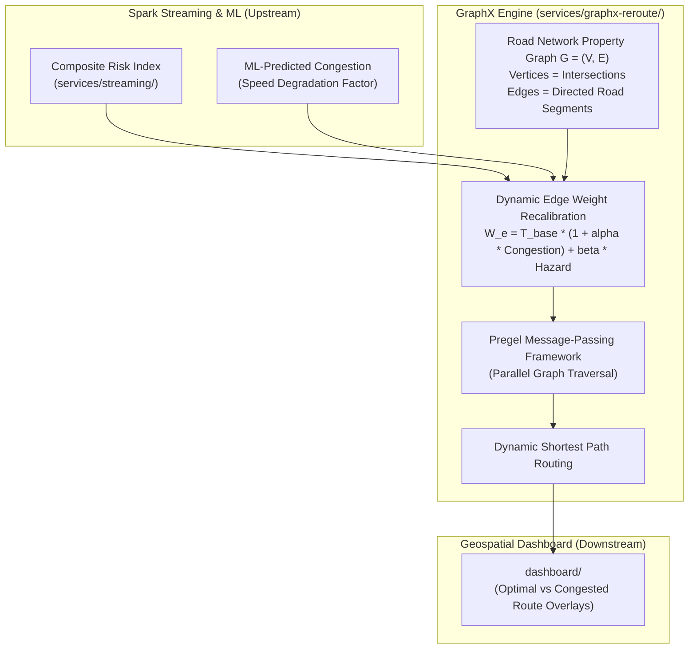

# 🕸️ Congestion & Hazard-Aware Rerouting Engine (`services/graphx-reroute/`)

-blueviolet)


This module implements the **Dynamic Graph Routing Engine** for the **Urbanix Smart City Platform**. It models the metropolitan Los Angeles road network as a distributed property graph in **Apache Spark GraphX** and dynamically updates edge weights using real-time ML risk forecasts to compute congestion- and hazard-avoiding transit paths.

---

## 🏛️ 1. Graph Modeling Architecture



---

## 🔬 2. Graph Theoretical Concepts & Mathematical Formulations

### 1. The Road Network as a Property Graph: $G = (V, E)$
* **Vertices ($V$):** Physical road intersections and freeway interchanges.
  * *Vertex Attributes:* `VertexId` (Long), `name` (String), `latitude` (Double), `longitude` (Double), `zone_id` (String).
* **Edges ($E$):** Directed roadway segments connecting vertex $u$ to vertex $v$.
  * *Static Attributes:* `distance_km` (Double), `speed_limit_kmph` (Double), `base_travel_time_sec` ($T_{\text{base}} = \frac{\text{distance}}{\text{speed\_limit}} \times 3600$).

### 2. Dynamic Edge Weight Recalibration Formula
Under free-flow conditions, edge traversal cost is simply base travel time. In Urbanix, streaming ML predictions continuously adjust edge traversal weights ($W_e$):

$$W_e = T_{\text{base}} \times \left(1 + \alpha \cdot C_{\text{predicted}}\right) + \beta \cdot H_{\text{environmental}}$$

Where:
* $C_{\text{predicted}} \in [0.0, 1.0]$: Machine-learning predicted speed degradation on segment $e$.
* $H_{\text{environmental}} \in [0.0, 1.0]$: Hazard penalty derived from AQI and adverse weather conditions in the surrounding zone.
* $\alpha$: Congestion penalty multiplier ($\alpha = 2.5$).
* $\beta$: Environmental hazard aversion weight ($\beta = 1.2$).

### 3. Graph Traversal Algorithms
* **Dijkstra’s Algorithm:** Computes the minimal-cost dynamic route between user-specified origin and destination vertices.
* **Apache Spark Pregel API:** Executes parallel bulk-synchronous message passing across the graph partitions to compute multi-source reachability matrices.
* **A\* Heuristic Search:** Accelerates single-pair shortest path calculations using the Euclidean coordinate distance as the admissible potential function.

---

## ☕ 3. Why Scala for GraphX?

While producers and streaming pipelines leverage Python/PySpark, this module is intentionally implemented in **Scala**:
1. **Native JVM Execution:** Apache Spark GraphX is written in Scala. Python wrappers for GraphX (like GraphFrames) introduce significant cross-language serialization overhead (JVM $\leftrightarrow$ Py4J), degrading graph iteration speeds.
2. **Type Safety:** Complex graph vertex and edge property structures benefit from Scala's strong static typing.
3. **Memory Optimization:** Scala avoids Python object wrapper overhead, allowing large road networks with tens of thousands of edges to reside compactly in JVM off-heap memory.

---

## 📂 4. Target Directory Layout (Days 7–9)

```text
services/graphx-reroute/
├── README.md                      # GraphX engine architecture and documentation
├── build.sbt                      # Scala Build Tool configuration
├── project/
│   └── build.properties           # sbt version definition
└── src/
    └── main/
        └── scala/
            └── org/urbanix/reroute/
                ├── RoadNetworkGraph.scala  # Graph builder and topological loader
                ├── DynamicWeightUpdater.scala # Edge weight recalibration logic
                └── RouteOptimizer.scala    # Dijkstra and Pregel pathfinding engine
```

---

## 🚀 5. Compilation & Execution Preview

```powershell
# Navigate to graph routing service directory
cd services/graphx-reroute

# Compile Scala code via sbt
sbt clean compile

# Package into executable JAR
sbt package

# Submit GraphX job to Spark cluster
docker exec spark-master /opt/spark/bin/spark-submit \
  --class org.urbanix.reroute.RouteOptimizer \
  --master spark://spark-master:7077 \
  /opt/spark/work-dir/services/graphx-reroute/target/scala-2.12/urbanix-graphx-reroute_2.12-0.1.0.jar
```
