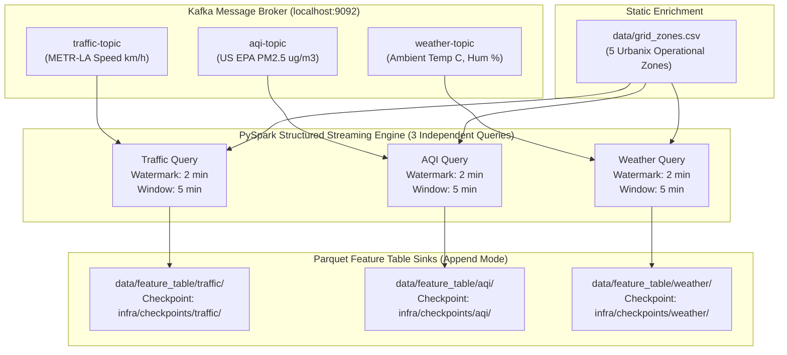

# 🌊 Urbanix Stream Processing & Feature Engineering Engine (`services/streaming/`)

-brightgreen)


-brightgreen)

This directory houses the distributed **Apache Spark Structured Streaming and Feature Engineering** engine for the **Urbanix Platform**. It consumes high-velocity telemetry from Kafka, enforces explicit schemas, performs physical measurement boundary validation, computes 5-minute tumbling window aggregations with an event-time watermark, joins static municipal zone metadata, persists feature datasets into partitioned Parquet sinks with checkpointed fault tolerance, and prepares model-ready, zero-leakage training and testing datasets for Spark MLlib forecasting.

---

## 🏛️ 1. Stream Processing Pipeline Architecture (Day 3 & Day 4 Contract)



---

## 📂 2. File Directory Layout

```text
services/streaming/
├── README.md                   # Streaming & ML feature pipeline architecture and run commands
├── requirements.txt            # PySpark, numpy, pytest, and python-dotenv dependencies
├── schemas.py                  # Explicit PySpark StructType schemas for Kafka payloads & zones
├── streaming_job.py            # Structured Streaming pipeline with 3 independent queries
├── verify_features.py          # Parquet feature table validation & schema assertion utility
├── prepare_training_data.py    # Day 4: Future label construction, feature engineering, chronological split
├── verify_split.py             # Day 4: Independent reload verification for train/test splits & zero leakage
└── tests/
    ├── test_streaming.py       # 14 deterministic tests covering parsing, windowing, and edge cases
    └── test_training_data.py   # 11 unit & integration tests covering label construction, leakage & splits
```

---

## 🔬 3. Stream Schemas & Aggregation Semantics

### Traffic Telemetry (`traffic-topic` → `data/feature_table/traffic/`)
- **Source:** Caltrans PeMS / METR-LA loop detectors on Los Angeles freeways.
- **Physical Validation:** $0.0 < \text{speed\_kmph} \le 250.0$ (filters sensor blackouts and unphysical spikes).
- **Aggregations:**
  - `traffic_record_count`: count of valid sensor readings in the 5-minute window.
  - `avg_speed_kmph`, `min_speed_kmph`, `max_speed_kmph`: velocity statistics.
- **Honest Semantics:** Velocity observations only. No synthetic `vehicle_count` is claimed.

### Air Quality Telemetry (`aqi-topic` → `data/feature_table/aqi/`)
- **Source:** U.S. EPA AirData (AQS) monitoring stations in Los Angeles County.
- **Physical Validation:** $0.0 \le \text{pm25} \le 1000.0$.
- **Aggregations:**
  - `aqi_record_count`: count of valid PM2.5 readings.
  - `avg_pm25`, `min_pm25`, `max_pm25`: particulate matter concentrations ($\mu g/m^3$).
  - `avg_aqi`: air quality index level.
- **Honest Semantics:** Preserves particulate matter and AQI. No fabricated `co2` is added.

### Weather Telemetry (`weather-topic` → `data/feature_table/weather/`)
- **Source:** Historical hourly meteorological observations for Los Angeles (OpenWeatherMap).
- **Physical Validation:** $-50.0 \le \text{temperature\_c} \le 60.0$, $0.0 \le \text{humidity\_pct} \le 100.0$.
- **Aggregations:**
  - `weather_record_count`: count of meteorological readings in window.
  - `avg_temperature_c`, `min_temperature_c`, `max_temperature_c`: Celsius temperatures.
  - `avg_humidity_pct`: relative humidity percentage.

---

## 🚀 4. How to Run & Verify the Pipeline

### Step 1: Set up Virtual Environment & Dependencies
```powershell
# Create dedicated virtual environment
python -m venv services\streaming\venv

# Activate and install dependencies
.\services\streaming\venv\Scripts\Activate.ps1
pip install -r services\streaming\requirements.txt
```

### Step 2: Run Automated Unit & Deterministic Tests
```powershell
# Run the 14 streaming pipeline tests
.\services\streaming\venv\Scripts\pytest services\streaming\tests\test_streaming.py -v

# Run Day 2 producer tests to assert zero regressions
.\services\producers\venv\Scripts\pytest services\producers\tests\test_producers.py -v
```

### Step 3: Run the Structured Streaming Pipeline
```powershell
# Run in continuous micro-batch streaming mode:
.\services\streaming\venv\Scripts\python services\streaming\streaming_job.py --starting-offsets latest

# OR run in bounded verification mode (processes all available Kafka records and exits cleanly):
.\services\streaming\venv\Scripts\python services\streaming\streaming_job.py --starting-offsets earliest --available-now
```

### Step 4: Verify Generated Parquet Feature Tables
```powershell
# Run standalone verification assertions on generated Parquet datasets
.\services\streaming\venv\Scripts\python services\streaming\verify_features.py
```

---

## 🛡️ 5. Fault Tolerance & Checkpointing
- **Independent Checkpoint Trees:** Each query writes state information (`commits/`, `offsets/`, `sources/`, `state/`) to its dedicated folder under `infra/checkpoints/{traffic, aqi, weather}`.
- **Recovery Guarantees:** Spark reads partition offset state and delta state files (`HDFSBackedStateStoreProvider`) upon restart, resuming exact watermark and state progress without duplicating committed Parquet batches.
- **Git Safety:** Checkpoints and Parquet tables are ignored in `.gitignore` to prevent repository bloat.

---

## 🤖 6. Day 4: Feature Engineering & Chronological Train/Test Split

Day 4 transforms the windowed traffic feature table into ML-ready, leakage-free training and testing partitions for Day 5 forecasting.

### Key Pipeline Modules
- `prepare_training_data.py`: Builds the target (`next_avg_speed_kmph`) using per-zone `lead()`, validates consecutive 300s window intervals, engineers time-of-day cyclic encodings, fits `StringIndexer` on training data only, computes an 80% chronological cutoff, excludes boundary-crossing rows, bundles features using `VectorAssembler`, and writes partitioned Parquet outputs to `data/train/` and `data/test/`.
- `verify_split.py`: Reloads persisted Parquet datasets from disk and verifies physical existence, schema adherence, vector dimensions, target exclusion, sample disjointness, and mathematical temporal separation:
  $$\max(\text{train.target\_window\_start}) < \min(\text{test.window\_start})$$
- `tests/test_training_data.py`: 11 automated unit and integration tests covering label construction, boundary crossing exclusion, gap detection, duplicate handling, and zero leakage.

### Execution Commands
```powershell
# 1. Run Day 4 feature engineering and chronological split
.\services\streaming\venv\Scripts\python services/streaming/prepare_training_data.py

# 2. Run independent reload verification
.\services\streaming\venv\Scripts\python services/streaming/verify_split.py

# 3. Run Day 4 automated unit tests
.\services\streaming\venv\Scripts\pytest services/streaming/tests/test_training_data.py -v
```
