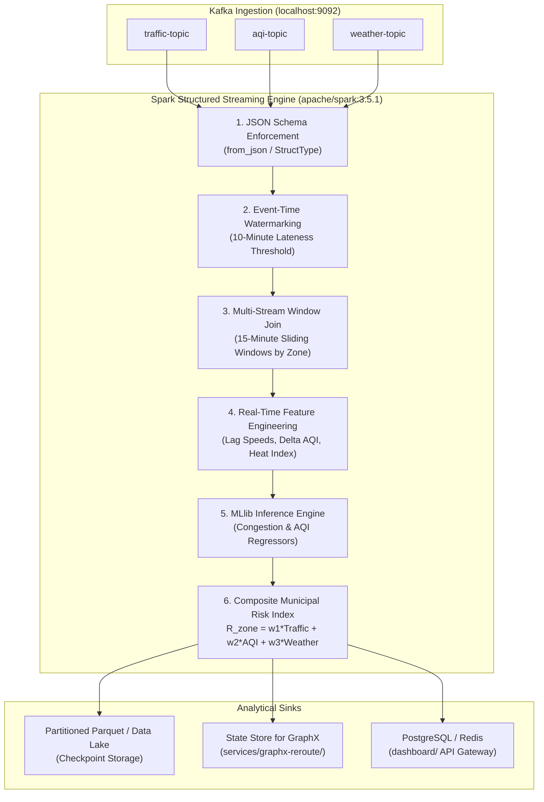

# 🌊 Urbanix Stream Processing & ML Forecasting Engine (`services/streaming/`)

-blue)


This directory houses the distributed **Apache Spark Structured Streaming** engine and machine learning inference pipeline for the **Urbanix Platform**. It consumes high-velocity sensor streams from Kafka, enforces schemas, resolves out-of-order temporal joins, computes sliding window aggregations, executes ML risk forecasting, and calculates the real-time **Composite Municipal Risk Index**.

---

## 🏛️ 1. Stream Processing Pipeline Architecture



---

## 🔬 2. Core Theoretical Concepts & Stream Mechanics

### 1. Event-Time Processing & Watermarking
IoT sensors operate over real-world wireless networks subject to packet loss, latency, and intermittent disconnects. 
* **Event Time:** The instant the loop detector or air monitor recorded the observation in the physical world.
* **Processing Time:** The clock time when the Spark cluster executes the task.
* **Watermarking:** Tells Spark how long to wait for late-arriving data before finalizing a time window:
  ```python
  df_traffic.withWatermark("timestamp", "10 minutes")
  ```
  Any event arriving with a timestamp older than $\text{MaxEventTime} - 10 \text{ minutes}$ is dropped, preventing boundless memory consumption in Spark's internal state store.

### 2. Multi-Stream Window Joins
Urbanix joins three disparate asynchronous streams on `zone_id` over time-window boundaries:
* **Tumbling Windows:** Non-overlapping fixed windows (e.g. hourly atmospheric aggregations).
* **Sliding Windows:** Overlapping rolling windows (e.g. 15-minute windows sliding every 5 minutes to detect sudden traffic congestion waves).

### 3. Resolving the Weather / Traffic Calendar Gap (Day 3 Contract)
As documented in Day 2, historical OpenWeather records begin in October 2012 while METR-LA and EPA AQI cover March–June 2012. 
* Spark Structured Streaming resolves this via **Pattern A (Simulation Time Normalization)** or **Pattern B (Non-Blocking Outer Joins with Baseline Defaults)**.
* Under outer joins, if weather data is absent for an interval, the streaming engine populates safe baseline atmospheric constants ($T = 20^\circ C$, Humidity $= 50\%$) without stalling the traffic and AQI forecasting pipeline.

---

## 🧮 3. Composite Municipal Risk Index Formula

Urbanix computes a normalized risk coefficient ($R_{\text{zone}} \in [0.0, 1.0]$) for each smart-city zone every 5 minutes:

$$R_{\text{zone}} = w_1 \cdot C_{\text{traffic}} + w_2 \cdot A_{\text{aqi}} + w_3 \cdot W_{\text{weather}}$$

Where:
* $C_{\text{traffic}} = 1.0 - \min\left(1.0, \frac{\text{CurrentSpeed}}{\text{FreeFlowSpeed}}\right)$ (Congestion risk)
* $A_{\text{aqi}} = \min\left(1.0, \frac{\text{AQI}}{300.0}\right)$ (Environmental risk)
* $W_{\text{weather}} = f(\text{Temp}, \text{Humidity})$ (Adverse weather severity factor)
* Weights: $w_1 = 0.50$, $w_2 = 0.35$, $w_3 = 0.15$ ($\sum w_i = 1.0$).

---

## 📂 4. Target Directory Layout (Days 3–6)

```text
services/streaming/
├── README.md                 # Streaming architecture and execution guide
├── requirements.txt          # PySpark and ML runtime dependencies
├── schemas.py                # StructType schemas for traffic, AQI, and weather JSON
├── spark_streaming.py        # Main Spark Structured Streaming pipeline
├── feature_engineering.py    # Window aggregations and metric transformations
├── ml_models.py              # MLlib regressor training and inference modules
└── risk_calculator.py        # Composite Municipal Risk Index calculation logic
```

---

## 🚀 5. Execution Model

Spark streaming applications will submit to the standalone cluster provisioned in Day 1:
```powershell
# Submit PySpark streaming job to local Spark Master
docker exec spark-master /opt/spark/bin/spark-submit \
  --master spark://spark-master:7077 \
  --packages org.apache.spark:spark-sql-kafka-0-10_2.12:3.5.1 \
  /opt/spark/work-dir/services/streaming/spark_streaming.py
```
